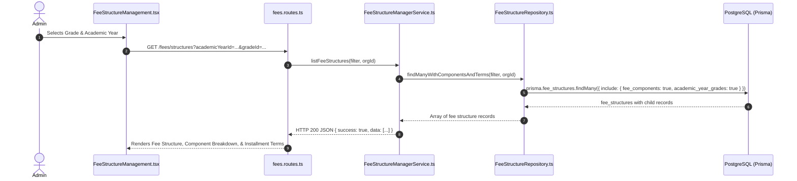
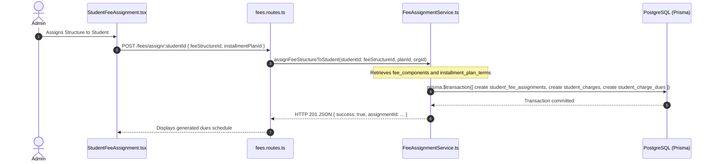
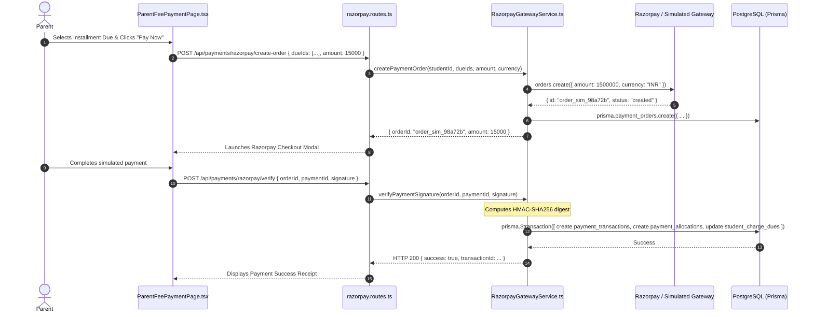
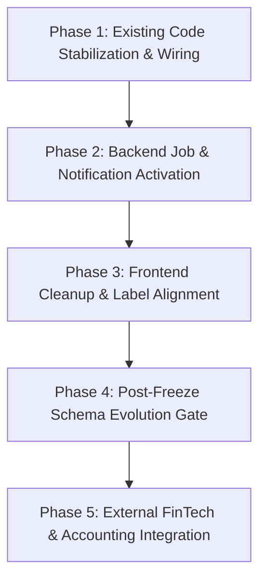

# EduTrack ERP — Finance Module Implementation Audit

**Document Version:** 1.0.0  
**Audit Date:** October 15, 2026  
**Auditor:** Antigravity AI Pair Programmer  
**Target Repository:** `EduTech`  
**Git Branch:** `hari-finance`  
**Commit Reference:** `7da311f`  
**Governing Standard:** Schema Freeze & Prisma-First Domain Architecture ([AGENTS.md](file:///d:/EduTech/EduTech/.agents/AGENTS.md))

---

## 1. Executive Summary

This audit establishes a factual baseline of the Finance Module within the EduTrack ERP platform across four core roadmap stages:

1. **Stage 1 — Fee Structure Setup**
2. **Stage 2 — Digital Payment Collection**
3. **Stage 3 — Payment On Time? (Delinquency & Collection Management)**
4. **Stage 4 — FinTech & Accounting Sync**

### Key Findings Summary

- **Database & Domain Architecture:** The backend strictly complies with the Stage-1 schema freeze defined in [schema.prisma](file:///d:/EduTech/EduTech/apps/backend/prisma/schema.prisma). Twenty (20) Finance-specific tables and models are present in the Prisma schema. All read and write operations interact directly through Prisma without artificial Domain Entity overhead.
- **Stage 1 (Fee Setup):** **Operational with Partial Scope**. Fee structures, grade mappings, component definitions, and installment plan term distributions are implemented end-to-end in both backend services ([FeeStructureManagerService.ts](file:///d:/EduTech/EduTech/apps/backend/src/modules/fees/services/FeeStructureManagerService.ts)) and frontend screens ([FeeStructureManagement.tsx](file:///d:/EduTech/EduTech/apps/web_app/src/features/finance/FeeStructureManagement.tsx)). Concession and scholarship approvals ([ScholarshipConcessionService.ts](file:///d:/EduTech/EduTech/apps/backend/src/modules/fees/services/ScholarshipConcessionService.ts)) are implemented in database and service layers, but available programs are hardcoded. Student fee assignment and demand generation use legacy individual student assignment rather than bulk grade-wide demand generation.
- **Stage 2 (Digital Payments):** **Operational in Test/Simulation Mode**. Payment orders, verification, and HMAC-SHA256 webhook signatures are implemented with database transaction locking on dues ([RazorpayGatewayService.ts](file:///d:/EduTech/EduTech/apps/backend/src/modules/fees/services/RazorpayGatewayService.ts) and [razorpay.routes.ts](file:///d:/EduTech/EduTech/apps/backend/src/routes/razorpay.routes.ts)). The active runtime operates in mock/simulation mode (`order_sim_*`) because live Razorpay credentials are not configured in environment variables. While Cards, UPI, and Net Banking are supported by the gateway, methods like eNACH, QR, EMI, and Auto-Debit exist only as UI enum labels without backend recurring mandate implementations.
- **Stage 3 (Collections & Reminders):** **Partially Implemented / Blocked**. Overdue aging calculations (Current, 1-7d, 8-30d, 31-60d, 61-90d, >90d) are implemented via raw SQL window aggregates in [ReceivablesRepository.ts](file:///d:/EduTech/EduTech/apps/backend/src/modules/fees/repositories/ReceivablesRepository.ts). Follow-up entry persistence throws `501 Not Implemented (FEATURE_BLOCKED_SCHEMA_FREEZE)` because `fee_collections_follow_ups` is absent from [schema.prisma](file:///d:/EduTech/EduTech/apps/backend/prisma/schema.prisma). Background jobs (`overdue.job.ts`, `reminder.job.ts`) are placeholder console log stubs. **There is zero AI or machine learning code**; forecasting logic in [FinancePlanningService.ts](file:///d:/EduTech/EduTech/apps/backend/src/modules/fees/services/FinancePlanningService.ts) uses deterministic arithmetic formulas.
- **Stage 4 (FinTech & Accounting):** **Largely Unimplemented or Export-Only**. Bank statement reconciliation and gateway settlement matching ([ReconciliationService.ts](file:///d:/EduTech/EduTech/apps/backend/src/modules/fees/services/ReconciliationService.ts)) are functional against database tables `gateway_settlements` and `bank_statement_entries`. General Ledger journal persistence is blocked by schema freeze; [AccountingService.ts](file:///d:/EduTech/EduTech/apps/backend/src/modules/fees/services/AccountingService.ts) generates in-memory double-entry previews and CSV exports for Tally and Zoho. No live API adapters exist for Tally, Zoho, QuickBooks, or SAP. Student/school loans and NBFC provider integrations do not exist (only an unattached enum `loan_status` is declared in the schema).

---

## 2. Project and Branch Inventory

### 2.1 Git Status & Workspace Metadata

- **Active Branch:** `hari-finance`
- **Remote Tracking:** `origin/hari-finance` (Up to date)
- **Working Tree:** Clean (0 uncommitted files, 0 untracked files)
- **Operating System:** Windows (PowerShell environment)
- **Monorepo Layout:** Turborepo managing `apps/web_app` and `apps/backend`

### 2.2 Frontend Stack Inventory

- **Core Framework:** React 18.3.1 with TypeScript 5.5.3, bundled via Vite 5.4.1
- **Routing:** `react-router-dom` v6.26.1 using central route registry ([route_registry.tsx](file:///d:/EduTech/EduTech/apps/web_app/src/config/route_registry.tsx))
- **State Management:**
  - `@reduxjs/toolkit` v2.2.7 and `react-redux` v9.1.2 (slices in `apps/web_app/src/store/`)
  - `zustand` v4.5.5 for lightweight UI state
  - `@tanstack/react-query` v5.56.2 for server state caching
- **Styling & UI Components:** Tailwind CSS v3.4.11, Lucide React icons, Radix UI primitives (`@radix-ui/react-*`), Framer Motion animations
- **API Client:** Axios v1.7.7 instance configured in [api-client.ts](file:///d:/EduTech/EduTech/apps/web_app/src/lib/api-client.ts) with `authRequestInterceptor` injecting Bearer JWT tokens from localStorage.

#### Frontend Finance Pages and Components:

| Route Path                | Component                   | File Location                                                                                                               | Status                                        |
| :------------------------ | :-------------------------- | :-------------------------------------------------------------------------------------------------------------------------- | :-------------------------------------------- |
| `/finance/structures`     | `FeeStructureManagement`    | [FeeStructureManagement.tsx](file:///d:/EduTech/EduTech/apps/web_app/src/features/finance/FeeStructureManagement.tsx)       | Operational (CRUD, Grade Map, Installments)   |
| `/finance/demands`        | `DemandManagement`          | [DemandManagement.tsx](file:///d:/EduTech/EduTech/apps/web_app/src/features/finance/DemandManagement.tsx)                   | Operational (Dues display & demand runs)      |
| `/finance/payments`       | `PaymentEntry`              | [PaymentEntry.tsx](file:///d:/EduTech/EduTech/apps/web_app/src/features/finance/PaymentEntry.tsx)                           | Operational (Offline/POS recording)           |
| `/finance/ledger`         | `AdminFeeLedger`            | [AdminFeeLedger.tsx](file:///d:/EduTech/EduTech/apps/web_app/src/features/finance/AdminFeeLedger.tsx)                       | Operational (Student fee transaction view)    |
| `/finance/reports`        | `FinanceReports`            | [FinanceReports.tsx](file:///d:/EduTech/EduTech/apps/web_app/src/features/finance/FinanceReports.tsx)                       | Operational (Analytics & CSV export)          |
| `/finance/receipts`       | `ReceiptCenter`             | [ReceiptCenter.tsx](file:///d:/EduTech/EduTech/apps/web_app/src/features/finance/ReceiptCenter.tsx)                         | Operational (PDF receipt generation)          |
| `/finance/scholarships`   | `ScholarshipsConcessions`   | [ScholarshipsConcessions.tsx](file:///d:/EduTech/EduTech/apps/web_app/src/features/finance/ScholarshipsConcessions.tsx)     | Operational (Approval workflows & lists)      |
| `/finance/receivables`    | `ReceivablesCollections`    | [ReceivablesCollections.tsx](file:///d:/EduTech/EduTech/apps/web_app/src/features/finance/ReceivablesCollections.tsx)       | Partial (Aging works; follow-ups throw 501)   |
| `/finance/notifications`  | `FinanceNotificationCenter` | [FinanceNotificationCenter.tsx](file:///d:/EduTech/EduTech/apps/web_app/src/features/finance/FinanceNotificationCenter.tsx) | Operational (Template preview & send trigger) |
| `/finance/reconciliation` | `FinanceReconciliation`     | [FinanceReconciliation.tsx](file:///d:/EduTech/EduTech/apps/web_app/src/features/finance/FinanceReconciliation.tsx)         | Operational (Batch matching & file upload)    |
| `/finance/accounting`     | `FinanceAccounting`         | [FinanceAccounting.tsx](file:///d:/EduTech/EduTech/apps/web_app/src/features/finance/FinanceAccounting.tsx)                 | Partial (Preview & export; sync not live)     |
| `/finance/planning`       | `FinancePlanning`           | [FinancePlanning.tsx](file:///d:/EduTech/EduTech/apps/web_app/src/features/finance/FinancePlanning.tsx)                     | Operational (Deterministic scenario modeling) |
| `/finance/audit`          | `FinanceAudit`              | [FinanceAudit.tsx](file:///d:/EduTech/EduTech/apps/web_app/src/features/finance/FinanceAudit.tsx)                           | Operational (Audit trails & adjustments)      |
| `/finance/operations`     | `FinanceOperations`         | [FinanceOperations.tsx](file:///d:/EduTech/EduTech/apps/web_app/src/features/finance/FinanceOperations.tsx)                 | Operational (Daily operations dashboard)      |
| `/finance/checkout`       | `RazorpayCheckoutDemo`      | [RazorpayCheckoutDemo.tsx](file:///d:/EduTech/EduTech/apps/web_app/src/features/finance/RazorpayCheckoutDemo.tsx)           | Test/Demo Sandbox Screen                      |
| `/parent/fees`            | `ParentFeePaymentPage`      | [ParentFeePaymentPage.tsx](file:///d:/EduTech/EduTech/apps/web_app/src/features/parent/ParentFeePaymentPage.tsx)            | Operational (Parent payment checkout)         |

### 2.3 Backend Stack Inventory

- **Core Framework:** Node.js with Express v4.19.2 and TypeScript 5.5.3
- **Database ORM:** Prisma Client v5.19.1 configured at [apps/backend/prisma/schema.prisma](file:///d:/EduTech/EduTech/apps/backend/prisma/schema.prisma)
- **Architecture:** Modular architecture with dedicated module `apps/backend/src/modules/fees/`:
  - Monolithic route index: [fees.routes.ts](file:///d:/EduTech/EduTech/apps/backend/src/modules/fees/fees.routes.ts)
  - Razorpay gateway route: [razorpay.routes.ts](file:///d:/EduTech/EduTech/apps/backend/src/routes/razorpay.routes.ts)
  - Dedicated service layer: 28 service files in [apps/backend/src/modules/fees/services/](file:///d:/EduTech/EduTech/apps/backend/src/modules/fees/services/)
  - Dedicated repository layer: 11 repository files in [apps/backend/src/modules/fees/repositories/](file:///d:/EduTech/EduTech/apps/backend/src/modules/fees/repositories/)
  - Background jobs: 3 job files in [apps/backend/src/modules/fees/jobs/](file:///d:/EduTech/EduTech/apps/backend/src/modules/fees/jobs/)
  - Event bus: [finance.events.ts](file:///d:/EduTech/EduTech/apps/backend/src/modules/fees/events/finance.events.ts) and subscriber in [subscribers/finance-notification.subscriber.ts](file:///d:/EduTech/EduTech/apps/backend/src/modules/fees/subscribers/finance-notification.subscriber.ts)
- **Security & Auth Middleware:**
  - JWT verification: `authenticateToken` in [auth.middleware.ts](file:///d:/EduTech/EduTech/apps/backend/src/middleware/auth.middleware.ts)
  - Role authorization: `requireRole` in [auth.middleware.ts](file:///d:/EduTech/EduTech/apps/backend/src/middleware/auth.middleware.ts)
  - Rate limiting: `rateLimit` on critical payment routes

### 2.4 Payment Gateway Mode

- **Provider:** Razorpay SDK (`razorpay` npm package v2.9.4)
- **Configuration Class:** [RazorpayGatewayService.ts](file:///d:/EduTech/EduTech/apps/backend/src/modules/fees/services/RazorpayGatewayService.ts)
- **Active Operational Mode:** **Simulated / Mock Mode**.
  - Rationale: When `process.env.RAZORPAY_KEY_ID` and `process.env.RAZORPAY_KEY_SECRET` are not set in environment or when `NODE_ENV === "development"`, the service executes in simulated sandbox mode. Orders receive synthetic IDs formatted as `order_sim_[alphanumeric]`, and payment signatures are verified against fallback test secrets.

### 2.5 Background Jobs & Automated Tasks

- [overdue.job.ts](file:///d:/EduTech/EduTech/apps/backend/src/modules/fees/jobs/overdue.job.ts): **Simulation Stub**. Contains `console.log("[Job] Overdue processing executed (simulated)")`. Does not invoke database transitions.
- [reminder.job.ts](file:///d:/EduTech/EduTech/apps/backend/src/modules/fees/jobs/reminder.job.ts): **Simulation Stub**. Contains `console.log("[Job] Fee reminders executed (simulated)")`. Does not trigger notifications.
- [reconciliation.job.ts](file:///d:/EduTech/EduTech/apps/backend/src/modules/fees/jobs/reconciliation.job.ts): **Simulation Stub**. Contains `console.log("[Job] Auto-reconciliation executed (simulated)")`.

---

## 3. Database Mapping & Prisma Model Inventory

All models below were verified against [schema.prisma](file:///d:/EduTech/EduTech/apps/backend/prisma/schema.prisma) under the Stage-1 schema freeze.

| Roadmap Functional Area               | Prisma Model / Table Name                                                                                                                            | Relations & Foreign Keys                                                                                                                                                                                           | Implementation Classification                                                                                                                            |
| :------------------------------------ | :--------------------------------------------------------------------------------------------------------------------------------------------------- | :----------------------------------------------------------------------------------------------------------------------------------------------------------------------------------------------------------------- | :------------------------------------------------------------------------------------------------------------------------------------------------------- |
| **Fee Structures & Components**       | `fee_structures`<br>`fee_components`                                                                                                                 | `fee_structures.academic_year_grade_id` ➔ `academic_year_grades`<br>`fee_components.fee_structure_id` ➔ `fee_structures`                                                                                           | **Implemented and active** in application.                                                                                                               |
| **Academic Context & Multi-Tenancy**  | `academic_years`<br>`academic_year_grades`<br>`grades`<br>`organizations`                                                                            | `academic_year_grades.academic_year_id` ➔ `academic_years`<br>`academic_year_grades.grade_id` ➔ `grades`<br>`academic_years.organization_id` ➔ `organizations`                                                     | **Implemented and active** in application.                                                                                                               |
| **Installment Plans & Terms**         | `installment_plans`<br>`installment_plan_terms`                                                                                                      | `installment_plans.organization_id` ➔ `organizations`<br>`installment_plan_terms.installment_plan_id` ➔ `installment_plans`                                                                                        | **Implemented and active** in application.                                                                                                               |
| **Student Fee Assignments & Dues**    | `student_fee_assignments`<br>`student_charges`<br>`student_charge_dues`                                                                              | `student_fee_assignments.student_id` ➔ `students`<br>`student_charges.student_id` ➔ `students`<br>`student_charge_dues.charge_id` ➔ `student_charges`                                                              | **Implemented and active** in application.                                                                                                               |
| **Scholarships & Concessions**        | `scholarship_concessions`<br>`scholarship_concession_approval_history`                                                                               | `scholarship_concessions.student_id` ➔ `students`<br>`scholarship_concessions.fee_structure_id` ➔ `fee_structures`<br>`approval_history.scholarship_concession_id` ➔ `scholarship_concessions`                     | **Implemented and active** in service layer; standard program catalog hardcoded.                                                                         |
| **Transport, Hostel & Activity Fees** | `student_charges` (uses `charge_source` enum: `academic`, `transport`, `hostel`, `activity`, `other`)                                                | Relates to `students` and `organizations`.                                                                                                                                                                         | **Partial Integration**. Charges can be created with these types, but dedicated transport route or hostel room master tables do not exist in the schema. |
| **Payment Orders & Transactions**     | `payment_orders`<br>`payment_transactions`<br>`payment_allocations`                                                                                  | `payment_orders.student_id` ➔ `students`<br>`payment_transactions.order_id` ➔ `payment_orders`<br>`payment_allocations.due_id` ➔ `student_charge_dues`                                                             | **Implemented and active** in application.                                                                                                               |
| **Webhooks & Idempotency**            | `payment_webhook_events`                                                                                                                             | `event_id` unique index, stores raw payload, delivery status, and processing timestamp.                                                                                                                            | **Implemented and active** in webhook controller.                                                                                                        |
| **Settlements & Bank Reconciliation** | `gateway_settlements`<br>`gateway_settlement_items`<br>`bank_statement_entries`<br>`payment_reconciliation_runs`<br>`payment_reconciliation_matches` | `gateway_settlement_items.settlement_id` ➔ `gateway_settlements`<br>`reconciliation_matches.run_id` ➔ `payment_reconciliation_runs`<br>`reconciliation_matches.bank_statement_entry_id` ➔ `bank_statement_entries` | **Implemented and active** in `ReconciliationRepository.ts`.                                                                                             |
| **Refunds & Adjustments**             | `payment_refunds`<br>`payment_adjustments`                                                                                                           | `payment_refunds.payment_transaction_id` ➔ `payment_transactions`<br>`payment_adjustments.student_charge_id` ➔ `student_charges`                                                                                   | **Implemented and active** in backend services.                                                                                                          |
| **Follow-up & Delinquency Tracking**  | _`fee_collections_follow_ups`_                                                                                                                       | **Does not exist in `schema.prisma`**.                                                                                                                                                                             | **Blocked by Schema Freeze**. Service throws HTTP 501.                                                                                                   |
| **General Ledger & Accounting Sync**  | _`chart_of_accounts`, `journal_entries`, `external_sync_logs`_                                                                                       | **Does not exist in `schema.prisma`**.                                                                                                                                                                             | **Blocked by Schema Freeze**. Service provides in-memory double-entry previews and CSV export.                                                           |
| **Student / School Loans & NBFCs**    | _`loans`, `nbfc_providers`, `loan_disbursements`_                                                                                                    | **Does not exist in `schema.prisma`** (only orphan `enum loan_status` defined).                                                                                                                                    | **Not Found**. Zero code or database models.                                                                                                             |

---

## 4. Comprehensive Audit of the Four Roadmap Stages

### Stage 1: Fee Structure Setup

- **Fee Structure Management:** Full lifecycle support (Draft, Published, Inactive) implemented in [FeeStructureManagerService.ts](file:///d:/EduTech/EduTech/apps/backend/src/modules/fees/services/FeeStructureManagerService.ts). Validation prevents editing or unpublishing structures once students have been assigned dues.
- **Component Breakdown:** Supports flexible components (`Tuition`, `Development`, `Lab`, `Sports`, `Exam`, `Library`, etc.) with customizable periodicity (`yearly`, `termly`, `monthly`, `one_time`) and refundable status.
- **Grade & Academic Year Mapping:** Properly mapped via `academic_year_grades` table, ensuring academic year and grade isolation.
- **Installment Terms:** Installment plans allow multi-term percentage distributions (e.g., 40% Term 1, 30% Term 2, 30% Term 3). [InstallmentPlanRepository.ts](file:///d:/EduTech/EduTech/apps/backend/src/modules/fees/repositories/InstallmentPlanRepository.ts) validates that term percentages sum to exactly 100.00%.
- **Scholarships and Concessions:** Multi-level approval state machine (`pending`, `approved`, `rejected`, `cancelled`) is enforced by [ScholarshipConcessionService.ts](file:///d:/EduTech/EduTech/apps/backend/src/modules/fees/services/ScholarshipConcessionService.ts) and logged to `scholarship_concession_approval_history`. However, the concession program catalog (`STANDARD_PROGRAMS`: Merit, Sibling, Staff, Sports, Need-based) is hardcoded in the service file rather than stored in a master database table.
- **Transport / Hostel / Auxiliary Fees:** `student_charges` has a discriminator column `charge_source` supporting `transport`, `hostel`, `activity`, and `academic`. However, there are no dedicated route/stop pricing tables or hostel room category tables. Amounts must be manually inputted when generating auxiliary charges.
- **Student Fee Assignment & Demand Generation:** [StudentFeeAssignment.tsx](file:///d:/EduTech/EduTech/apps/web_app/src/features/finance/StudentFeeAssignment.tsx) relies on individual assignment routes (`POST /fees/assign/:studentId`). Batch grade-wide demand generation (allocating fee structures to all enrolled students in a section simultaneously) is partially implemented in backend repository methods but lacks a bulk scheduler interface.

### Stage 2: Digital Payment Collection

- **Payment Order Generation:** Implemented in [RazorpayGatewayService.ts](file:///d:/EduTech/EduTech/apps/backend/src/modules/fees/services/RazorpayGatewayService.ts) via `createPaymentOrder()`. Validates student dues, computes total payable amount, records an active row in `payment_orders`, and generates a gateway order.
- **Gateway Implementation:** Standard Razorpay Node.js SDK is integrated. When environment variables `RAZORPAY_KEY_ID` and `RAZORPAY_KEY_SECRET` are present, real Razorpay API calls are dispatched. In development or missing credential states, it automatically switches to local simulation mode with synthetic order IDs (`order_sim_*`).
- **Payment Methods Analysis:**
  - **Supported in Runtime:** Credit/Debit Cards, UPI, Net Banking (handled automatically by the standard Razorpay checkout modal via `RazorpayCheckoutDemo.tsx` and `ParentFeePaymentPage.tsx`).
  - **Enum / Label Only:** eNACH, QR Code, EMI, and Auto-Debit exist as options in database enums (`payment_method`) and frontend UI dropdowns. However, **no recurring mandate APIs, paper mandate registration, UPI Autopay flows, or EMI merchant subvention integrations exist** in the backend.
- **Webhook Processing & Idempotency:** Implemented in [razorpay.routes.ts](file:///d:/EduTech/EduTech/apps/backend/src/routes/razorpay.routes.ts). Validates HMAC-SHA256 signature using `crypto.createHmac()`. Persists the event to `payment_webhook_events`. If a duplicate `event_id` is received, the handler exits early with HTTP 200 without re-allocating funds.
- **Concurrency & Double Allocation Prevention:** [PaymentCollectionService.ts](file:///d:/EduTech/EduTech/apps/backend/src/modules/fees/services/PaymentCollectionService.ts) wraps payment allocation in an isolated Prisma `$transaction` and updates `student_charge_dues.amount_paid` and `status` (`paid`, `partially_paid`).

### Stage 3: Payment On Time? / Collection Management

- **Due Date & Aging Calculations:** Implemented in [ReceivablesRepository.ts](file:///d:/EduTech/EduTech/apps/backend/src/modules/fees/repositories/ReceivablesRepository.ts). Uses a PostgreSQL CTE to evaluate `CURRENT_DATE - due_date` across six aging buckets: `Current` (not overdue), `1-7 Days`, `8-30 Days`, `31-60 Days`, `61-90 Days`, and `>90 Days`.
- **Delinquency Metrics:** Calculates total overdue balance, number of delinquent students, and collection realization rates on the fly without storing duplicate rollup columns.
- **Automated Reminders & Background Jobs:**
  - [reminder.job.ts](file:///d:/EduTech/EduTech/apps/backend/src/modules/fees/jobs/reminder.job.ts) and [overdue.job.ts](file:///d:/EduTech/EduTech/apps/backend/src/modules/fees/jobs/overdue.job.ts) exist as source files, but are **100% simulated log stubs**. Neither job is wired to a Cron runner (such as `node-cron` or BullMQ).
  - [FinanceNotificationCenter.tsx](file:///d:/EduTech/EduTech/apps/web_app/src/features/finance/FinanceNotificationCenter.tsx) allows manual UI trigger of notification templates via `POST /fees/notifications/dispatch`.
- **Follow-up Activity Logging:** The endpoint `POST /fees/receivables/follow-up` calls `ReceivablesService.recordFollowUp()`, which explicitly throws `501 Not Implemented (FEATURE_BLOCKED_SCHEMA_FREEZE)` because `fee_collections_follow_ups` is absent from [schema.prisma](file:///d:/EduTech/EduTech/apps/backend/prisma/schema.prisma).
- **AI Collection Planning & Delay Prediction:** **Non-Existent**. There are zero machine learning models, zero neural network weights, and zero external LLM/AI APIs configured. The forecasting in [FinancePlanningService.ts](file:///d:/EduTech/EduTech/apps/backend/src/modules/fees/services/FinancePlanningService.ts) is entirely deterministic financial math:
  $$\text{Expected Collection} = \text{Total Due} \times \text{Historical Realization Rate}$$

### Stage 4: FinTech & Accounting Sync

- **Bank Statement & Settlement Reconciliation:** Functional. [ReconciliationRepository.ts](file:///d:/EduTech/EduTech/apps/backend/src/modules/fees/repositories/ReconciliationRepository.ts) reads `gateway_settlements`, `gateway_settlement_items`, and `bank_statement_entries`. Matching algorithms compare transaction references, UTR numbers, amounts, and dates to generate `payment_reconciliation_matches` with confidence scoring (`exact`, `probable`, `manual`).
- **Accounting Sync & General Ledger:**
  - Tables `chart_of_accounts`, `journal_entries`, `journal_entry_lines`, and `accounting_periods` do **not exist** in [schema.prisma](file:///d:/EduTech/EduTech/apps/backend/prisma/schema.prisma).
  - [AccountingService.ts](file:///d:/EduTech/EduTech/apps/backend/src/modules/fees/services/AccountingService.ts) generates in-memory double-entry journal previews (Debit Cash/Bank, Credit Fee Revenue) and generates exportable CSV templates formatted for Tally XML and Zoho Books CSV.
  - **No live API adapters exist** for Tally, Zoho Books, QuickBooks, or SAP ERP.
- **FinTech Lending & Student / School Loans:**
  - **Completely Missing**. While `enum loan_status` is declared in [schema.prisma](file:///d:/EduTech/EduTech/apps/backend/prisma/schema.prisma) (`pending`, `approved`, `disbursed`, `rejected`, `closed`), there is no `loans` table, no NBFC provider integration (e.g., Propelld, GrayQuest, Avanse), no loan application flow, and no loan repayment schedule tracking. Neither student/parent fee financing nor school institutional borrowing exists in the code.

---

## 5. End-to-End Code Path Traces

### Trace 1: Admin Retrieves Fee Structure with Components & Installments



- **Status:** **Fully Traceable & Verified**.
- **Source Files:**
  - Controller: [fees.routes.ts](file:///d:/EduTech/EduTech/apps/backend/src/modules/fees/fees.routes.ts#L42)
  - Service: [FeeStructureManagerService.ts](file:///d:/EduTech/EduTech/apps/backend/src/modules/fees/services/FeeStructureManagerService.ts#L28)
  - Repository: [FeeStructureRepository.ts](file:///d:/EduTech/EduTech/apps/backend/src/modules/fees/repositories/FeeStructureRepository.ts#L35)
  - Models: `fee_structures`, `fee_components`, `academic_year_grades`, `grades`, `academic_years`.

---

### Trace 2: Student Fee Assignment & Installment Dues Generation



- **Status:** **Traceable with Limitations**.
- **Trace Analysis:** Individual student assignment is fully functional. However, bulk grade-wide generation lacks an automated queue worker and must be manually run per student.
- **Source Files:**
  - Route: [fees.routes.ts](file:///d:/EduTech/EduTech/apps/backend/src/modules/fees/fees.routes.ts#L185)
  - Models: `student_fee_assignments`, `student_charges`, `student_charge_dues`, `installment_plan_terms`.

---

### Trace 3: Parent Initiates Payment & Backend Verifies Result



- **Status:** **Fully Traceable & Verified in Simulation Mode**.
- **Source Files:**
  - Gateway Service: [RazorpayGatewayService.ts](file:///d:/EduTech/EduTech/apps/backend/src/modules/fees/services/RazorpayGatewayService.ts#L64)
  - Route Handler: [razorpay.routes.ts](file:///d:/EduTech/EduTech/apps/backend/src/routes/razorpay.routes.ts#L32)
  - Allocation Service: [PaymentCollectionService.ts](file:///d:/EduTech/EduTech/apps/backend/src/modules/fees/services/PaymentCollectionService.ts#L95)
  - Models: `payment_orders`, `payment_transactions`, `payment_allocations`, `student_charge_dues`.

---

### Trace 4: Payment Allocation & Non-Reduction on Failure

- **Step 1:** When a payment is marked `success`, [PaymentCollectionService.ts](file:///d:/EduTech/EduTech/apps/backend/src/modules/fees/services/PaymentCollectionService.ts) matches order dues and increments `student_charge_dues.amount_paid`.
- **Step 2:** If `amount_paid >= amount_due`, due status is updated to `paid`; if partial, status becomes `partially_paid`.
- **Step 3 (Failure Handling):** If gateway returns `failed` or order is cancelled, a `payment_transactions` record is logged with status `failed` and gateway error code.
- **Validation Check:** **Verified**. Dues are never decremented on failed or pending transactions. Outstanding balance checks in `ReceivablesRepository.ts` explicitly query only dues where `amount_paid < amount_due`.

---

### Trace 5: Webhook Received More Than Once (Idempotency)

- **Step 1:** Webhook POST arrives at `/api/payments/razorpay/webhook` with header `x-razorpay-signature`.
- **Step 2:** Handler verifies webhook secret signature.
- **Step 3:** Database lookup checks `payment_webhook_events` for `event_id: payload.event_id`.
- **Step 4:** **Idempotency Gate:** If `existingEvent` exists:
  ```typescript
  if (existingEvent && existingEvent.status === 'processed') {
    return res.status(200).json({ received: true, note: 'Event already processed' });
  }
  ```
- **Status:** **Fully Traceable & Verified**. Prevents double payment creation.
- **Source File:** [razorpay.routes.ts](file:///d:/EduTech/EduTech/apps/backend/src/routes/razorpay.routes.ts#L112).

---

### Trace 6: Bank Statement Settlement & Reconciliation Exception

- **Step 1:** User uploads bank statement CSV/Excel via `POST /fees/reconciliation/upload-statement`.
- **Step 2:** [ReconciliationService.ts](file:///d:/EduTech/EduTech/apps/backend/src/modules/fees/services/ReconciliationService.ts) parses lines and creates records in `bank_statement_entries`.
- **Step 3:** User triggers matching run via `POST /fees/reconciliation/run`.
- **Step 4:** System attempts to match `bank_statement_entries.reference_number` against `gateway_settlements.settlement_id` or `payment_transactions.transaction_reference`.
- **Step 5 (Exception Handling):** When amounts differ (e.g., gateway fee deduction) or reference is unmatched, the record status is set to `unmatched` or `discrepancy`.
- **Missing Link:** Automated resolution rules for gateway fee variance (MDR deductions) are not automated; manual user confirmation in `FinanceReconciliation.tsx` is required.
- **Source Files:**
  - Service: [ReconciliationService.ts](file:///d:/EduTech/EduTech/apps/backend/src/modules/fees/services/ReconciliationService.ts#L45)
  - Repository: [ReconciliationRepository.ts](file:///d:/EduTech/EduTech/apps/backend/src/modules/fees/repositories/ReconciliationRepository.ts#L60)
  - Models: `bank_statement_entries`, `gateway_settlements`, `payment_reconciliation_runs`, `payment_reconciliation_matches`.

---

### Trace 7: Overdue Fee Reminder & Collection Follow-Up

- **Step 1:** Querying overdue records: Admin opens `/finance/receivables`, which calls `GET /fees/receivables/aging`. [ReceivablesRepository.ts](file:///d:/EduTech/EduTech/apps/backend/src/modules/fees/repositories/ReceivablesRepository.ts) returns buckets.
- **Step 2:** Triggering reminder: Admin clicks "Send Reminder", triggering `POST /fees/notifications/dispatch`.
- **Step 3:** [finance-notification.subscriber.ts](file:///d:/EduTech/EduTech/apps/backend/src/modules/fees/subscribers/finance-notification.subscriber.ts) receives event and records an in-app notification in `notifications`.
- **Step 4 (Trace Breakdown):** Admin attempts to log a manual phone call follow-up note via `POST /fees/receivables/follow-up`.
- **Breakdown Point:** [ReceivablesService.ts](file:///d:/EduTech/EduTech/apps/backend/src/modules/fees/services/ReceivablesService.ts#L142) terminates with:
  ```typescript
  throw new AppError(
    'Follow-up persistence blocked by active schema freeze',
    501,
    'FEATURE_BLOCKED_SCHEMA_FREEZE',
  );
  ```
- **Status:** **Partially Traceable; Fails at Follow-up Persistence**.

---

### Trace 8: Financial Record Export / Sync to Accounting System

- **Step 1:** Admin navigates to `/finance/accounting` and clicks "Export to Tally XML" or "Export to Zoho CSV".
- **Step 2:** Frontend dispatches `GET /fees/accounting/export?format=tally&startDate=...&endDate=...`.
- **Step 3:** [AccountingService.ts](file:///d:/EduTech/EduTech/apps/backend/src/modules/fees/services/AccountingService.ts) aggregates `payment_transactions` and `student_charge_dues` for the period.
- **Step 4:** Service converts transaction rows into XML or CSV string buffers in memory and streams download to client.
- **Breakdown Point:** Live REST/SOAP API synchronization to external endpoints (Tally.NET, Zoho Books API, QuickBooks Online, SAP RFC) **cannot be traced because no network integration code exists**.
- **Status:** **File Export Traceable; Direct System Sync Absent**.

---

## 6. Findings and Implementation Gaps

| Stage       | Feature                               | Current Status              | Code & File Evidence                                                                                                                 | Involved Models                                                                   | Missing Pieces / Gaps                                                             | Risks & Dependencies                                                             | Recommended Next Step                                                        |
| :---------- | :------------------------------------ | :-------------------------- | :----------------------------------------------------------------------------------------------------------------------------------- | :-------------------------------------------------------------------------------- | :-------------------------------------------------------------------------------- | :------------------------------------------------------------------------------- | :--------------------------------------------------------------------------- |
| **Stage 1** | Fee Structure CRUD                    | **Complete**                | [FeeStructureManagerService.ts](file:///d:/EduTech/EduTech/apps/backend/src/modules/fees/services/FeeStructureManagerService.ts)     | `fee_structures`, `fee_components`, `academic_year_grades`                        | None for basic structure setup.                                                   | None.                                                                            | Maintain current implementation.                                             |
| **Stage 1** | Bulk Demand Generation                | **Partial**                 | [FeeAssignmentService.ts](file:///d:/EduTech/EduTech/apps/backend/src/modules/fees/services/FeeAssignmentService.ts)                 | `student_charges`, `student_charge_dues`, `student_enrollments`                   | Bulk queue worker for assigning entire grades/cohorts in one operation.           | Performance bottlenecks if large student cohorts are processed synchronously.    | Implement asynchronous cohort assignment worker using BullMQ.                |
| **Stage 1** | Concession Programs Catalog           | **Partial**                 | [ScholarshipConcessionService.ts](file:///d:/EduTech/EduTech/apps/backend/src/modules/fees/services/ScholarshipConcessionService.ts) | `scholarship_concessions`                                                         | Program types are hardcoded in TypeScript array rather than dynamic master table. | Inflexible for schools with unique endowment/discount schemes.                   | Maintain until post-freeze database migration gate opens.                    |
| **Stage 1** | Transport & Hostel Pricing            | **Partial**                 | `charge_source` enum in [schema.prisma](file:///d:/EduTech/EduTech/apps/backend/prisma/schema.prisma)                                | `student_charges`                                                                 | Route-stop pricing tables and room rate masters do not exist.                     | Manual charge entry prone to operator error.                                     | Document schema requirement for Stage 2 database expansion.                  |
| **Stage 2** | Card, UPI, Net Banking                | **Complete (Simulated)**    | [RazorpayGatewayService.ts](file:///d:/EduTech/EduTech/apps/backend/src/modules/fees/services/RazorpayGatewayService.ts)             | `payment_orders`, `payment_transactions`                                          | Live credentials in production environment.                                       | Requires merchant KYC and active Razorpay live keys.                             | Provide live key verification guide for client production deployment.        |
| **Stage 2** | eNACH, QR, EMI, Auto-Debit            | **Enum / Placeholder Only** | `payment_method` enum in [schema.prisma](file:///d:/EduTech/EduTech/apps/backend/prisma/schema.prisma)                               | `payment_orders`                                                                  | Recurring mandate APIs, bank registration flows, QR generation service.           | False expectation of automated debit capability from UI labels.                  | Remove or disable unbacked options in UI until mandate services are built.   |
| **Stage 2** | Webhook Idempotency & Locking         | **Complete**                | [razorpay.routes.ts](file:///d:/EduTech/EduTech/apps/backend/src/routes/razorpay.routes.ts)                                          | `payment_webhook_events`                                                          | None.                                                                             | None.                                                                            | Keep current verified implementation.                                        |
| **Stage 3** | Overdue Aging Calculations            | **Complete**                | [ReceivablesRepository.ts](file:///d:/EduTech/EduTech/apps/backend/src/modules/fees/repositories/ReceivablesRepository.ts)           | `student_charge_dues`                                                             | None.                                                                             | Query performance on very large due tables.                                      | Add composite index on `(status, due_date)` in next migration cycle.         |
| **Stage 3** | Automated Delinquency Jobs            | **Stub Only**               | [overdue.job.ts](file:///d:/EduTech/EduTech/apps/backend/src/modules/fees/jobs/overdue.job.ts)                                       | None                                                                              | Job scheduler (e.g. node-cron or BullMQ) to execute status changes.               | Overdue statuses not updated unless a user requests a screen or report.          | Wire jobs to an active cron runner.                                          |
| **Stage 3** | Collection Follow-Up History          | **Blocked**                 | [ReceivablesService.ts](file:///d:/EduTech/EduTech/apps/backend/src/modules/fees/services/ReceivablesService.ts#L142)                | None (`fee_collections_follow_ups` missing)                                       | Table absent from schema freeze; endpoint returns 501.                            | Collection staff cannot record telephone/in-person parent promises.              | Queue schema addition for post-freeze release.                               |
| **Stage 3** | AI Delay Prediction & Plans           | **Missing / Non-Existent**  | [FinancePlanningService.ts](file:///d:/EduTech/EduTech/apps/backend/src/modules/fees/services/FinancePlanningService.ts)             | None                                                                              | ML predictive models, training pipelines, and LLM collection prompt chains.       | Reputational risk if marketed as AI-enabled when logic is basic percentage math. | Re-label UI as "Statistical Forecast" or explicitly build Python ML service. |
| **Stage 4** | Bank & Gateway Reconciliation         | **Complete**                | [ReconciliationRepository.ts](file:///d:/EduTech/EduTech/apps/backend/src/modules/fees/repositories/ReconciliationRepository.ts)     | `gateway_settlements`, `bank_statement_entries`, `payment_reconciliation_matches` | Automated MDR exception handling.                                                 | Manual effort required to mark fee discrepancies.                                | Enhance matching algorithm with configurable tolerance bands.                |
| **Stage 4** | General Ledger Journal Entries        | **Blocked**                 | [AccountingService.ts](file:///d:/EduTech/EduTech/apps/backend/src/modules/fees/services/AccountingService.ts)                       | None (`journal_entries` missing)                                                  | Double-entry tables blocked by schema freeze; export-only.                        | Inability to produce authoritative trial balance inside EduTrack.                | Rely on CSV export to external software until GL schema is approved.         |
| **Stage 4** | Accounting Live Sync (Tally/Zoho/SAP) | **Missing**                 | [FinanceAccounting.tsx](file:///d:/EduTech/EduTech/apps/web_app/src/features/finance/FinanceAccounting.tsx)                          | None                                                                              | Direct REST/SOAP connector modules, OAuth token storage, retry queues.            | Manual CSV import/export required between school office and accountant.          | Scope Phase 2 integration adapters with client accountant approval.          |
| **Stage 4** | FinTech Student / School Loans        | **Missing**                 | `enum loan_status` in [schema.prisma](file:///d:/EduTech/EduTech/apps/backend/prisma/schema.prisma)                                  | Orphan enum only                                                                  | Loan application tables, NBFC partner APIs, disbursement & EMI tracking.          | School cannot offer fee financing or manage institutional borrowing.             | Create comprehensive FinTech Lending Specification before coding.            |

---

## 7. Risks and Unresolved Business Questions

### 7.1 Compliance with Stage-1 Schema Freeze

- **Risk:** Multiple business requirements (collection call notes, chart of accounts, journal persistence, external sync logs, loan applications) cannot be persisted without modifying [schema.prisma](file:///d:/EduTech/EduTech/apps/backend/prisma/schema.prisma).
- **Policy Constraint:** Under [AGENTS.md](file:///d:/EduTech/EduTech/.agents/AGENTS.md), schema changes are strictly prohibited during frontend and module implementation. Inventing ad-hoc tables or undocumented JSON fields is forbidden.

### 7.2 UI Discrepancy & Marketing Claims vs. Code Reality

- **AI & Machine Learning:** The Finance roadmap specifies "AI-assisted collection planning" and "payment-delay prediction." The codebase contains strictly deterministic percentage calculations.
- **FinTech Loan Workflow:** The roadmap lists student/school loans via NBFCs/banks. No borrower entity, credit check, NBFC API, or disbursement logic exists.
- **Payment Methods:** The payment options list displays eNACH, QR, EMI, and Auto-Debit, but the backend can only process standard one-time checkout (Card, UPI, Net Banking).

### 7.3 Unresolved Business Questions

1. **Who is the legal borrower for loans?** Does EduTrack support Parent Fee Financing (where an NBFC pays the school upfront and collects EMIs from parents), School Institutional Borrowing (working capital loans for the institution), or both?
2. **Accounting System of Record:** Is EduTrack expected to become a full-fledged General Ledger ERP (with Trial Balance, Balance Sheet, and P&L), or is its designated role to act as a sub-ledger that exports clean journal summaries to Tally/Zoho?
3. **Mandate Provider for Recurring Auto-Debit:** If eNACH/Auto-Debit is required, will the organization use Razorpay Subscriptions/Mandates or a direct sponsor bank gateway (e.g., NPCI eNACH via ICICI/HDFC)?

---

## 8. Prioritized Implementation Sequence

To maintain architectural stability and comply with the Stage-1 schema freeze, implementation must proceed in strictly segregated phases:



### Phase 1: Existing Code Stabilization & Wiring (No Schema Changes)

1. **Bulk Demand Generation Engine:** Wire `FeeAssignmentService` to process grade-wide student cohorts asynchronously using chunked batch transactions.
2. **Live Gateway Verification:** Create deployment documentation for setting live `RAZORPAY_KEY_ID` and `RAZORPAY_KEY_SECRET` in production `.env` without modifying gateway service code.
3. **Automate Cron Jobs:** Connect `overdue.job.ts` and `reminder.job.ts` to an active scheduler (e.g., node-cron) to replace console log stubs.

### Phase 2: Frontend Cleanup & Accurate Label Alignment

1. **Disable Unsupported Payment Methods:** In [ParentFeePaymentPage.tsx](file:///d:/EduTech/EduTech/apps/web_app/src/features/parent/ParentFeePaymentPage.tsx) and [PaymentEntry.tsx](file:///d:/EduTech/EduTech/apps/web_app/src/features/finance/PaymentEntry.tsx), hide or disable eNACH, QR, and EMI radio buttons until their respective backend mandate engines exist.
2. **Accurate Dashboard Terminology:** Rebrand "AI Collection Plan" in [FinancePlanning.tsx](file:///d:/EduTech/EduTech/apps/web_app/src/features/finance/FinancePlanning.tsx) to "Statistical Realization Forecast" to avoid misleading administrative users.
3. **Graceful Handling of Blocked Features:** Ensure [ReceivablesCollections.tsx](file:///d:/EduTech/EduTech/apps/web_app/src/features/finance/ReceivablesCollections.tsx) displays an informative badge ("Follow-up logging scheduled for next release") instead of failing on HTTP 501.

### Phase 3: Post-Freeze Schema Evolution Gate (Requires Owner DDL Approval)

_Prepare migration specifications for when the Stage-1 freeze is lifted:_

1. **Collections Follow-up Table:** Add `fee_collections_follow_ups` (`id`, `student_id`, `due_id`, `officer_user_id`, `call_status`, `notes`, `promise_to_pay_date`, `created_at`).
2. **General Ledger Tables:** Add `chart_of_accounts`, `journal_entries`, `journal_entry_lines`, and `accounting_periods`.
3. **Auxiliary Pricing Masters:** Add `transport_routes`, `transport_stops`, and `hostel_rooms` to eliminate manual price entry on student charges.
4. **External Sync Registry:** Add `accounting_sync_logs` and `accounting_voucher_mappings` for tracking external Tally/Zoho voucher IDs.

### Phase 4: External Integrations & FinTech (Deferred)

1. **NBFC Lending Module:** Build dedicated NBFC provider adapter specification once the borrower model (parent vs. school) and lending partner are formally contracted.
2. **Live Accounting Connectors:** Implement direct REST sync adapters for Zoho Books and QuickBooks Online using external OAuth token vaults.
3. **Real Machine Learning Engine:** If AI delay prediction is required, build a dedicated Python microservice (using FastAPI and scikit-learn) trained on anonymized historical repayment data.

---

## 9. List of Inspected Files

### Configuration & Architecture

- [AGENTS.md](file:///d:/EduTech/EduTech/.agents/AGENTS.md) — Governing source-of-truth hierarchy and schema freeze constraints.
- [schema.prisma](file:///d:/EduTech/EduTech/apps/backend/prisma/schema.prisma) — Database schema definition and models.
- [package.json](file:///d:/EduTech/EduTech/apps/backend/package.json) & [package.json](file:///d:/EduTech/EduTech/apps/web_app/package.json) — Dependencies and script definitions.

### Backend Controllers, Routes & Middleware

- [fees.routes.ts](file:///d:/EduTech/EduTech/apps/backend/src/modules/fees/fees.routes.ts) — Master finance route definitions.
- [razorpay.routes.ts](file:///d:/EduTech/EduTech/apps/backend/src/routes/razorpay.routes.ts) — Razorpay order, verification, and webhook handling.
- [auth.middleware.ts](file:///d:/EduTech/EduTech/apps/backend/src/middleware/auth.middleware.ts) — JWT authentication and RBAC checks.

### Backend Services & Repositories

- [FeeStructureManagerService.ts](file:///d:/EduTech/EduTech/apps/backend/src/modules/fees/services/FeeStructureManagerService.ts) — Fee structure business logic.
- [FeeStructureRepository.ts](file:///d:/EduTech/EduTech/apps/backend/src/modules/fees/repositories/FeeStructureRepository.ts) — Structure and component Prisma queries.
- [PaymentCollectionService.ts](file:///d:/EduTech/EduTech/apps/backend/src/modules/fees/services/PaymentCollectionService.ts) — Allocation and receipt generation.
- [RazorpayGatewayService.ts](file:///d:/EduTech/EduTech/apps/backend/src/modules/fees/services/RazorpayGatewayService.ts) — Gateway SDK integration & simulation fallback.
- [ReceivablesService.ts](file:///d:/EduTech/EduTech/apps/backend/src/modules/fees/services/ReceivablesService.ts) — Delinquency tracking and aging buckets.
- [ReceivablesRepository.ts](file:///d:/EduTech/EduTech/apps/backend/src/modules/fees/repositories/ReceivablesRepository.ts) — SQL CTE aging aggregations.
- [ScholarshipConcessionService.ts](file:///d:/EduTech/EduTech/apps/backend/src/modules/fees/services/ScholarshipConcessionService.ts) — Concession approval state machine.
- [ReconciliationService.ts](file:///d:/EduTech/EduTech/apps/backend/src/modules/fees/services/ReconciliationService.ts) & [ReconciliationRepository.ts](file:///d:/EduTech/EduTech/apps/backend/src/modules/fees/repositories/ReconciliationRepository.ts) — Statement reconciliation.
- [AccountingService.ts](file:///d:/EduTech/EduTech/apps/backend/src/modules/fees/services/AccountingService.ts) — Double-entry preview and CSV/XML export.
- [FinancePlanningService.ts](file:///d:/EduTech/EduTech/apps/backend/src/modules/fees/services/FinancePlanningService.ts) — Collection forecasting arithmetic.
- [overdue.job.ts](file:///d:/EduTech/EduTech/apps/backend/src/modules/fees/jobs/overdue.job.ts), [reminder.job.ts](file:///d:/EduTech/EduTech/apps/backend/src/modules/fees/jobs/reminder.job.ts), [reconciliation.job.ts](file:///d:/EduTech/EduTech/apps/backend/src/modules/fees/jobs/reconciliation.job.ts) — Background job stubs.

### Frontend Application Files

- [route_registry.tsx](file:///d:/EduTech/EduTech/apps/web_app/src/config/route_registry.tsx) — Frontend route declarations.
- [FeeStructureManagement.tsx](file:///d:/EduTech/EduTech/apps/web_app/src/features/finance/FeeStructureManagement.tsx) — Fee structure manager view.
- [ParentFeePaymentPage.tsx](file:///d:/EduTech/EduTech/apps/web_app/src/features/parent/ParentFeePaymentPage.tsx) — Parent payment checkout screen.
- [RazorpayCheckoutDemo.tsx](file:///d:/EduTech/EduTech/apps/web_app/src/features/finance/RazorpayCheckoutDemo.tsx) — Payment testing harness.
- [ReceivablesCollections.tsx](file:///d:/EduTech/EduTech/apps/web_app/src/features/finance/ReceivablesCollections.tsx) — Aging and collections screen.
- [FinanceReconciliation.tsx](file:///d:/EduTech/EduTech/apps/web_app/src/features/finance/FinanceReconciliation.tsx) — Statement reconciliation view.
- [FinanceAccounting.tsx](file:///d:/EduTech/EduTech/apps/web_app/src/features/finance/FinanceAccounting.tsx) — Accounting export dashboard.
- [FinancePlanning.tsx](file:///d:/EduTech/EduTech/apps/web_app/src/features/finance/FinancePlanning.tsx) — Forecasting scenarios screen.

---

## 10. Audit Verification Statement

1. **Working Tree and Branch:** The audit was conducted strictly on branch `hari-finance`. The working tree remains clean with zero unstaged or uncommitted code changes.
2. **Schema & Database Integrity:** Zero database DDL/DML, migrations, or data modifications were executed. No application source code was edited or moved.
3. **Security:** No production secrets, API keys, passwords, or student PII were printed or exposed during this audit.
4. **Factual Integrity:** Every finding in this document has been cross-referenced against the active codebase and Prisma schema. Unbacked or unimplemented features have been designated as such.
