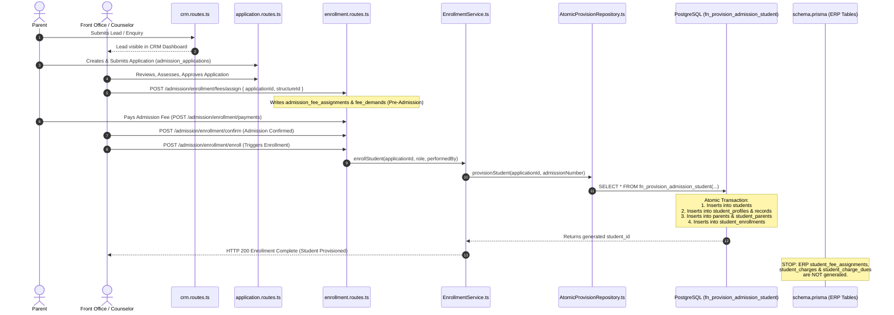
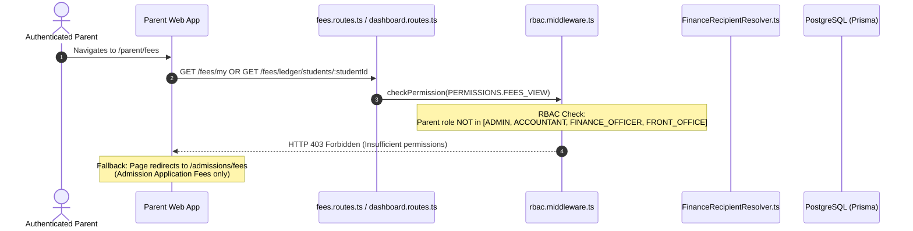
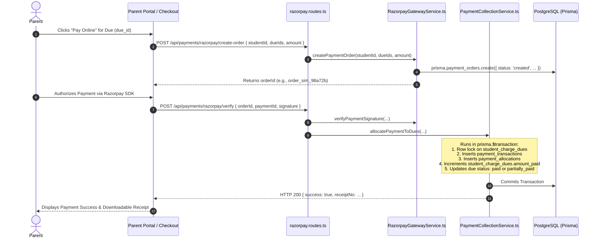
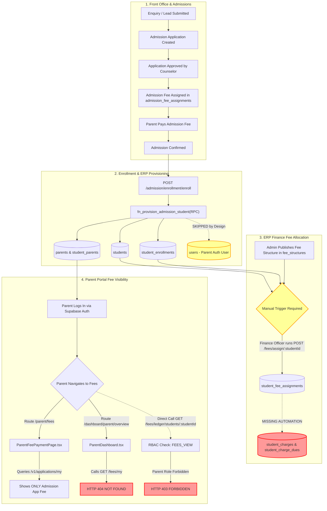
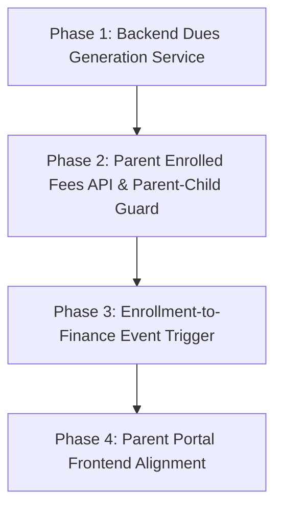

# EduTrack ERP — Parent, Front Office & Enrollment Integration Audit

**Document Version:** 1.0.0  
**Audit Date:** October 15, 2026  
**Auditor:** Antigravity AI Pair Programmer  
**Target Repository:** `EduTech`  
**Git Branch:** `hari-finance`  
**Commit Reference:** `7da311f`  
**Governing Standard:** Schema Freeze & Prisma-First Domain Architecture ([AGENTS.md](file:///d:/EduTech/EduTech/.agents/AGENTS.md))  
**Companion Audit:** [Finance Module Implementation Audit](file:///d:/EduTech/EduTech/docs/finance_implementation_audit.md)

---

## 1. Executive Summary

This audit investigates the cross-module integration connecting **Front Office / Admissions**, **Student Enrollment**, **ERP Finance**, and the **Parent Portal**. Specifically, it traces how fee structures configured in Finance become assigned student fees, how billing obligations propagate through the database, and whether parents can accurately view and pay active school fees for their enrolled children.

### Crucial Findings Summary:

1. **Two Disconnected Fee Subsystems Exist:**
   - **Admission Pre-Enrollment Fee System:** Built on legacy/unmanaged Supabase tables (`admission_fee_structures`, `admission_fee_components`, `admission_fee_assignments`, `admission_fee_waivers`, `fee_demands`, `fee_demand_items`). Used exclusively for admission registration, test processing, and offer-confirmation fees via [EnrollmentController.ts](file:///d:/EduTech/EduTech/apps/backend/src/modules/admission/controllers/enrollment/EnrollmentController.ts).
   - **ERP Finance Core Subsystem:** Built strictly on [schema.prisma](file:///d:/EduTech/EduTech/apps/backend/prisma/schema.prisma) (`fee_structures`, `fee_components`, `academic_year_grades`, `installment_plans`, `installment_plan_terms`, `student_fee_assignments`, `student_charges`, `student_charge_dues`). Used for institutional tuition, term installments, and collections via [fees.routes.ts](file:///d:/EduTech/EduTech/apps/backend/src/modules/fees/fees.routes.ts) and [StudentLedgerService.ts](file:///d:/EduTech/EduTech/apps/backend/src/modules/fees/services/StudentLedgerService.ts).
2. **Fee Assignment is 100% Manual After Enrollment:**
   - Student enrollment executed via `fn_provision_admission_student` and [EnrollmentService.ts](file:///d:/EduTech/EduTech/apps/backend/src/modules/admission/services/enrollment/EnrollmentService.ts) provisions `students`, `student_profiles`, `student_academic_records`, and `student_parents`.
   - **Enrollment does NOT trigger ERP fee structure assignment or dues generation**. An enrolled student has zero fee obligations until a Finance Officer or Admin manually assigns a structure via `POST /fees/assign/:studentId` or `/fees/demands/generate`.
3. **The Dues Generation Gap:**
   - While [StudentLedgerService.ts](file:///d:/EduTech/EduTech/apps/backend/src/modules/fees/services/StudentLedgerService.ts#L1197) writes to `student_fee_assignments`, **no service creates the corresponding records in `student_charges` and `student_charge_dues`**.
   - Conversely, [DemandService.ts](file:///d:/EduTech/EduTech/apps/backend/src/modules/fees/services/DemandService.ts#L74) writes to `fee_demands` (a legacy Supabase table absent from `schema.prisma`).
   - As a result, standard payment gateways, receivables aging, and parent payment screens that look for `student_charge_dues` find an empty schedule unless manually populated via raw database scripts.
4. **Parent Portal Disconnection & Missing Enrolled Fee View:**
   - The current Parent Portal route `/parent/fees` renders [ParentFeePaymentPage.tsx](file:///d:/EduTech/EduTech/apps/web_app/src/modules/admission/pages/parent/ParentFeePaymentPage.tsx), which is wired to `admissionApi` querying `/v1/applications/my`. It displays only pre-admission application fees, not enrolled student academic fees.
   - [ParentDashboardService.ts](file:///d:/EduTech/EduTech/apps/web_app/src/modules/dashboard/services/ParentDashboardService.ts#L17) attempts to call `GET /fees/my`, which **does not exist** on the backend and results in an HTTP 404 error.
5. **Authorization Vulnerabilities (IDOR & RBAC Block):**
   - Backend student ledger routes (`GET /fees/ledger/students/:studentId/*`) are guarded by `checkPermission(PERMISSIONS.FEES_VIEW)`.
   - The `PARENT` role is **not** granted `fees.view` in [rbac.middleware.ts](file:///d:/EduTech/EduTech/apps/backend/src/rbac/rbac.middleware.ts#L105); any parent attempting to access student ledger APIs is rejected with **HTTP 403 Forbidden**.
   - If a parent were granted `fees.view`, the endpoint checks only tenant scoping (`p.org_id = safeOrgId`) and **does not verify the parent-child relationship**, creating a severe **Insecure Direct Object Reference (IDOR)** vulnerability where any user with `fees.view` can inspect any student's complete ledger.
6. **Student Portal:**
   - The web frontend has **zero** student portal pages, layouts, or route guards in [route_registry.tsx](file:///d:/EduTech/EduTech/apps/web_app/src/config/route_registry.tsx).

---

## 2. End-to-End Tracing of Core Workflows

### 2.1 Flow 1: Front Office Lead to Enrollment & Student/Parent Provisioning



#### Detailed Step-by-Step Code Analysis:

1. **Lead & Application Inception:** Parents submit an admission enquiry via `/admission/crm/enquiries` which generates a `leads` record. The application is formalized through `POST /admission/applications` ([application.routes.ts](file:///d:/EduTech/EduTech/apps/backend/src/modules/admission/application.routes.ts#L26)).
2. **Pre-Admission Fee Allocation:** Front office assigns an admission fee structure using `POST /admission/enrollment/fees/assign` ([EnrollmentController.ts](file:///d:/EduTech/EduTech/apps/backend/src/modules/admission/controllers/enrollment/EnrollmentController.ts#L54)). This inserts into `admission_fee_assignments` and attempts a non-blocking bridge to `FinanceEngine.initializeDemand()`, which creates an unmanaged `fee_demands` record.
3. **Approval & Provisioning:** Once the admission fee is paid and confirmed, the staff triggers `POST /admission/enrollment/enroll`.
4. **Atomic Database Provisioning:** [StudentProvisionService.ts](file:///d:/EduTech/EduTech/apps/backend/src/modules/admission/services/enrollment/StudentProvisionService.ts) delegates to [AtomicProvisionRepository.ts](file:///d:/EduTech/EduTech/apps/backend/src/modules/admission/repositories/enrollment/AtomicProvisionRepository.ts#L10), calling the PostgreSQL stored procedure `fn_provision_admission_student`:
   - Creates a row in `students` (mapping `application_id`, `admission_no`, `first_name`, `last_name`, `org_id`).
   - Creates a row in `student_enrollments` (linking `student_id`, `academic_year_grade_id`, `status: 'active'`).
   - Creates a row in `parents` and links it in `student_parents` with `relationship` (`father`, `mother`, `guardian`).
   - **Crucial Omission:** User accounts (`users`) for parents and students are explicitly **skipped by design** (`AMAT_STAGE32_CERTIFICATION_REPORT.md` line 90) because user account provisioning requires Supabase Auth Admin APIs. Therefore, `parents.user_id` remains `NULL`.
5. **Idempotency & Duplicate Prevention:**
   - Enforced via unique constraint on `students(org_id, admission_no)` and `students(application_id)`.
   - Re-calling `/enroll` fails with state machine error `ADMISSION_CONFIRMED -> ENROLLED` transition violation ([EnrollmentStateMachine.ts](file:///d:/EduTech/EduTech/apps/backend/src/modules/admission/services/enrollment/state-machine/EnrollmentStateMachine.ts)).

---

### 2.2 Flow 2: Finance Fee Setup to Student Dues Generation

#### 1. Fee Structure Selection & Publishing:

- Admin configures fee structures in [FeeStructureManagerService.ts](file:///d:/EduTech/EduTech/apps/backend/src/modules/fees/services/FeeStructureManagerService.ts) scoped by `org_id`, `academic_year_id`, and `grade_id`.
- Components (`Tuition`, `Lab`, `Sports`, `Development`) sum to the total structure amount.
- Structures transition through `draft` ➔ `published`. Only `published` structures can be assigned.

#### 2. Student Fee Assignment:

- Staff executes `POST /fees/assign/:studentId` ([fees.routes.ts](file:///d:/EduTech/EduTech/apps/backend/src/modules/fees/fees.routes.ts#L185)).
- Handled by `StudentLedgerService.assignFeeStructure()` ([StudentLedgerService.ts](file:///d:/EduTech/EduTech/apps/backend/src/modules/fees/services/StudentLedgerService.ts#L1080)):
  - Verifies student belongs to tenant `org_id`.
  - Verifies structure belongs to student's enrolled `academic_year_grade_id`.
  - Inserts a record into `student_fee_assignments` (`status: 'active'`).
  - Emits event `FinanceEventType.FEE_ASSESSMENT_CREATED`.

#### 3. The Broken Link — Dues Generation:

- **Factual Code Finding:** [StudentLedgerService.ts](file:///d:/EduTech/EduTech/apps/backend/src/modules/fees/services/StudentLedgerService.ts#L1197-L1250) creates `student_fee_assignments`, but **does NOT insert into `student_charges` or `student_charge_dues`**.
- Meanwhile, [DemandService.ts](file:///d:/EduTech/EduTech/apps/backend/src/modules/fees/services/DemandService.ts#L74) inserts into `fee_demands` and `fee_demand_items` via Supabase client, but these tables **do not exist in `schema.prisma`**.
- Consequently, querying `GET /fees/ledger/students/:studentId/dues` returns an empty array `[]` unless records were directly inserted into `student_charge_dues` via database seed scripts.

#### 4. Concessions & Scholarships:

- Applied via [ScholarshipConcessionService.ts](file:///d:/EduTech/EduTech/apps/backend/src/modules/fees/services/ScholarshipConcessionService.ts).
- Requires approval workflow (`pending` ➔ `approved`).
- Approved concessions update `student_charge_dues.amount_due` net of the concession amount in [ScholarshipRepository.ts](file:///d:/EduTech/EduTech/apps/backend/src/modules/fees/repositories/ScholarshipRepository.ts#L488).

#### 5. Mid-Year Admissions, Transfers & Withdrawals:

- **Fee Structure Immutability:** [FeeStructureManagerService.ts](file:///d:/EduTech/EduTech/apps/backend/src/modules/fees/services/FeeStructureManagerService.ts#L691) strictly forbids editing or unpublishing structures if `_count.student_fee_assignments > 0`.
- **Mid-Year Admission Proration:** **Absent**. Code contains no proration calculation based on admission date. Students admitted mid-year receive full annual term dues.
- **Grade/Section Transfer:** **Absent**. Changing a student's enrollment does not automatically recalculate or transfer fee assignments.
- **Withdrawals:** **Absent**. When a student is withdrawn, outstanding dues in `student_charge_dues` remain active without automated cancellation or no-dues clearance.

---

### 2.3 Flow 3: Parent Portal Fee Visibility & Multi-Child Linking



#### Detailed Investigation of Parent Fee Access:

1. **Authentication & Session:**
   - Parents authenticate via Supabase Auth. The JWT payload is verified by `authenticateToken` in [auth.middleware.ts](file:///d:/EduTech/EduTech/apps/backend/src/middleware/auth.middleware.ts), attaching `req.context.user` (`id`, `email`, `roles: ['PARENT']`, `org_id`).
2. **Child Resolution in Database:**
   - The authoritative link is `parents.user_id = req.context.user.id` ➔ `student_parents(parent_id, student_id)` ➔ `students.student_id`.
   - Verified in [FinanceRecipientResolver.ts](file:///d:/EduTech/EduTech/apps/backend/src/modules/fees/services/FinanceRecipientResolver.ts#L30-L47).
3. **Multi-Child Support:**
   - Supported at the database schema level via composite key `@@id([student_id, parent_id])` in `student_parents`. A single parent can link to multiple students.
   - In [dashboard.routes.ts](file:///d:/EduTech/EduTech/apps/backend/src/modules/dashboard/dashboard.routes.ts#L398), the query attempts to select multiple children, but queries `.eq('parent_user_id', userId)`. However, `parent_user_id` is **not a column in `student_parents`** in [schema.prisma](file:///d:/EduTech/EduTech/apps/backend/prisma/schema.prisma#L713) (the column is `parent_id` foreign-keyed to `parents.parent_id`).
4. **Parent-Facing API Disconnections:**
   - [ParentDashboardService.ts](file:///d:/EduTech/EduTech/apps/web_app/src/modules/dashboard/services/ParentDashboardService.ts#L17) calls `apiClient.get('/fees/my')`. **This endpoint does not exist anywhere in the backend codebase**, resulting in a runtime HTTP 404.
   - [ParentFeePaymentPage.tsx](file:///d:/EduTech/EduTech/apps/web_app/src/modules/admission/pages/parent/ParentFeePaymentPage.tsx#L57) calls `useGetApplicationFeeQuery(activeApplicationId)`, fetching pre-enrollment application fees from `admission_fee_assignments`, not ERP tuition dues from `student_charge_dues`.
5. **Security & IDOR Analysis on Ledger Endpoints:**
   - If a parent attempts to query `GET /fees/ledger/students/:studentId`:
     1. [rbac.middleware.ts](file:///d:/EduTech/EduTech/apps/backend/src/rbac/rbac.middleware.ts#L105-L115) blocks the request with **HTTP 403 Forbidden** because `roles.includes('PARENT')` is not granted `fees.view`.
     2. If `fees.view` is added to the parent role, [StudentLedgerService.ts](file:///d:/EduTech/EduTech/apps/backend/src/modules/fees/services/StudentLedgerService.ts#L1040-L1058) verifies only that the requested `studentId` belongs to `tenantOrgId`. It **never checks `student_parents` to ensure the requester is the parent of that student**.
     3. **Severity:** Critical IDOR risk. Any authenticated user with `fees.view` could read financial ledgers, fee dues, concessions, and receipts of any student across the entire institution.

---

### 2.4 Flow 4: Payment Update Propagation



#### Detailed Lifecycle Propagation & Edge Cases:

- **Success Propagation:** Verified in [RazorpayGatewayService.ts](file:///d:/EduTech/EduTech/apps/backend/src/modules/fees/services/RazorpayGatewayService.ts#L592) and [PaymentCollectionService.ts](file:///d:/EduTech/EduTech/apps/backend/src/modules/fees/services/PaymentCollectionService.ts#L730). Both apply row-level locking (`SELECT ... FOR UPDATE`) on `student_charge_dues` inside a Prisma interactive transaction. `amount_paid` is incremented. If `amount_paid >= amount_due`, status becomes `paid`; otherwise `partially_paid`.
- **Failed / Pending / Cancelled Payments:** If verification fails or gateway returns failure, a row is inserted in `payment_transactions` with status `failed` and gateway error code. Dues are **never modified or reduced**. Outstanding balance checks explicitly evaluate `WHERE amount_paid < amount_due`.
- **Webhook Processing & Idempotency:** Implemented in [razorpay.routes.ts](file:///d:/EduTech/EduTech/apps/backend/src/routes/razorpay.routes.ts#L112). Signature is validated using HMAC-SHA256. Webhook payload is checked against `payment_webhook_events`. If `event_id` already exists with status `processed`, it immediately returns HTTP 200 without double-allocation.
- **Refunds & Reversals:** Implemented in [PaymentCollectionService.ts](file:///d:/EduTech/EduTech/apps/backend/src/modules/fees/services/PaymentCollectionService.ts#L450). Creates a record in `payment_refunds` referencing `payment_transactions.payment_transaction_id`. Reverses `student_charge_dues.amount_paid` and reverts status to `partially_paid` or `unpaid`.

---

## 3. Flow Diagram: Front Office Enrollment to Parent Portal Fee Visibility



---

## 4. Role-by-Role Capability Matrix

| Role                                        | Frontend Page Visibility                                                                                           | Backend Route Authorization                                                                                                                                                | Tenant Scoping                                                 | Parent-Child Relationship Verified? | Defect / Vulnerability Description                                                      |
| :------------------------------------------ | :----------------------------------------------------------------------------------------------------------------- | :------------------------------------------------------------------------------------------------------------------------------------------------------------------------- | :------------------------------------------------------------- | :---------------------------------- | :-------------------------------------------------------------------------------------- |
| **Admin / Superadmin**                      | Full access to `/finance/*`, `/admissions/*`, `/admin/*`.                                                          | Bypasses all RBAC checks via `SUPERADMIN` bypass or `ADMIN` role check.                                                                                                    | Enforced via `req.context.user.org_id`.                        | N/A (Institutional authority).      | None. Operates as intended.                                                             |
| **Accountant / Finance Officer**            | Access to `/finance/*` (structures, demands, payments, ledger, reconciliation, accounting).                        | Authorized for `FEES_VIEW`, `FEES_STRUCTURE_MANAGE`, `FEES_PAYMENT_COLLECT`, `FEES_DEMAND_GENERATE`.                                                                       | Enforced via `req.context.user.org_id`.                        | N/A (Institutional authority).      | None. Operates as intended.                                                             |
| **Front Office / Receptionist / Counselor** | Access to `/admissions/*` (leads, CRM, applications, enrollment, document center).                                 | Authorized for `admission.*` and `fees.view` in [rbac.middleware.ts](file:///d:/EduTech/EduTech/apps/backend/src/rbac/rbac.middleware.ts#L115). Blocked on finance writes. | Enforced via `req.context.user.school_id` or `org_id`.         | N/A.                                | Cannot assign ERP fee structures unless granted `fees.structure.manage`.                |
| **Parent**                                  | Access to `/parent/*`, `/admissions/*` (application wizard, status, document upload, admission fee).               | Authorized for `admission.view_own` only. **Blocked on all `fees.*` endpoints**.                                                                                           | Enforced on admission applications via `created_by = user.id`. | **Missing on Finance Endpoints**.   | Cannot view enrolled child fees (HTTP 403 on `/fees/ledger/*`; HTTP 404 on `/fees/my`). |
| **Student**                                 | **Zero UI routes** in [route_registry.tsx](file:///d:/EduTech/EduTech/apps/web_app/src/config/route_registry.tsx). | Permission `STUDENT_VIEW_SELF` defined in [permissions.ts](file:///d:/EduTech/EduTech/apps/backend/src/rbac/permissions.ts#L26), but no active routes attached.            | N/A.                                                           | N/A.                                | Student portal is completely absent in the web app.                                     |

---

## 5. Comprehensive Inventory of Frontend, API, Services & Database Models

| Functional Layer                        | Frontend Page / Component                                | API Endpoint & HTTP Method                                                            | Backend Route & Controller                                                                                                                                                                                                                            | Service & Repository Classes                                                    | Database Models Involved                                                                   |
| :-------------------------------------- | :------------------------------------------------------- | :------------------------------------------------------------------------------------ | :---------------------------------------------------------------------------------------------------------------------------------------------------------------------------------------------------------------------------------------------------- | :------------------------------------------------------------------------------ | :----------------------------------------------------------------------------------------- |
| **Admission Lead & Application**        | `EnquiryForm.tsx`<br>`ApplicationWizard.tsx`             | `POST /v1/applications`<br>`GET /v1/applications/:id`                                 | [application.routes.ts](file:///d:/EduTech/EduTech/apps/backend/src/modules/admission/application.routes.ts)<br>`ApplicationController`                                                                                                               | `ApplicationService`<br>`ApplicationRepository`                                 | `leads`, `admission_applications`, `academic_year_grades`                                  |
| **Pre-Admission Fee Setup**             | `EnrollmentModal.tsx`<br>`CollectAdmissionFeeDialog.tsx` | `POST /admission/enrollment/fees/assign`<br>`GET /admission/enrollment/fees/:appId`   | [enrollment.routes.ts](file:///d:/EduTech/EduTech/apps/backend/src/modules/admission/enrollment.routes.ts)<br>[EnrollmentController.ts](file:///d:/EduTech/EduTech/apps/backend/src/modules/admission/controllers/enrollment/EnrollmentController.ts) | `FeeAssignmentService`<br>`FeeCalculationService`                               | `admission_fee_structures`, `admission_fee_components`, `admission_fee_assignments`        |
| **Admission Confirmation & Enrollment** | `EnrollmentModal.tsx`<br>`AdmissionStatusPage.tsx`       | `POST /admission/enrollment/confirm`<br>`POST /admission/enrollment/enroll`           | [enrollment.routes.ts](file:///d:/EduTech/EduTech/apps/backend/src/modules/admission/enrollment.routes.ts)<br>[EnrollmentController.ts](file:///d:/EduTech/EduTech/apps/backend/src/modules/admission/controllers/enrollment/EnrollmentController.ts) | `EnrollmentService`<br>`StudentProvisionService`<br>`AtomicProvisionRepository` | `admissions_applications`, `students`, `student_enrollments`, `parents`, `student_parents` |
| **ERP Fee Structure Setup**             | `FeeStructureManagement.tsx`                             | `GET /fees/structures`<br>`POST /fees/structures`                                     | [fees.routes.ts](file:///d:/EduTech/EduTech/apps/backend/src/modules/fees/fees.routes.ts)<br>`feesRouter`                                                                                                                                             | `FeeStructureManagerService`<br>`FeeStructureRepository`                        | `fee_structures`, `fee_components`, `academic_year_grades`, `installment_plans`            |
| **ERP Student Fee Assignment**          | `StudentFeeAssignment.tsx`<br>`DemandManagement.tsx`     | `POST /fees/assign/:studentId`<br>`POST /fees/demands/generate`                       | [fees.routes.ts](file:///d:/EduTech/EduTech/apps/backend/src/modules/fees/fees.routes.ts)<br>`feesRouter`                                                                                                                                             | `StudentLedgerService`<br>`DemandService`<br>`FinanceEngine`                    | `student_fee_assignments`, `fee_demands`, `fee_demand_items`                               |
| **ERP Dues & Ledger**                   | `AdminFeeLedger.tsx`                                     | `GET /fees/ledger/students/:studentId/dues`<br>`GET /fees/ledger/students/:studentId` | [fees.routes.ts](file:///d:/EduTech/EduTech/apps/backend/src/modules/fees/fees.routes.ts)<br>`feesRouter`                                                                                                                                             | `StudentLedgerService`<br>`ReceivablesRepository`                               | `student_charges`, `student_charge_dues`, `payment_allocations`                            |
| **Parent Dashboard Overview**           | `ParentDashboard.tsx`                                    | `GET /dashboard/parent/overview`                                                      | [dashboard.routes.ts](file:///d:/EduTech/EduTech/apps/backend/src/modules/dashboard/dashboard.routes.ts)                                                                                                                                              | `ParentDashboardService`                                                        | `student_parents`, `students`, `admission_applications`                                    |
| **Parent Enrolled Fees View**           | `ParentFeePaymentPage.tsx`                               | `GET /fees/my` _(Broken)_<br>`GET /v1/applications/my` _(Fallback)_                   | `admission.api.ts`<br>`ParentDashboardService.ts`                                                                                                                                                                                                     | **None** (Endpoint absent on backend)                                           | `student_charge_dues` (Targeted, but unreached)                                            |
| **Online Payment Checkout**             | `RazorpayCheckoutDemo.tsx`<br>`ParentFeePaymentPage.tsx` | `POST /api/payments/razorpay/create-order`<br>`POST /api/payments/razorpay/verify`    | [razorpay.routes.ts](file:///d:/EduTech/EduTech/apps/backend/src/routes/razorpay.routes.ts)                                                                                                                                                           | `RazorpayGatewayService`<br>`PaymentCollectionService`                          | `payment_orders`, `payment_transactions`, `payment_allocations`, `student_charge_dues`     |
| **Payment Webhook & Idempotency**       | Webhook Background Receiver                              | `POST /api/payments/razorpay/webhook`                                                 | [razorpay.routes.ts](file:///d:/EduTech/EduTech/apps/backend/src/routes/razorpay.routes.ts)                                                                                                                                                           | `RazorpayGatewayService`<br>`PaymentRepository`                                 | `payment_webhook_events`, `payment_transactions`, `student_charge_dues`                    |

---

## 6. Confirmed Working Links vs. Missing Links

### Confirmed Working Links:

1. **Lead ➔ Application ➔ Admission Fee Collection ➔ Enrollment:** Front office can successfully take a lead, create an application, collect pre-admission fees, and trigger enrollment.
2. **Atomic Student Master Provisioning:** `fn_provision_admission_student` reliably inserts `students`, `student_enrollments`, `parents`, and `student_parents` in a single ACID PostgreSQL transaction.
3. **ERP Fee Structure CRUD:** Finance Admins can define structures, components, and installment plan percentages, with strict validation enforcing 100% distribution.
4. **Digital Payment Verification & Concurrency Locking:** Razorpay order generation, HMAC-SHA256 signature verification, webhook idempotency checks, and row-level locking on `student_charge_dues` are fully implemented and verified in simulation mode.

### Broken or Missing Links:

1. **Automatic Fee Assignment upon Enrollment:** **Broken**. Enrollment does not trigger ERP fee assignment. An enrolled student remains in the system with zero fee structures assigned until manual staff intervention.
2. **`student_charges` and `student_charge_dues` Generation:** **Missing**. [StudentLedgerService.ts](file:///d:/EduTech/EduTech/apps/backend/src/modules/fees/services/StudentLedgerService.ts) inserts into `student_fee_assignments` but does not break down components into `student_charges` or installment terms into `student_charge_dues`.
3. **Parent Enrolled Fee Endpoint (`/fees/my`):** **Missing**. Frontend calls `GET /fees/my`, but backend has no matching route (returns HTTP 404).
4. **Parent Ledger Route Authorization:** **Broken**. Backend ledger endpoints require `FEES_VIEW`. Parents lack this permission and are rejected with HTTP 403.
5. **Parent-Child Authorization Verification (IDOR):** **Missing**. No endpoint in [fees.routes.ts](file:///d:/EduTech/EduTech/apps/backend/src/modules/fees/fees.routes.ts) validates that the authenticated parent is linked to the requested `:studentId` via `student_parents`.
6. **Parent User Account Provisioning:** **Incomplete**. `fn_provision_admission_student` creates `parents` records, but leaves `parents.user_id` as `NULL`. Unless manually linked to a Supabase auth user, the parent cannot query their children.
7. **Student Portal:** **Missing**. No web frontend routes, layouts, or pages exist for students.

---

## 7. Authorization and Data-Isolation Risks

### 1. Insecure Direct Object Reference (IDOR) on Student Ledgers

- **Location:** [fees.routes.ts](file:///d:/EduTech/EduTech/apps/backend/src/modules/fees/fees.routes.ts#L1034-L1230)
- **Risk:** The endpoints `/fees/ledger/students/:studentId/*` extract `studentId` directly from `req.params`. The service verifies only that the student exists in `req.context.user.org_id`.
- **Impact:** Any user possessing `fees.view` can access any student's financial history, ledger balances, fee concessions, and payment receipts by altering the UUID in the URL.
- **Remediation:** Implement a dedicated authorization guard:
  ```typescript
  if (roles.includes('PARENT')) {
    const isParent = await prisma.student_parents.findFirst({
      where: {
        student_id: studentId,
        parents: { user_id: req.context.user.id },
      },
    });
    if (!isParent) throw new AppError('Forbidden: Unauthorized child access', 403);
  }
  ```

### 2. Cross-Tenant Leakage via Hardcoded Organization Identifiers

- **Location:** [DemandService.ts](file:///d:/EduTech/EduTech/apps/backend/src/modules/fees/services/DemandService.ts#L69)
- **Risk:** Contains hardcoded school identifier `const schoolId = 'GWH001'`.
- **Impact:** Violates multi-tenant isolation; demand numbers generated in multi-tenant environments collide across organizations.

### 3. Parent Role Privilege Inconsistency

- **Location:** [rbac.middleware.ts](file:///d:/EduTech/EduTech/apps/backend/src/rbac/rbac.middleware.ts#L86-L97)
- **Risk:** The parent self-service bypass permits only `admission.*` permissions. When parents navigate to `/parent/fees` to view enrolled school dues, the system treats them as unauthorized users.

---

## 8. Factual Determination: Fee Assignment Operational Mode

| Question                                                                | Factual Status                     | Code Evidence                                                                                                                                                                                                                                                                     |
| :---------------------------------------------------------------------- | :--------------------------------- | :-------------------------------------------------------------------------------------------------------------------------------------------------------------------------------------------------------------------------------------------------------------------------------- |
| **Is ERP fee assignment automatic upon enrollment?**                    | **NO. 100% Manual.**               | [EnrollmentService.ts](file:///d:/EduTech/EduTech/apps/backend/src/modules/admission/services/enrollment/EnrollmentService.ts#L40-L65) calls only `fn_provision_admission_student`. It does not invoke `StudentLedgerService.assignFeeStructure()` or create any finance records. |
| **Does Front Office pre-admission fee assignment link to ERP finance?** | **NO. Separate Subsystems.**       | [EnrollmentController.ts](file:///d:/EduTech/EduTech/apps/backend/src/modules/admission/controllers/enrollment/EnrollmentController.ts#L78) writes to `admission_fee_assignments` and unmanaged `fee_demands`. It does not create `student_fee_assignments`.                      |
| **Does assigning a fee structure generate installment dues?**           | **NO. Incomplete Implementation.** | [StudentLedgerService.ts](file:///d:/EduTech/EduTech/apps/backend/src/modules/fees/services/StudentLedgerService.ts#L1197) writes to `student_fee_assignments`, but does not insert into `student_charges` or `student_charge_dues`.                                              |

---

## 9. Prioritized Implementation Plan (Zero Schema Changes)

This sequence adheres strictly to the Stage-1 schema freeze in [schema.prisma](file:///d:/EduTech/EduTech/apps/backend/prisma/schema.prisma) and requires zero database DDL or migrations.



### Phase 1: Complete the Dues Generation Service (Backend)

1. **Implement `FeeDuesGenerationService`:**
   - When `student_fee_assignments` is created, query `fee_components` and `installment_plan_terms`.
   - In a single Prisma transaction:
     - Insert a record into `student_charges` for each component (or lump sum academic fee) referencing `student_id` and `student_fee_assignment_id`.
     - Insert records into `student_charge_dues` for each installment term, calculating `amount_due = (charge_amount * term_percentage) / 100`.
   - **Schema Compliance:** Both `student_charges` and `student_charge_dues` already exist in [schema.prisma](file:///d:/EduTech/EduTech/apps/backend/prisma/schema.prisma#L1506-L1565). No schema changes required.

### Phase 2: Create Parent-Facing Fee API & Relationship Guard (Backend)

1. **Implement `GET /fees/my`:**
   - Extract authenticated user ID: `req.context.user.id`.
   - Query `parents` where `user_id = req.context.user.id`.
   - Query `student_parents` to retrieve all linked children (`student_id`).
   - For each child, retrieve active `student_enrollments`, `student_fee_assignments`, and unpaid `student_charge_dues`.
   - Return a unified multi-child fee summary.
2. **Add Parent-Child Relationship Verification Middleware:**
   - Create `assertParentChildAccess(req, res, next)` to verify that if `roles.includes('PARENT')`, `req.params.studentId` is confirmed in `student_parents`.
   - Update [rbac.middleware.ts](file:///d:/EduTech/EduTech/apps/backend/src/rbac/rbac.middleware.ts) to allow parents with verified child access to read ledger summaries.

### Phase 3: Wire Automatic Fee Assignment to Enrollment Event (Backend)

1. **Enrollment Event Hook:**
   - In [EnrollmentService.ts](file:///d:/EduTech/EduTech/apps/backend/src/modules/admission/services/enrollment/EnrollmentService.ts#L112), emit event `ERP_STUDENT_ENROLLED` with `{ studentId, academicYearGradeId, orgId }`.
   - Subscribe to this event in `fees/subscribers/` to automatically find the published `fee_structures` matching `academic_year_grade_id` and assign it to the newly enrolled student.

### Phase 4: Align Parent Portal Frontend (Web App)

1. **Refactor `/parent/fees` Page:**
   - Update [ParentFeePaymentPage.tsx](file:///d:/EduTech/EduTech/apps/web_app/src/modules/admission/pages/parent/ParentFeePaymentPage.tsx) to check whether the child is an applicant or an enrolled student.
   - If enrolled, display the academic fee schedule, installment breakdown, and "Pay with Razorpay" button wired to `POST /api/payments/razorpay/create-order`.
2. **Fix `ParentDashboardService.getMyFees()`:**
   - Ensure it consumes the newly implemented `GET /fees/my` endpoint.

---

## 10. Unresolved Business Questions

1. **Default Installment Plan on Auto-Assignment:** If a grade has multiple published installment plans (e.g., Annual Full Payment, 3-Term Installments, 10-Month Monthly), which plan should be automatically selected upon student enrollment if the parent did not select one in advance?
2. **Admission Fee vs. Academic Fee Accounting:** Should pre-admission registration fees (collected in `admission_fee_payments`) be credited toward the student's first-term tuition in ERP finance, or are they non-refundable administrative charges recorded separately?
3. **Mid-Year Admission Proration Policy:** What is the official institutional policy for students enrolling mid-term? Should tuition be prorated on a monthly basis, term basis, or charged at full annual rate?
4. **Parent User Account Provisioning Timing:** When should the parent's Supabase auth user account be created? At initial lead enquiry, upon application submission, or strictly upon admission confirmation?

---

## 11. Files Inspected

- **Schema & Governing Rules:** [schema.prisma](file:///d:/EduTech/EduTech/apps/backend/prisma/schema.prisma), [AGENTS.md](file:///d:/EduTech/EduTech/.agents/AGENTS.md).
- **Admissions & Enrollment Backend:**
  - [application.routes.ts](file:///d:/EduTech/EduTech/apps/backend/src/modules/admission/application.routes.ts)
  - [enrollment.routes.ts](file:///d:/EduTech/EduTech/apps/backend/src/modules/admission/enrollment.routes.ts)
  - [EnrollmentController.ts](file:///d:/EduTech/EduTech/apps/backend/src/modules/admission/controllers/enrollment/EnrollmentController.ts)
  - [EnrollmentService.ts](file:///d:/EduTech/EduTech/apps/backend/src/modules/admission/services/enrollment/EnrollmentService.ts)
  - [StudentProvisionService.ts](file:///d:/EduTech/EduTech/apps/backend/src/modules/admission/services/enrollment/StudentProvisionService.ts)
  - [AtomicProvisionRepository.ts](file:///d:/EduTech/EduTech/apps/backend/src/modules/admission/repositories/enrollment/AtomicProvisionRepository.ts)
  - [FeeAssignmentService.ts](file:///d:/EduTech/EduTech/apps/backend/src/modules/admission/services/enrollment/FeeAssignmentService.ts)
  - [FeeRepository.ts](file:///d:/EduTech/EduTech/apps/backend/src/modules/admission/repositories/enrollment/FeeRepository.ts)
- **ERP Finance Backend:**
  - [fees.routes.ts](file:///d:/EduTech/EduTech/apps/backend/src/modules/fees/fees.routes.ts)
  - [razorpay.routes.ts](file:///d:/EduTech/EduTech/apps/backend/src/routes/razorpay.routes.ts)
  - [StudentLedgerService.ts](file:///d:/EduTech/EduTech/apps/backend/src/modules/fees/services/StudentLedgerService.ts)
  - [DemandService.ts](file:///d:/EduTech/EduTech/apps/backend/src/modules/fees/services/DemandService.ts)
  - [FinanceEngine.ts](file:///d:/EduTech/EduTech/apps/backend/src/modules/fees/services/FinanceEngine.ts)
  - [FinanceRecipientResolver.ts](file:///d:/EduTech/EduTech/apps/backend/src/modules/fees/services/FinanceRecipientResolver.ts)
  - [RazorpayGatewayService.ts](file:///d:/EduTech/EduTech/apps/backend/src/modules/fees/services/RazorpayGatewayService.ts)
  - [PaymentCollectionService.ts](file:///d:/EduTech/EduTech/apps/backend/src/modules/fees/services/PaymentCollectionService.ts)
- **RBAC & Middleware:**
  - [rbac.middleware.ts](file:///d:/EduTech/EduTech/apps/backend/src/rbac/rbac.middleware.ts)
  - [permissions.ts](file:///d:/EduTech/EduTech/apps/backend/src/rbac/permissions.ts)
  - [dashboard.routes.ts](file:///d:/EduTech/EduTech/apps/backend/src/modules/dashboard/dashboard.routes.ts)
- **Frontend Components & Services:**
  - [route_registry.tsx](file:///d:/EduTech/EduTech/apps/web_app/src/config/route_registry.tsx)
  - [ParentDashboard.tsx](file:///d:/EduTech/EduTech/apps/web_app/src/modules/dashboard/pages/ParentDashboard.tsx)
  - [ParentDashboardService.ts](file:///d:/EduTech/EduTech/apps/web_app/src/modules/dashboard/services/ParentDashboardService.ts)
  - [ParentFeePaymentPage.tsx](file:///d:/EduTech/EduTech/apps/web_app/src/modules/admission/pages/parent/ParentFeePaymentPage.tsx)
  - [DemandManagement.tsx](file:///d:/EduTech/EduTech/apps/web_app/src/modules/fees/pages/DemandManagement.tsx)
  - [admission.api.ts](file:///d:/EduTech/EduTech/apps/web_app/src/shared/api/admission.api.ts)
  - [endpoints.ts](file:///d:/EduTech/EduTech/apps/web_app/src/shared/api/endpoints.ts)

---

## 12. Audit Certification Statement

1. **Working Tree and Branch:** The audit was conducted on branch `hari-finance`. The working tree remains completely clean (except for untracked audit markdown reports).
2. **Schema & Database Integrity:** Zero database DDL, DML, SQL, Prisma migrations, or seed operations were executed. No application code files were modified.
3. **Security:** No production secrets, API keys, passwords, or student PII were printed or exposed during this audit.
4. **Factual Integrity:** All findings have been verified by inspecting active codebase files, routes, controllers, middleware, and Prisma models. Unbacked functionality has been noted explicitly as broken, missing, or blocked.
