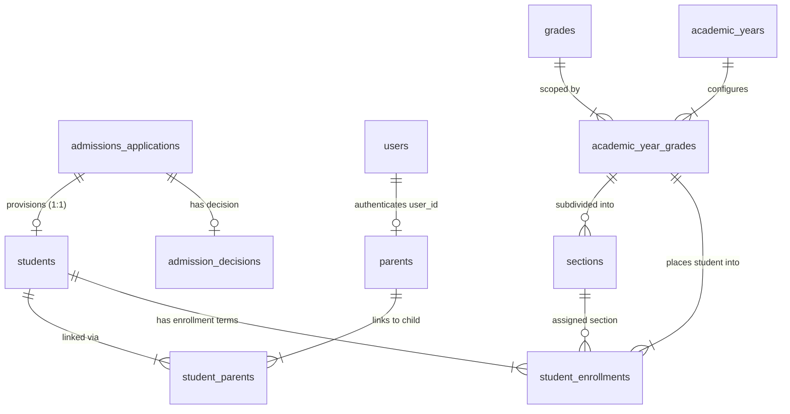

# EduTrack ERP — Parent Experience Integration

# Document 03: Admission & Enrollment Source-of-Truth Blueprint

**Document Version:** 1.0.0  
**Phase:** Phase 0 — Complete Repository Audit, System Discovery & Integration Blueprint  
**Date:** October 16, 2026  
**Governing Standard:** Schema Freeze & Prisma-First Domain Architecture ([AGENTS.md](file:///Users/sathish/Documents/GitHub/EduTech/.agents/AGENTS.md))  
**Auditor:** Antigravity AI Pair Programmer

---

## 1. Executive Summary & Source of Truth Mandate

Under the governing rules of [AGENTS.md](file:///Users/sathish/Documents/GitHub/EduTech/.agents/AGENTS.md), **`schema.prisma` is the SOLE Source of Truth for Database Models**. This document establishes the authoritative data contracts, relationships, and lifecycle transitions connecting **Admissions**, **Student Provisioning**, **Enrollment**, and **Academic Placement**.

### Primary Architectural Directive:

- **Academic placement is derived EXCLUSIVELY from authoritative `student_enrollments` records**.
- The Parent Web Dashboard and Parent Mobile App **must NEVER** generate admission numbers, create enrollment records, or infer academic placement from unapproved application forms.
- All parent-facing views must query the authoritative models verified below.

---

## 2. Authoritative Database Models & Relationships

Verified against [apps/backend/prisma/schema.prisma](file:///Users/sathish/Documents/GitHub/EduTech/apps/backend/prisma/schema.prisma):

### Table Specifications:

| Prisma Model              | Table Name                | Key Columns                                                                                                                                                                               | Authoritative Domain Purpose                                                                      |
| :------------------------ | :------------------------ | :---------------------------------------------------------------------------------------------------------------------------------------------------------------------------------------- | :------------------------------------------------------------------------------------------------ |
| `admissions_applications` | `admissions_applications` | `application_id` (PK, UUID) `application_number` (Unique, VarChar 30) `status` (`application_status`) `academic_year_id` (FK) `org_id` (FK)                                   | Stores applicant intake profile before admission approval and student provisioning.               |
| `admission_decisions`     | `admission_decisions`     | `decision_id` (PK, UUID) `application_id` (Unique FK) `decision_status` (`admission_decision_status`) `scholarship_percentage` (Decimal)                                         | Formal institutional approval, waitlisting, rejection, or offer expiration.                       |
| `students`                | `students`                | `student_id` (PK, UUID) `admission_no` (VarChar 30) `application_id` (Unique FK) `user_id` (UUID, Nullable) `first_name`, `last_name` `status` (`enrollment_status`)       | Authoritative institutional student master record created only upon completed enrollment.         |
| `parents`                 | `parents`                 | `parent_id` (PK, UUID) `org_id` (FK) `user_id` (Unique, FK to users) `email`, `phone` `first_name`, `last_name`                                                               | Master parent profile. Links authenticated user identity (`user_id`) to institutional records.    |
| `student_parents`         | `student_parents`         | `student_id` (Composite PK, FK) `parent_id` (Composite PK, FK) `relationship` (`relationship_type`) `is_primary_contact` (Boolean)                                               | Authoritative link establishing parent-child relationship and access authorization.               |
| `student_enrollments`     | `student_enrollments`     | `enrollment_id` (PK, UUID) `student_id` (FK) `academic_year_grade_id` (FK) `section_id` (FK, Nullable) `roll_number` (VarChar 20, Nullable) `status` (`enrollment_status`) | Authoritative placement record defining student's academic year, grade, section, and roll number. |
| `academic_year_grades`    | `academic_year_grades`    | `academic_year_grade_id` (PK, UUID) `academic_year_id` (FK) `grade_id` (FK) `intake_capacity` (Int)                                                                              | Associative entity mapping a specific Grade to an Academic Year.                                  |
| `sections`                | `sections`                | `section_id` (PK, UUID) `academic_year_grade_id` (FK) `section_name` (VarChar 10) `class_teacher_id` (FK)                                                                        | Class section subdivision (e.g. "Section A", "Section B").                                        |

---

## 3. Systematic Verification of the 10 Core Lifecycle Questions

### 1. Where is the Application Number stored?

- **Authoritative Field:** `admissions_applications.application_number` ([schema.prisma:L185](file:///Users/sathish/Documents/GitHub/EduTech/apps/backend/prisma/schema.prisma#L185)).
- **Format & Uniqueness:** `@db.VarChar(30)`, unique database constraint `ix_admissions_applications_number`.
- **Generation:** Generated by `DocumentNumberService` (e.g. `APP-2026-00123`) during application submission in [application.routes.ts](file:///Users/sathish/Documents/GitHub/EduTech/apps/backend/src/modules/admission/application.routes.ts).

### 2. Where is the Admission Number assigned and stored?

- **Authoritative Field:** `students.admission_no` ([schema.prisma:L738](file:///Users/sathish/Documents/GitHub/EduTech/apps/backend/prisma/schema.prisma#L738)).
- **Format & Uniqueness:** `@db.VarChar(30)`, unique per organization `unique(org_id, admission_no)`.
- **Assignment:** Assigned strictly during the enrollment execution step by `EnrollmentService` via `DocumentNumberService.generateNextNumber('ADM', schoolId)` (e.g. `ADM-2026-0089`).

### 3. Which operation creates the Student record?

- **Authoritative Endpoint:** `POST /api/v1/admission/enrollment/enroll` ([enrollment.routes.ts](file:///Users/sathish/Documents/GitHub/EduTech/apps/backend/src/modules/admission/enrollment.routes.ts)).
- **Handler & Repository:** `EnrollmentController.enrollStudent` ➔ `EnrollmentService.enrollStudent` ➔ [AtomicProvisionRepository.ts](file:///Users/sathish/Documents/GitHub/EduTech/apps/backend/src/modules/admission/repositories/enrollment/AtomicProvisionRepository.ts).
- **Execution Mechanism:** Executes the PostgreSQL atomic stored procedure `fn_provision_admission_student(applicationId, admissionNumber)`. It transactionally inserts:
  1. `students` row (linking `application_id` and assigning `admission_no`).
  2. `student_enrollments` row (linking `academic_year_grade_id`).
  3. `parents` and `student_parents` rows (linking family relationships).
  4. Updates `admissions_applications.status` to `enrolled`.

### 4. How is a Parent linked to a Child?

- **Two-Tier Relational Mapping:**
  1. **User Identity to Parent Master:** The authenticated user session (`req.context.user.id` or `user.email`) maps to `parents.user_id` (or fallback `parents.email`).
  2. **Parent Master to Student:** `parents.parent_id` maps through `student_parents.parent_id` ➔ `student_parents.student_id` ➔ `students.student_id`.
- **Multi-Child Relationship:** Supported natively via composite key `@@id([student_id, parent_id])` in `student_parents`. One parent record can connect to multiple student records.
- **Reference Code:** Verified in [ParentFinanceService.verifyParentChildAccess](file:///Users/sathish/Documents/GitHub/EduTech/apps/backend/src/modules/fees/services/ParentFinanceService.ts#L89-L136).

### 5. How is Enrollment created?

- Created within the atomic provisioning transaction inside `student_enrollments`:
  - `student_id`: Generated UUID of the new student.
  - `academic_year_grade_id`: Resolved from the application's applied grade and active academic year.
  - `status`: `'active'`.
  - `enrollment_date`: `CURRENT_DATE`.
  - `section_id`: `NULL` (unless pre-allocated).
  - `roll_number`: `NULL` (assigned later by Class Teacher/Admin).

### 6. Where are Academic Year, Grade, Section, and Roll Number obtained?

Placement data must be traversed from `student_enrollments` (never from raw application forms):

- **Academic Year:** `student_enrollments.academic_year_grades.academic_years.academic_year_name` (e.g. `"2026-2027"`).
- **Grade Name:** `student_enrollments.academic_year_grades.grades.grade_name` (e.g. `"Grade 5"`).
- **Section Name:** `student_enrollments.sections.section_name` (e.g. `"Section A"` or `null` if unallocated).
- **Roll Number:** `student_enrollments.roll_number` (e.g. `"05-A-14"` or `null` if unallocated).

### 7. How does Admission Approval differ from Completed Enrollment?

| Attribute              | Admission Approval (`admission_decisions`)                                                          | Completed Enrollment (`student_enrollments`)                                             |
| :--------------------- | :-------------------------------------------------------------------------------------------------- | :--------------------------------------------------------------------------------------- |
| **State**              | `admissions_applications.status = 'approved'` `admission_decisions.decision_status = 'approved'` | `admissions_applications.status = 'enrolled'` `student_enrollments.status = 'active'` |
| **Student Record**     | Does **NOT** exist (`students` row is absent).                                                      | **Exists** in `students` with permanent `admission_no`.                                  |
| **Academic Placement** | Provisional / Intended grade only.                                                                  | Authoritative institutional placement in `student_enrollments`.                          |
| **Fee Obligations**    | Application / Registration fee only.                                                                | Annual / Term ERP tuition structures assigned to ledger.                                 |
| **Parent Action**      | Review offer letter, pay confirmation fee.                                                          | Access student attendance, grades, term fees, and report cards.                          |

### 8. How is Pending Class or Section Allocation represented?

- **Database Representation:**
  - `student_enrollments.section_id IS NULL`
  - `student_enrollments.roll_number IS NULL`
- **Business Meaning:** Student is fully admitted and enrolled in the institution for the given grade, but administrative sectioning (classroom assignment) has not yet occurred.
- **Parent UI Display:** Must display Grade (e.g. `"Grade 5"`) with `"Section Allocation Pending"` badge.

### 9. How are Withdrawn, Transferred, and Historical Enrollment Records represented?

- **Status Lifecycle:** `student_enrollments.status` uses the `enrollment_status` enum:
  - `active`: Current attending student.
  - `transferred`: Transferred to another branch or section.
  - `withdrawn`: Formally withdrawn (TC issued).
  - `completed`: Successfully graduated the academic year.
  - `suspended`: Temporarily suspended.
- **Historical Tracking:** `student_enrollments.exit_date` records when an enrollment ended. Historical enrollments remain in the database for auditing and transcript generation.
- **Filter Rule:** Parent dashboards must query `WHERE status = 'active'` for current academic obligations.

### 10. Which APIs can safely provide this information to Parents?

1. **Admission Applications:** `GET /v1/applications?mine=true` and `GET /v1/applications/:id` (scoped strictly to `created_by = user.id`).
2. **Enrolled Children Overview:** `GET /v1/fees/my` (and `/fees/my`), which resolves linked children via `ParentFinanceService.getMyChildrenFees()` providing `admission_no`, `grade_name`, `academic_year_name`, `section_name`, and `enrollment_id`.
3. **Child-Specific Ledger & Placement:** `GET /v1/fees/my/children/:studentId`, which strictly verifies parent-child access before returning academic and financial records.
4. **Proposed Unified Placement Endpoint:** `GET /v1/parents/my/children` (to be implemented in Phase 1) to provide complete academic, section, teacher, and profile data decoupled from financial queries.

---

## 4. Non-Negotiable Preservation Rules for Parent Experience

1. **Zero DDL Mutations:** Under no circumstances will database triggers, stored procedures (`fn_provision_admission_student`), foreign keys, or enum types be modified.
2. **No Admission Number Generation in Frontend:** All student codes and admission numbers originate strictly from server-side atomic provisioning.
3. **No Phantom Enrollments:** If an application is in `approved` or `payment_pending` status, the frontend must not display student ledger cards or invent enrollment dates.
