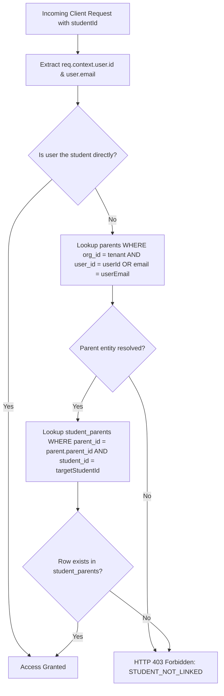

# EduTrack ERP — Parent Experience Integration

# Document 05: Security, Authorization & Financial Integrity Audit

**Document Version:** 1.0.0  
**Phase:** Phase 0 — Complete Repository Audit, System Discovery & Integration Blueprint  
**Date:** October 16, 2026  
**Governing Standard:** Schema Freeze & Prisma-First Domain Architecture ([AGENTS.md](file:///Users/sathish/Documents/GitHub/EduTech/.agents/AGENTS.md))  
**Auditor:** Antigravity AI Pair Programmer

---

## 1. Executive Summary

This audit assesses the **Security Architecture, Multi-Tenant Boundaries, Access Control, and Financial Integrity Protections** governing parent self-service in EduTrack ERP. It examines authorization code paths, token verification, payment concurrency locks, cryptographic webhook handling, and Insecure Direct Object Reference (IDOR) vulnerabilities.

---

## 2. Parent-Child Authorization Lifecycle

### 2.1 Identity Derivation

- Authentication is governed by [auth.middleware.ts](file:///Users/sathish/Documents/GitHub/EduTech/apps/backend/src/auth/auth.middleware.ts), which extracts and verifies the Bearer JWT token from the `Authorization` header.
- The verified session is bound to `req.context.user` containing `id` (UUID), `email`, `org_id`, and assigned `roles` (`['PARENT']`).
- **Parent identity is derived strictly from server-side context**; clients cannot pass an arbitrary `parent_id` in request payloads to impersonate other parents.

### 2.2 Relational Authorization Check

Parent access to a specific student's records is validated by [ParentFinanceService.verifyParentChildAccess](file:///Users/sathish/Documents/GitHub/EduTech/apps/backend/src/modules/fees/services/ParentFinanceService.ts#L89-L136):



---

## 3. Security Findings & Gap Analysis

| Security Evaluation Dimension            | Current Implementation Status | Code Evidence                                          | Vulnerability / Risk Level | Verified Status & Remedy                                                                                                                                                                                                                     |
| :--------------------------------------- | :---------------------------- | :----------------------------------------------------- | :------------------------- | :------------------------------------------------------------------------------------------------------------------------------------------------------------------------------------------------------------------------------------------- |
| **Parent Identity Derivation**           | **Enforced**                  | `auth.middleware.ts`<br>`ParentFinanceService.ts:L153` | None (Secure)              | Identity strictly bound to authenticated JWT token context.                                                                                                                                                                                  |
| **Multi-Child Scoping**                  | **Enforced**                  | `ParentFinanceService.getMyChildrenFees()`             | None (Secure)              | Queries `student_parents` for all children matching resolved parent profile.                                                                                                                                                                 |
| **Tenant Isolation (Org Boundary)**      | **Enforced**                  | `tenant.middleware.ts`<br>`toSafeUuid(orgId)`          | None (Secure)              | All database queries strictly parameterized with `WHERE org_id = safeOrgId`.                                                                                                                                                                 |
| **Direct Student Ledger Access**         | **Enforced**                  | `fees.routes.ts:L1419`                                 | None (Secure)              | Enforces `verifyParentChildAccess` if caller has `PARENT` role.                                                                                                                                                                              |
| **Payment Order Creation Authorization** | **Vulnerable (IDOR Risk)**    | `razorpay.routes.ts:L75-L118`                          | **High Severity**          | `create-order` verifies that `studentId` belongs to `org_id`, but **does NOT verify that the authenticated user is the linked parent of that student**. An authenticated parent could generate payment orders for any student in the school. |
| **Receipt Document Access**              | **Defect (RBAC Lockout)**     | `fees.routes.ts:L1178`                                 | **Medium Severity**        | Guarded by `checkPermission(PERMISSIONS.FEES_VIEW)`. Rejects parents with HTTP 403. Needs parent-child verification instead of administrative permission check.                                                                              |
| **Gateway Secrets Isolation**            | **Enforced**                  | `razorpay.routes.ts:L19-L46`                           | None (Secure)              | `GET /razorpay/config` returns only public `key_id`. Secret keys and webhook secrets remain strictly server-side in `.env`.                                                                                                                  |
| **Server-Side Payment Verification**     | **Enforced**                  | `RazorpayGatewayService.ts:L720`                       | None (Secure)              | Gateway signatures verified with HMAC-SHA256 (`crypto.createHmac`) before triggering financial allocations.                                                                                                                                  |
| **Double Allocation Prevention**         | **Enforced**                  | `PaymentCollectionService.ts:L768`                     | None (Secure)              | Prisma `$transaction` executes row-level lock (`SELECT ... FOR UPDATE`) on `student_charge_dues`.                                                                                                                                            |
| **Webhook Idempotency**                  | **Enforced**                  | `razorpay.routes.ts:L112`                              | None (Secure)              | Deduplicated against `payment_webhook_events(provider_event_id)`. Duplicate webhook deliveries return HTTP 200 without duplicate allocations.                                                                                                |
| **Non-Reduction on Failure**             | **Enforced**                  | `PaymentCollectionService.ts:L728`                     | None (Secure)              | Failed or pending payments log to `payment_transactions` with error codes. Dues are never decremented.                                                                                                                                       |

---

## 4. Financial Concurrency & Transactional Integrity

### 4.1 Row-Level Concurrency Locking

In [PaymentCollectionService.ts](file:///Users/sathish/Documents/GitHub/EduTech/apps/backend/src/modules/fees/services/PaymentCollectionService.ts#L745-L775):

1. **Transaction Row Lock:**
   ```sql
   SELECT payment_transaction_id, status FROM payment_transactions
   WHERE payment_transaction_id = $1::uuid FOR UPDATE;
   ```
   If already marked `success`, exits immediately to prevent duplicate credit.
2. **Due Row Lock:**
   ```sql
   SELECT student_charge_due_id, amount_due, status FROM student_charge_dues
   WHERE student_charge_due_id = $1::uuid FOR UPDATE;
   ```
   Calculates remaining due in real-time. If concurrent payments exceed the remaining balance, the transaction is rejected or converted to unallocated pending state.

### 4.2 Webhook Signature Verification

In [apps/backend/src/routes/razorpay.routes.ts](file:///Users/sathish/Documents/GitHub/EduTech/apps/backend/src/routes/razorpay.routes.ts):

- Webhook payloads are hashed with `crypto.createHmac('sha256', webhookSecret)` against `req.rawBody`.
- Evaluated via `crypto.timingSafeEqual` to eliminate timing attacks.

---

## 5. Security Recommendations for Phase 1 & Phase 4

1. **Patch `create-order` in `razorpay.routes.ts`:**
   - Add `ParentFinanceService.verifyParentChildAccess(tenantOrgId, userId, studentId, userEmail)` inside `create-order` whenever the authenticated user holds the `PARENT` role.
2. **Expose Parent Receipt Route:**
   - Introduce `GET /v1/fees/my/children/:studentId/receipts/:transactionId` that executes `verifyParentChildAccess` before returning [PaymentRepository.getReceiptDetails](file:///Users/sathish/Documents/GitHub/EduTech/apps/backend/src/modules/fees/repositories/PaymentRepository.ts#L850).
