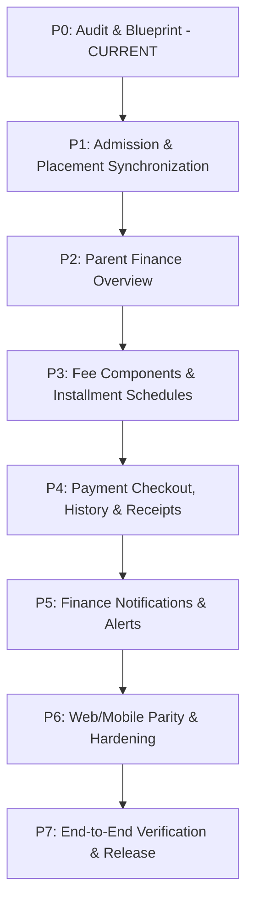

# EduTrack ERP — Parent Experience Integration

# Document 07: Implementation Roadmap & Engineering Specifications (Stages P0–P7)

**Document Version:** 1.0.0  
**Phase:** Phase 0 — Complete Repository Audit, System Discovery & Integration Blueprint  
**Date:** October 16, 2026  
**Governing Standard:** Schema Freeze & Prisma-First Domain Architecture ([AGENTS.md](file:///Users/sathish/Documents/GitHub/EduTech/.agents/AGENTS.md))  
**Auditor:** Antigravity AI Pair Programmer

---

## 1. Executive Implementation Strategy

This roadmap details the sequential engineering execution required to achieve seamless **Parent Experience Integration** across Web and Mobile platforms without violating the Stage-1 database schema freeze.

---

## 2. Detailed Stage-by-Stage Implementation Specifications

### Stage P1: Admission & Enrollment Placement Synchronization

- **Objective:** Synchronize child admission application milestones and display confirmed academic placement (admission number, academic year, grade, section, and roll number) across Web and Mobile.
- **Existing Screens to Reuse:**
  - Web: [MyApplications.tsx](file:///Users/sathish/Documents/GitHub/EduTech/apps/web_app/src/modules/admission/pages/parent/MyApplications.tsx), [ParentDashboard.tsx](file:///Users/sathish/Documents/GitHub/EduTech/apps/web_app/src/modules/dashboard/pages/ParentDashboard.tsx).
  - Mobile: `app/(parent)/index.tsx`, `app/(parent)/applications/index.tsx`, [EnrolledChildFeeCard.tsx](file:///Users/sathish/Documents/GitHub/EduTech/apps/mobile_app/src/components/parent/EnrolledChildFeeCard.tsx).
- **Confirmed Files to Extend:**
  - Backend: [dashboard.routes.ts](file:///Users/sathish/Documents/GitHub/EduTech/apps/backend/src/modules/dashboard/dashboard.routes.ts#L398) (fix `student_parents` query defect), [parent.routes.ts](file:///Users/sathish/Documents/GitHub/EduTech/apps/backend/src/modules/parent-management/routes/parent.routes.ts).
  - Web: [ParentDashboard.tsx](file:///Users/sathish/Documents/GitHub/EduTech/apps/web_app/src/modules/dashboard/pages/ParentDashboard.tsx).
  - Mobile: `app/(parent)/index.tsx`.
- **API Dependencies:**
  - `GET /v1/applications?mine=true`
  - `GET /v1/parents/my/children` (expose dedicated placement DTO).
- **Security Requirements:**
  - Parent identity strictly derived from `req.context.user.id`.
  - Direct student self-access allowed via `students.user_id` or `students.admission_no`.
- **Acceptance Criteria:**
  - Confirmed admission number (`students.admission_no`) renders accurately.
  - Active academic year and enrolled grade render from `student_enrollments`.
  - Unallocated sections display cleanly as `"Section Allocation Pending"`.
  - Roll number displays when assigned, or hidden when null.

---

### Stage P2: Parent Finance Overview

- **Objective:** Deliver multi-child financial KPI cards (Total Assessed, Paid Against Dues, Current Outstanding, Overdue Balance, and Overall Status).
- **Existing Screens to Reuse:**
  - Web: [MyFees.tsx](file:///Users/sathish/Documents/GitHub/EduTech/apps/web_app/src/modules/fees/pages/MyFees.tsx).
  - Mobile: [EnrolledChildFeeCard.tsx](file:///Users/sathish/Documents/GitHub/EduTech/apps/mobile_app/src/components/parent/EnrolledChildFeeCard.tsx).
- **Confirmed Files to Extend:**
  - Backend: [fees.routes.ts](file:///Users/sathish/Documents/GitHub/EduTech/apps/backend/src/modules/fees/fees.routes.ts) (deprecate legacy duplicate `/my` route at line 2094; maintain line 1803).
  - Frontend: [MyFees.tsx](file:///Users/sathish/Documents/GitHub/EduTech/apps/web_app/src/modules/fees/pages/MyFees.tsx).
- **API Dependencies:**
  - `GET /v1/fees/my` (backed by [ParentFinanceService.ts](file:///Users/sathish/Documents/GitHub/EduTech/apps/backend/src/modules/fees/services/ParentFinanceService.ts)).
- **Acceptance Criteria:**
  - Financial calculations match authoritative backend math:
    - $\text{Assessed} = \sum \text{student\_charges}$
    - $\text{Paid} = \sum \text{payment\_allocations}$ (successful only)
    - $\text{Outstanding} = \max(0, \text{Assessed} - \text{Paid})$
  - Multi-child switchers update financial cards instantly without race conditions.

---

### Stage P3: Fee Components, Installment Terms & Upcoming Dues

- **Objective:** Provide full itemized breakdown of assigned fee components, approved scholarships/concessions, and scheduled installment terms.
- **Existing Screens to Reuse:**
  - Web: [MyFees.tsx](file:///Users/sathish/Documents/GitHub/EduTech/apps/web_app/src/modules/fees/pages/MyFees.tsx#L243-L353).
- **Proposed Mobile Screen:**
  - `app/(parent)/fees/[studentId].tsx` (Mobile Fee Breakdown & Installment Schedule screen).
- **Confirmed Files to Extend:**
  - Mobile: [EnrolledChildFeeCard.tsx](file:///Users/sathish/Documents/GitHub/EduTech/apps/mobile_app/src/components/parent/EnrolledChildFeeCard.tsx#L234) (wire `onPress` navigation to `/(parent)/fees/${child.student_id}`).
  - Backend: [ParentFinanceService.ts](file:///Users/sathish/Documents/GitHub/EduTech/apps/backend/src/modules/fees/services/ParentFinanceService.ts) (ensure concessions are itemized in `components` list).
- **Acceptance Criteria:**
  - Displays each component (Tuition, Lab, Sports, Development) with currency amounts.
  - Displays installment term names (Term 1, Term 2, etc.), due dates, amount due, amount paid, and outstanding balance.
  - Overdue terms clearly highlighted with red alert badges.

---

### Stage P4: Payment Checkout, History & Receipts

- **Objective:** Allow parents to pay scheduled installment dues online via Razorpay and inspect/download authoritative ERP receipts.
- **Screens to Extend:**
  - Web: [MyFees.tsx](file:///Users/sathish/Documents/GitHub/EduTech/apps/web_app/src/modules/fees/pages/MyFees.tsx) (add `"Pay Online"` button and Razorpay checkout modal).
  - Mobile: `app/(parent)/fees/[studentId].tsx` (add native checkout button).
- **Backend Files to Extend:**
  - [razorpay.routes.ts](file:///Users/sathish/Documents/GitHub/EduTech/apps/backend/src/routes/razorpay.routes.ts#L75) (add `ParentFinanceService.verifyParentChildAccess` check in `/create-order`).
  - [fees.routes.ts](file:///Users/sathish/Documents/GitHub/EduTech/apps/backend/src/modules/fees/fees.routes.ts#L1178) (expose parent-authorized receipt route).
- **Acceptance Criteria:**
  - Clicking `"Pay Online"` initiates order creation, opens Razorpay modal, verifies signature server-side, and commits allocations in a Prisma transaction.
  - Dues update from `pending` to `paid` or `partially_paid` immediately.
  - Payment failure does not decrement dues.
  - Downloadable/viewable receipt generated with official sequential number (`RCPT-YYYY-XXXXXX`).

---

### Stage P5: Finance Notifications & Alerts

- **Objective:** Deliver timely in-app notifications for payment receipts, upcoming due reminders, and overdue warnings.
- **Screens to Extend:**
  - Web: Add Notification Bell dropdown to [route_registry.tsx](file:///Users/sathish/Documents/GitHub/EduTech/apps/web_app/src/config/route_registry.tsx) parent layout.
  - Mobile: Reuse `app/(parent)/notifications.tsx`.
- **Backend Files to Extend:**
  - [finance-notification.subscriber.ts](file:///Users/sathish/Documents/GitHub/EduTech/apps/backend/src/modules/fees/subscribers/finance-notification.subscriber.ts).
- **Acceptance Criteria:**
  - Payment success automatically dispatches `PAYMENT_RECEIPT_AVAILABLE` notification with link to receipt.
  - Overdue alerts dispatches `PAYMENT_OVERDUE` with direct link to dues schedule.

---

### Stage P6: Web/Mobile Parity & Hardening

- **Objective:** Achieve complete UX and behavioral parity between Web and Mobile.
- **Verification Focus:**
  - Test on various viewport sizes (mobile, tablet, desktop).
  - Verify accessibility labels, ARIA tags, and screen reader announcements.
  - Ensure dark mode consistency across NativeWind and Tailwind web themes.
  - Verify offline query recovery on mobile resume.

---

### Stage P7: End-to-End Verification & Release Readiness

- **Objective:** Comprehensive testing and pre-flight validation.
- **Test Scenarios:**
  - Multi-child switching across 2+ enrolled students and 1+ admission applicant.
  - End-to-end simulated payment flow with receipt generation and ledger reflection.
  - Concurrency test: Rapid double-clicks on payment buttons do not trigger duplicate orders.
  - Negative security test: Tampered `studentId` or foreign child access returns HTTP 403.
- **Exit Criteria:**
  - All test suites passing (`turbo run test`).
  - Zero TypeScript compile errors (`turbo run typecheck`).
  - Documentation updated and verified.
