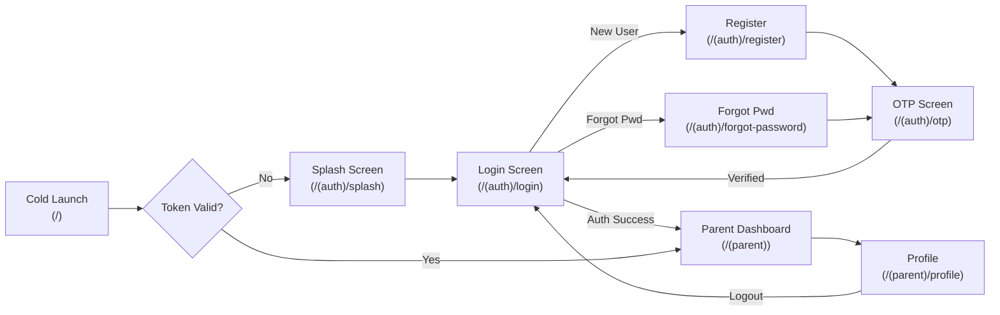
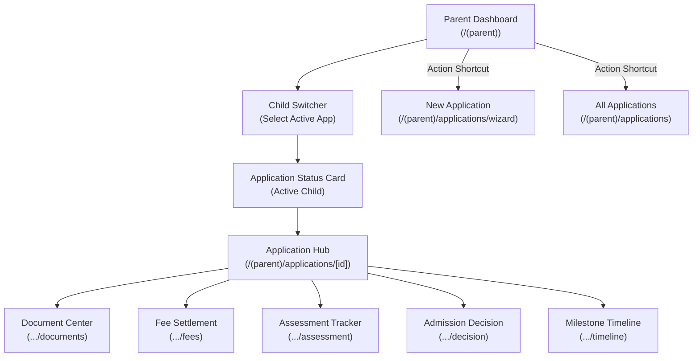
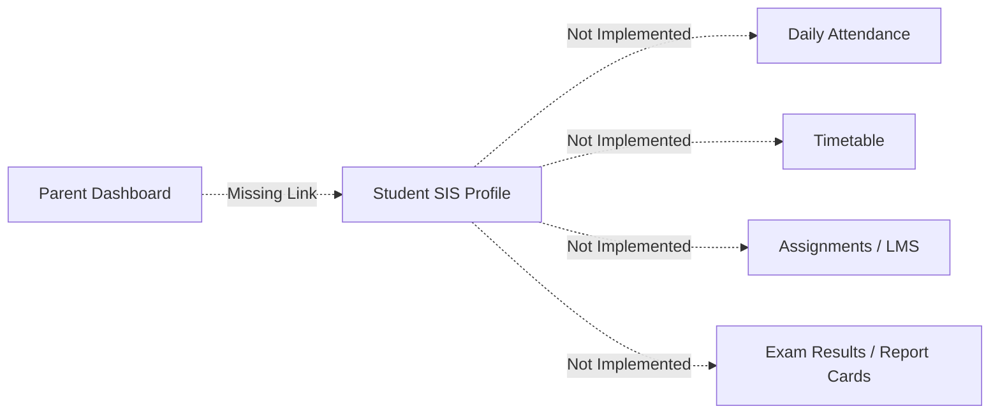
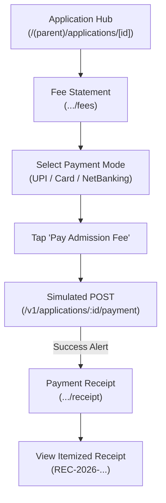
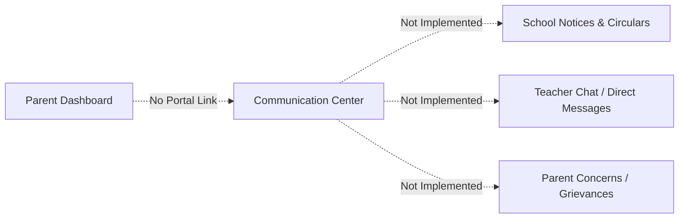
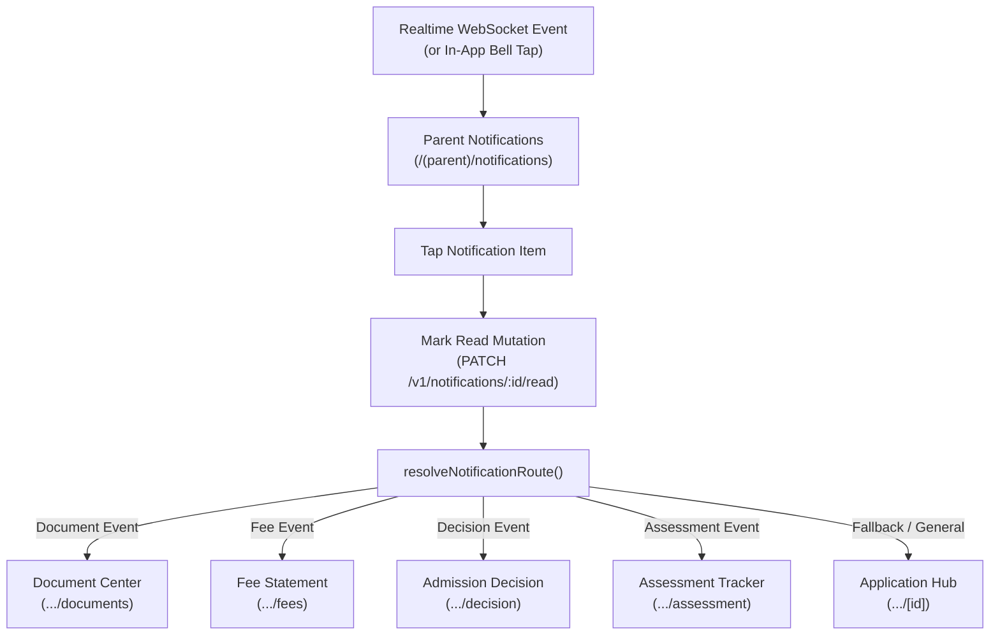
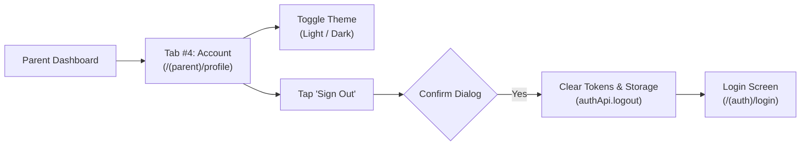

# 04 — Navigation & User Journey Audit: Parent Mobile Application

**Project:** EduTrack ERP — Parent Mobile Application  
**Audit Phase:** Phase 1 — Complete Mobile Application Audit & Baseline Validation  
**Date of Audit:** November 2, 2026  
**Status:** Complete & Validated  
**Inspection Scope:** End-to-End User Journeys, Route State Transitions, and Navigation Dead-Ends

---

## 1. Global Navigation Topology & Layout Architecture

The application's navigation is governed by **Expo Router v3**, which translates the filesystem hierarchy inside `apps/mobile_app/app/` into React Navigation native stacks and bottom tabs.

### Discovered Navigation Trees

```
+-----------------------------------------------------------------------------------+
| Root Stack (_layout.tsx)                                                          |
|                                                                                   |
|  ├── index (Initial Auth/Hydration Gate)                                          |
|                                                                                   |
|  ├── (auth) [Stack]                                                               |
|  │     ├── splash                                                                 |
|  │     ├── login                                                                  |
|  │     ├── register                                                               |
|  │     ├── forgot-password                                                        |
|  │     ├── otp                                                                    |
|  │     └── workspace                                                              |
|                                                                                   |
|  ├── (parent) [Bottom Tabs]                                                       |
|  │     ├── index ("Home" / Parent Dashboard)                                      |
|  │     ├── applications ("Applications" List)                                     |
|  │     ├── notifications ("Notifications" Center)                                 |
|  │     ├── profile ("Account" Settings)                                           |
|  │     └── [Nested Stack for Applications Hub]                                    |
|  │           ├── applications/wizard                                              |
|  │           └── applications/[id] (Hub)                                          |
|  │                 ├── documents                                                  |
|  │                 ├── fees                                                       |
|  │                 ├── receipt                                                    |
|  │                 ├── assessment                                                 |
|  │                 ├── decision                                                   |
|  │                 └── timeline                                                   |
|                                                                                   |
|  ├── (tabs) [Secondary / Mock Admin Tabs]                                         |
|  │     ├── dashboard                                                              |
|  │     ├── profile                                                                |
|  │     └── settings                                                               |
|                                                                                   |
|  ├── (common) [Stack]                                                             |
|  │     ├── notifications                                                          |
|  │     ├── no-internet                                                            |
|  │     ├── maintenance                                                            |
|  │     └── unexpected-error                                                       |
|                                                                                   |
|  └── Module Shells: (admission), (student), (teacher)                             |
+-----------------------------------------------------------------------------------+
```

---

## 2. End-to-End User Journey Audit

---

### Journey 1: Authentication & Onboarding Journey



| Journey Attribute       | Audit Finding & Verification Details                                                  |    Status    |
| :---------------------- | :------------------------------------------------------------------------------------ | :----------: |
| **Starting Route**      | `/` (`apps/mobile_app/app/index.tsx`)                                                 | **Verified** |
| **Intermediate Routes** | `/(auth)/splash` → `/(auth)/login` → `/(auth)/otp`                                    | **Verified** |
| **Final Destination**   | `/(parent)` (`apps/mobile_app/app/(parent)/index.tsx`)                                | **Verified** |
| **Required Parameters** | `{ email, password }` for login; `{ email, otp }` for verification                    | **Verified** |
| **Data Dependencies**   | `POST /v1/auth/login`, `POST /v1/admission/register`, `POST /v1/admission/verify-otp` | **Verified** |
| **Auth Requirements**   | Public until session creation; requires `PARENT` role in JWT                          | **Verified** |
| **Failure Handling**    | Inline error banners for 401/403/422; session auto-cleared on 401                     | **Verified** |
| **Back Navigation**     | Hardware back navigates backwards through stack cleanly                               | **Verified** |
| **Discovered Gaps**     | `/(auth)/forgot-password` does NOT call any API; jumps to OTP without sending code    | **PARTIAL**  |

---

### Journey 2: Parent Admission & Dashboard Journey



| Journey Attribute       | Audit Finding & Verification Details                                             |     Status      |
| :---------------------- | :------------------------------------------------------------------------------- | :-------------: |
| **Starting Route**      | `/(parent)` (`apps/mobile_app/app/(parent)/index.tsx`)                           |  **Verified**   |
| **Intermediate Routes** | `ChildSwitcher` selection → `/(parent)/applications/[id]`                        |  **Verified**   |
| **Final Destination**   | Specific sub-portals (`documents`, `fees`, `assessment`, `decision`, `timeline`) |  **Verified**   |
| **Required Parameters** | `[id]` (string UUID of the admission application)                                |  **Verified**   |
| **Data Dependencies**   | `GET /v1/applications?mine=true`, `GET /v1/applications/:id`                     |  **Verified**   |
| **Auth Requirements**   | Valid `Bearer <token>` with parent ownership of application records              |  **Verified**   |
| **Failure Handling**    | Empty state with "Start Application" CTA; error card with retry button           |  **Verified**   |
| **Back Navigation**     | `router.back()` returns to Dashboard or Applications list properly               |  **Verified**   |
| **Discovered Gaps**     | None for admission applications; however, enrolled SIS students are absent       | **IMPLEMENTED** |

---

### Journey 3: Academics & Enrolled Student Journey (SIS)



| Journey Attribute       | Audit Finding & Verification Details                                                                                                                                                              |       Status        |
| :---------------------- | :------------------------------------------------------------------------------------------------------------------------------------------------------------------------------------------------ | :-----------------: |
| **Starting Route**      | `/(parent)` or `/(tabs)/dashboard`                                                                                                                                                                |     **Gapped**      |
| **Intermediate Routes** | None in parent flow; `/(tabs)/dashboard` links Attendance to `/(student)`                                                                                                                         |     **Broken**      |
| **Final Destination**   | Generic placeholder `/(student)` (`ModuleShell`)                                                                                                                                                  |    **Stub Only**    |
| **Required Parameters** | Enrolled Student ID (not provided or managed)                                                                                                                                                     |     **Missing**     |
| **Data Dependencies**   | Backend has `student_attendances`, `timetables`, `exams`; mobile has zero hooks                                                                                                                   |  **Backend Only**   |
| **Auth Requirements**   | Requires Parent-Student link verification via `student_parents` table                                                                                                                             |     **Unused**      |
| **Failure Handling**    | N/A                                                                                                                                                                                               |       **N/A**       |
| **Back Navigation**     | Trapped in `ModuleShell` placeholder                                                                                                                                                              |    **Dead End**     |
| **Discovered Gaps**     | **Feature NOT IMPLEMENTED in Mobile App**. The mobile app currently has no attendance tracking, timetable viewing, homework/assignment portal, or examination report cards for enrolled children. | **NOT IMPLEMENTED** |

---

### Journey 4: Finance & Payment Journey



| Journey Attribute       | Audit Finding & Verification Details                                                                                                                                                                                                                                                                                                                |         Status          |
| :---------------------- | :-------------------------------------------------------------------------------------------------------------------------------------------------------------------------------------------------------------------------------------------------------------------------------------------------------------------------------------------------- | :---------------------: |
| **Starting Route**      | `/(parent)/applications/[id]`                                                                                                                                                                                                                                                                                                                       |      **Verified**       |
| **Intermediate Routes** | `/(parent)/applications/[id]/fees`                                                                                                                                                                                                                                                                                                                  |      **Verified**       |
| **Final Destination**   | `/(parent)/applications/[id]/receipt`                                                                                                                                                                                                                                                                                                               |      **Verified**       |
| **Required Parameters** | `[id]` (application ID)                                                                                                                                                                                                                                                                                                                             |      **Verified**       |
| **Data Dependencies**   | `GET /v1/applications/:id/fee`, `POST /v1/applications/:id/payment`, `GET /v1/applications/:id/receipt`                                                                                                                                                                                                                                             |      **Verified**       |
| **Auth Requirements**   | Valid Bearer JWT                                                                                                                                                                                                                                                                                                                                    |      **Verified**       |
| **Failure Handling**    | Double-submit block via `isPaying`; payment failure alert dialog                                                                                                                                                                                                                                                                                    |      **Verified**       |
| **Back Navigation**     | Back button returns cleanly to Fee Statement or Hub                                                                                                                                                                                                                                                                                                 |      **Verified**       |
| **Discovered Gaps**     | **Critical Payment Integrity Gap**: No payment gateway SDK (Razorpay / Stripe) is integrated. The app generates a client transaction reference `MOB-${Date.now()}` and posts directly to a simulated ledger settlement endpoint. Furthermore, regular school tuition fee payments (SIS Fee Collections) are completely missing from the mobile app. | **PARTIAL / SIMULATED** |

---

### Journey 5: Communication & Announcements Journey



| Journey Attribute       | Audit Finding & Verification Details                                                                                                                                                                                                                                         |       Status        |
| :---------------------- | :--------------------------------------------------------------------------------------------------------------------------------------------------------------------------------------------------------------------------------------------------------------------------- | :-----------------: |
| **Starting Route**      | `/(parent)` (No link) or `/(tabs)/dashboard` (Notices button)                                                                                                                                                                                                                |     **Gapped**      |
| **Intermediate Routes** | `/(tabs)/dashboard` button routes to `/(common)/notifications`                                                                                                                                                                                                               |    **Misrouted**    |
| **Final Destination**   | `/(common)/notifications` (Static empty state screen)                                                                                                                                                                                                                        |    **Stub Only**    |
| **Required Parameters** | None                                                                                                                                                                                                                                                                         |     **Missing**     |
| **Data Dependencies**   | Backend has communication & notice tables; mobile has only `Announcement` stub                                                                                                                                                                                               |  **Backend Only**   |
| **Auth Requirements**   | N/A                                                                                                                                                                                                                                                                          |       **N/A**       |
| **Failure Handling**    | N/A                                                                                                                                                                                                                                                                          |       **N/A**       |
| **Back Navigation**     | Returns to secondary dashboard                                                                                                                                                                                                                                               |    **Dead End**     |
| **Discovered Gaps**     | **Feature NOT IMPLEMENTED in Mobile App**. There is no announcement feed, circular download, teacher-parent messaging, or grievance/concern ticketing in the mobile app. Only the `Announcement` interface exists as a 1-line stub in `src/features/communication/index.ts`. | **NOT IMPLEMENTED** |

---

### Journey 6: Notifications & Deep-Link Journey



| Journey Attribute       | Audit Finding & Verification Details                                                                                                                                                                                            |    Status    |
| :---------------------- | :------------------------------------------------------------------------------------------------------------------------------------------------------------------------------------------------------------------------------ | :----------: |
| **Starting Route**      | Header notification bell on `/(parent)` or Tab #3                                                                                                                                                                               | **Verified** |
| **Intermediate Routes** | `/(parent)/notifications`                                                                                                                                                                                                       | **Verified** |
| **Final Destination**   | Dynamic target based on event (`documents`, `fees`, `decision`, `assessment`, `hub`)                                                                                                                                            | **Verified** |
| **Required Parameters** | Notification entity payload (`entity_id` / `metadata.application_id`)                                                                                                                                                           | **Verified** |
| **Data Dependencies**   | `GET /v1/notifications`, `PATCH /v1/notifications/:id/read`, `WebSocket`                                                                                                                                                        | **Verified** |
| **Auth Requirements**   | Bearer JWT attached to REST and WebSocket connection                                                                                                                                                                            | **Verified** |
| **Failure Handling**    | If target entity is invalid, stays in notification center; network error retries                                                                                                                                                | **Verified** |
| **Back Navigation**     | Back button from deep-linked destination returns directly to Notification Center                                                                                                                                                | **Verified** |
| **Discovered Gaps**     | Push notifications are not received via APNs/FCM because push tokens are not persisted on backend (`pushNotificationService.isPushSupported()` returns `false`). Realtime delivery works only while app is open via WebSockets. | **PARTIAL**  |

---

### Journey 7: Profile & Preferences Journey



| Journey Attribute       | Audit Finding & Verification Details                                         |    Status    |
| :---------------------- | :--------------------------------------------------------------------------- | :----------: |
| **Starting Route**      | `/(parent)` Tab #4                                                           | **Verified** |
| **Intermediate Routes** | `/(parent)/profile`                                                          | **Verified** |
| **Final Destination**   | `/(auth)/login` (upon sign-out)                                              | **Verified** |
| **Required Parameters** | Current user session in `useAuthStore`                                       | **Verified** |
| **Data Dependencies**   | `SecureStorage.clearSession()`, `useTheme().toggleTheme()`                   | **Verified** |
| **Auth Requirements**   | Authenticated parent session                                                 | **Verified** |
| **Failure Handling**    | Even if `authApi.logout()` fails over network, client session is cleared     | **Verified** |
| **Back Navigation**     | `router.replace(ROUTES.AUTH.LOGIN)` removes parent routes from history stack | **Verified** |
| **Discovered Gaps**     | No profile editing, password change, or notification settings in this screen | **PARTIAL**  |

---

## 3. Discovered Navigation Dead Ends & Anomalies

1. **Secondary Dashboard Loop:**
   - On `app/(tabs)/dashboard.tsx`, clicking on **Assignments**, **Exams**, **Fee Collection**, or **Timetable** calls `router.push(ROUTES.TABS.DASHBOARD as any)`, which reloads the same screen. This is a complete dead loop.
2. **Forgot Password Dead End:**
   - `app/(auth)/forgot-password.tsx` calls `router.push(ROUTES.AUTH.OTP as any)` without sending an OTP or passing the email parameter.
3. **No Internet Dead End:**
   - `app/(common)/no-internet.tsx` button click has an empty handler (`onPress={() => {}}`).
4. **Unexpected Error Wrong Destination:**
   - `app/(common)/unexpected-error.tsx` button calls `router.replace(ROUTES.TABS.DASHBOARD)` which leads parents into the mock staff dashboard.
5. **Orphaned Route Exposure:**
   - `app/index - Copy.tsx` is an exposed deep link that routes to the mock tabs instead of the parent portal.

---

## 4. Complete Feature Implementation Status Matrix

| ERP Functional Domain | Specific Feature                   |  Implementation Status  | Data Source / Audit Evidence                      |
| :-------------------- | :--------------------------------- | :---------------------: | :------------------------------------------------ |
| **Authentication**    | Parent Login                       |     **IMPLEMENTED**     | `POST /v1/auth/login`, Parent role check          |
| **Authentication**    | Parent Registration                |     **IMPLEMENTED**     | `POST /v1/admission/register`, password strength  |
| **Authentication**    | OTP Verification                   |     **IMPLEMENTED**     | `POST /v1/admission/verify-otp`                   |
| **Authentication**    | Forgot Password                    |  **UI ONLY / BROKEN**   | No API call; navigates to blank OTP               |
| **Authentication**    | Biometric Quick Login              |   **NOT IMPLEMENTED**   | Switch in settings is local state only            |
| **Multi-Tenancy**     | Workspace Switcher                 |   **UI ONLY (MOCK)**    | Hardcoded array in `workspace.tsx`                |
| **Parent Portal**     | Admission Dashboard                |     **IMPLEMENTED**     | `GET /v1/applications?mine=true`                  |
| **Parent Portal**     | Multi-Child Switcher               |     **IMPLEMENTED**     | Switches active application in state              |
| **Admission**         | 8-Step Application Wizard          |     **IMPLEMENTED**     | Zod schemas, AsyncStorage draft, multipart upload |
| **Admission**         | Document Center                    |     **IMPLEMENTED**     | `GET/POST /v1/applications/:id/documents`         |
| **Admission**         | Signed URL Document View           |     **IMPLEMENTED**     | `GET /v1/applications/documents/:id/signed-url`   |
| **Admission**         | Assessment Tracker                 |     **IMPLEMENTED**     | `GET /v1/applications/:id/assessment`             |
| **Admission**         | Decision & Offer Letter            |     **IMPLEMENTED**     | `GET /v1/applications/:id/decision`               |
| **Admission**         | Milestone Timeline                 |     **IMPLEMENTED**     | `GET /v1/applications/:id/timeline`               |
| **Finance**           | Application Fee Settlement         | **PARTIAL (SIMULATED)** | `POST /v1/applications/:id/payment` (Dummy ID)    |
| **Finance**           | Payment Gateway (Razorpay/Stripe)  |   **NOT IMPLEMENTED**   | No gateway SDK integrated in mobile app           |
| **Finance**           | Enrolled Student School Fees       |   **NOT IMPLEMENTED**   | Only 1-line stub `FinanceFeeRecord`               |
| **Academics**         | Enrolled Student Attendance        |   **NOT IMPLEMENTED**   | Only 1-line stub `Student` & `(student)` shell    |
| **Academics**         | Class Timetable                    |   **NOT IMPLEMENTED**   | Loops to dashboard in mock tabs                   |
| **Academics**         | Homework & Assignments             |   **NOT IMPLEMENTED**   | Loops to dashboard in mock tabs                   |
| **Academics**         | Examination Results / Report Cards |   **NOT IMPLEMENTED**   | Loops to dashboard in mock tabs                   |
| **Communication**     | School Announcements / Notices     |   **NOT IMPLEMENTED**   | Only 1-line stub `Announcement`                   |
| **Communication**     | Parent-Teacher Chat                |   **NOT IMPLEMENTED**   | No chat socket or UI                              |
| **Communication**     | Parent Concerns / Tickets          |   **NOT IMPLEMENTED**   | Only 1-line stub `ConcernTicket`                  |
| **Notifications**     | In-App Notification Center         |     **IMPLEMENTED**     | `GET /v1/notifications`, filter, mark read        |
| **Notifications**     | Real-time WebSocket Alerts         |     **IMPLEMENTED**     | WebSocket connection with auto-reconnect          |
| **Notifications**     | Push Notifications (APNs/FCM)      |   **BACKEND MISSING**   | Mobile service returns `UNSUPPORTED_IN_BACKEND`   |
| **Profile**           | Account Info & Theme Switcher      |     **IMPLEMENTED**     | Local user store, theme toggle                    |
| **Profile**           | Edit Profile / Change Password     |   **NOT IMPLEMENTED**   | Read-only profile display                         |
