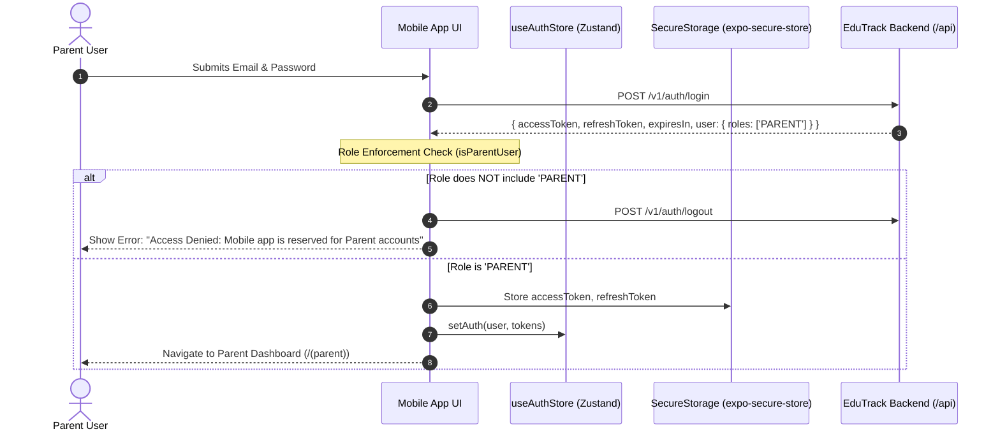

# 06 — Authentication & Security Audit: Parent Mobile Application

**Project:** EduTrack ERP — Parent Mobile Application  
**Audit Phase:** Phase 1 — Complete Mobile Application Audit & Baseline Validation  
**Date of Audit:** November 2, 2026  
**Status:** Complete & Validated  
**Inspection Scope:** Authentication Lifecycles, Role Validation, Multi-Child Access Control, Token Storage, and Threat Surface

---

## 1. Authentication Lifecycle & Session Management

Authentication in the Parent Mobile Application is built on JSON Web Tokens (JWT) issued by the backend at `POST /v1/auth/login`.



### Session Persistence & Hydration Flow

1. **Cold Launch (`AuthProvider.tsx`):**
   - On cold launch, `AuthProvider` reads `SecureStorage.getAccessToken()`.
   - If an `accessToken` exists, it sets `isAuthenticated: true` in `useAuthStore` and clears `isHydrating: false`.
   - If no token is found, it clears state and sets `isHydrating: false`, allowing `app/index.tsx` to redirect to `/(auth)/login`.
2. **Session Termination (`ParentProfileScreen.tsx` / `authApi.logout`):**
   - Calls backend `POST /v1/auth/logout`.
   - Executes `SecureStorage.clearSession()`, wiping `edutrack_access_token`, `edutrack_refresh_token`, and `edutrack_workspace_id`.
   - Executes `useAuthStore.getState().logout()`, resetting in-memory user and token references.
   - Replaces route to `ROUTES.AUTH.LOGIN`.

---

## 2. Parent Role & Authorization Enforcement

### Parent Role Guard (`apps/mobile_app/src/features/auth/hooks/useLogin.ts`)

The application implements strict client-side role validation upon login:

```typescript
export function isParentUser(user: LoginResponse['user']): boolean {
  if (!user) return false;
  const roles = user.roles || (user.role ? [String(user.role)] : []);
  return roles.some((r) => r.toUpperCase() === 'PARENT');
}
```

If a staff member (e.g. `TEACHER`, `FINANCE_OFFICER`, `SUPER_ADMIN`) attempts to log in via the mobile application, the login hook rejects the session:

- Wipes the newly obtained tokens via `authApi.logout()`.
- Throws an `ApiError` with code `PARENT_ROLE_REQUIRED`.
- Prevents staff administration screens from loading in the parent application.

### Route Guard Architecture (`src/navigation/protected-route.tsx`)

Parent tabs (`app/(parent)/_layout.tsx`) are wrapped inside `<ProtectedRoute>`:

- If `isAuthenticated` is `false` and `isHydrating` is `false`, it redirects immediately to `ROUTES.AUTH.LOGIN`.
- Renders an inline loader while hydrating to prevent flickering unauthenticated screens.

---

## 3. Multi-Child Data Access Control & Tenant Isolation

### Multi-Child Data Isolation Audit

A critical area of audit is verifying how the application partitions records for parents with multiple children.

1. **Active Application Context:**
   - In `app/(parent)/index.tsx`, the parent's admission applications are queried via `GET /v1/applications?mine=true`.
   - The `activeAppId` state tracks the currently selected child application.
   - When the parent selects a different child in `ChildSwitcher.tsx`:
     ```typescript
     <ChildSwitcher
       applications={applications}
       selectedId={activeAppId}
       onSelect={(id) => setSelectedAppId(id)}
     />
     ```
   - All detail queries (`applicationsApi.getById`, `feesApi.getFeeSummary`, `documentsApi.list`) depend strictly on the specific `applicationId` route parameter (`/(parent)/applications/[id]`).
   - Query keys in TanStack Query are scoped per ID: `QUERY_KEYS.applications.detail(appId)`, `QUERY_KEYS.fees.summary(appId)`.

2. **Cross-Child Data Leakage Assessment:**
   - **Static Verification:** Switching children updates the local query parameter and triggers isolated queries. There is no observed state bleed between children in React Query because all cache keys include the distinct `applicationId`.
   - **Backend RLS Dependency:** The mobile app relies on the backend to enforce that the requesting parent's `user_id` actually owns the `application_id`. If the backend failed to validate ownership, a malicious user could theoretically alter the route ID. The backend schema enforces Row Level Security (RLS) on `parents` and `admission_applications`.

3. **Multi-Tenant Workspace Context:**
   - The Axios request interceptor attaches `X-Workspace-Id` from `SecureStorage.getWorkspaceId()`.
   - **Audit Finding:** While `MOBILE_ARCHITECTURE.md` states that `X-Tenant-ID`, `School-ID`, and `Academic-Year-ID` are attached to every request, the actual implementation in `src/api/client.ts` lines 42–56 attaches **ONLY** `X-Workspace-Id` and `Authorization: Bearer <token>`. The remaining tenant headers are currently omitted.

---

## 4. Deep-Link Security & Parameter Sanitization

### Deep Link Whitelist Engine (`src/features/notifications/utils/notification-deep-link.ts`)

The application implements an explicit allowlist pattern to protect against arbitrary deep-link redirection and parameter tampering:

```typescript
export const ALLOWED_PARENT_ROUTES = {
  APPLICATION_HUB: (id: string) => `/(parent)/applications/${id}`,
  DOCUMENTS: (id: string) => `/(parent)/applications/${id}/documents`,
  FEES: (id: string) => `/(parent)/applications/${id}/fees`,
  RECEIPT: (id: string) => `/(parent)/applications/${id}/receipt`,
  ASSESSMENT: (id: string) => `/(parent)/applications/${id}/assessment`,
  DECISION: (id: string) => `/(parent)/applications/${id}/decision`,
  TIMELINE: (id: string) => `/(parent)/applications/${id}/timeline`,
  NOTIFICATIONS: '/(parent)/notifications',
} as const;
```

### Application ID Sanitization

Before any deep link is resolved, `extractApplicationId()` validates the input:

- Verifies that `notification` is a valid object.
- Extracts `entity_id` or `metadata.application_id`.
- Checks for string type and trims whitespace.
- Prevents path traversal characters (`../`) and non-string injections.
- If sanitization fails, returns `null` and safely defaults the user to `/(parent)/notifications`.

---

## 5. Security Vulnerability & Threat Surface Analysis

---

### Finding SEC-01: Plaintext Token Exposure in WebSocket URL Query String

- **Classification:** **CRITICAL SECURITY RISK**
- **File Reference:** `apps/mobile_app/src/features/notifications/services/notification-socket.ts` line 91
- **Code Snippet:**
  ```typescript
  const wsUrl = `${ENV.WS_URL}?token=${encodeURIComponent(token)}`;
  const socket = new WebSocket(wsUrl);
  ```
- **Vulnerability Description:** The user's JWT access token is passed in cleartext as a URL query parameter during WebSocket connection establishment.
- **Threat Impact:**
  - URLs are logged in full by intermediate reverse proxies (e.g. Nginx, Cloudflare), API gateway access logs, CDN logs, and browser histories.
  - Anyone with access to server or infrastructure logs can obtain active parent session tokens.
- **Recommended Remediation (Phase 2):** Use an initial WebSocket authentication message payload (`{ type: 'AUTH', token }`) over the established WSS connection, or utilize standard HTTP headers during the upgrade handshake where supported.

---

### Finding SEC-02: Missing Refresh Token Rotation & Session Recovery

- **Classification:** **HIGH VULNERABILITY / OPERATIONAL RISK**
- **File Reference:** `apps/mobile_app/src/api/client.ts` lines 106–120
- **Code Snippet:**
  ```typescript
  if (status === 401) {
    if (!isAuthRoute) {
      await SecureStorage.clearSession();
      useAuthStore.getState().logout();
    }
    return Promise.reject(new ApiError(401, 'Session expired. Please sign in again.'));
  }
  ```
- **Vulnerability Description:** The client receives and stores a `refreshToken` from the backend (`SecureStorage.setRefreshToken`), but the Axios client **never uses it**. On any 401 error, the client forcefully clears the session and logs the user out.
- **Threat Impact:**
  - If access tokens have short lifespans (e.g. 15 minutes) as required by enterprise security standards, parents are frequently and unexpectedly kicked out of the app.
  - No seamless background token rotation is performed.
- **Recommended Remediation (Phase 2):** Implement an Axios response interceptor queue that traps 401s, executes `POST /v1/auth/refresh` using the stored refresh token, updates secure storage, and replays failed requests transparently.

---

### Finding SEC-03: Web LocalStorage Fallback Exposes Tokens to XSS

- **Classification:** **MEDIUM SECURITY RISK**
- **File Reference:** `apps/mobile_app/src/storage/secure-store.ts` lines 13–16, 27–30
- **Code Snippet:**
  ```typescript
  if (Platform.OS === 'web') {
    if (typeof window !== 'undefined' && window.localStorage) {
      window.localStorage.setItem(key, value);
    }
  }
  ```
- **Vulnerability Description:** When running in web preview or mobile web environments (`Platform.OS === 'web'`), `SecureStorage` falls back to unencrypted `window.localStorage`.
- **Threat Impact:** Any Cross-Site Scripting (XSS) vulnerability or third-party web script can read JWT tokens directly from `localStorage`.
- **Recommended Remediation:** Restrict web deployments to HttpOnly, Secure, SameSite cookies for token persistence rather than client-accessible storage.

---

### Finding SEC-04: Forgot Password Flow Has No API Protection

- **Classification:** **HIGH FUNCTIONAL DEFECT**
- **File Reference:** `apps/mobile_app/app/(auth)/forgot-password.tsx` lines 34–35
- **Vulnerability Description:** The screen allows entering an email address and clicking "Send OTP", but no API is called; it pushes to the OTP verification screen without generating or dispatching a one-time code.
- **Threat Impact:** Parents unable to remember their credentials cannot recover their accounts via the mobile app.

---

### Finding SEC-05: Incomplete Tenant Headers Attached to Network Requests

- **Classification:** **MEDIUM ARCHITECTURAL DEFECT**
- **File Reference:** `apps/mobile_app/src/api/client.ts` lines 42–63
- **Vulnerability Description:** Multi-tenant ERP rules specify that all requests must include `X-Tenant-ID`, `Workspace-ID`, `School-ID`, and `Academic-Year-ID`. The mobile client attaches only `X-Workspace-Id` and `Authorization`.
- **Threat Impact:** Backend controllers that rely on `School-ID` or `Academic-Year-ID` in headers may fall back to default contexts or fail when processing cross-branch parent queries.
