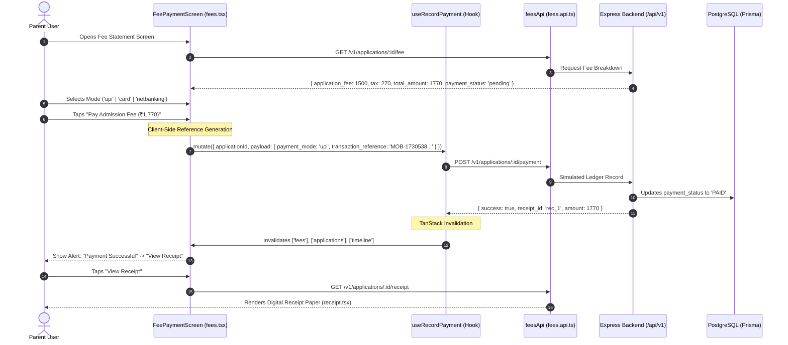
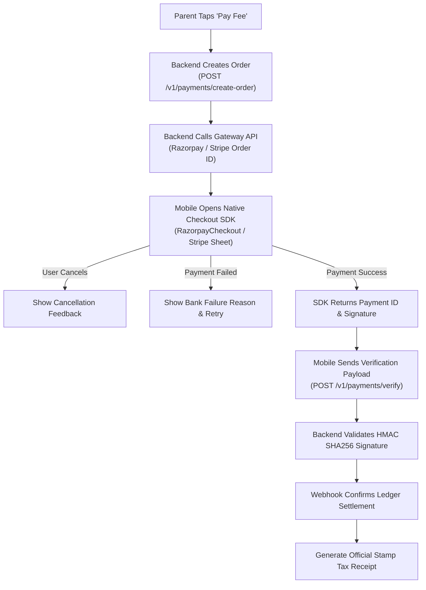

# 07 — Finance & Payment Workflow Audit: Parent Mobile Application

**Project:** EduTrack ERP — Parent Mobile Application  
**Audit Phase:** Phase 1 — Complete Mobile Application Audit & Baseline Validation  
**Date of Audit:** November 2, 2026  
**Status:** Complete & Validated  
**Inspection Scope:** Admission Application Fee Processing, Simulated Ledger Engine, Receipt Generation, and General ERP School Fees

---

## 1. Executive Summary: Current Payment Implementation Status

A rigorous inspection of the mobile application source code reveals a critical architectural finding:

> [!CRITICAL]
> **NO PRODUCTION PAYMENT GATEWAY SDK (Razorpay, Stripe, CCAvenue, Cashfree) IS INTEGRATED IN THE MOBILE APPLICATION.**
> The existing mobile finance implementation is limited strictly to **Admission Application Fee Settlement** and operates via a **simulated ledger recording endpoint** (`POST /v1/applications/:id/payment`) with client-generated transaction identifiers.
>
> Furthermore, **General ERP School Fees** (e.g. tuition fees, term fees, bus fees, uniforms, overdue balances, and student ledger statements) are **COMPLETELY UNIMPLEMENTED** in the mobile app.

---

## 2. Existing Payment Architecture & Code Trace

The current payment flow resides in `apps/mobile_app/src/features/admission/` and `apps/mobile_app/app/(parent)/applications/[id]/fees.tsx`.



---

## 3. Detailed Inspection of Payment Components & Services

### 1. Fee Statement Screen (`apps/mobile_app/app/(parent)/applications/[id]/fees.tsx`)

- **Calling Hook:** `useApplicationFee(appId)` -> `GET /v1/applications/:id/fee`.
- **Payment Mutation:** `useRecordPayment()` -> `POST /v1/applications/:id/payment`.
- **Payment Mode Selection:** State-driven segmented selector (`'upi' | 'card' | 'netbanking'`).
- **Submission Trigger (Lines 42–74):**
  ```typescript
  const handlePayNow = () => {
    if (isPaying) return; // Double-submit guard

    payFee(
      {
        applicationId: appId,
        payload: {
          payment_mode: selectedMode,
          transaction_reference: `MOB-${Date.now()}`, // Simulated client reference
          remarks: 'Admission application processing fee settled via mobile self-service',
        },
      },
      {
        onSuccess: () => {
          Alert.alert(
            'Payment Successful',
            'Your admission fee payment has been recorded and settled.',
            [
              {
                text: 'View Receipt',
                onPress: () => router.push(`/(parent)/applications/${appId}/receipt` as any),
              },
              { text: 'OK', style: 'cancel' },
            ],
          );
          refetch();
        },
        onError: (err) => {
          Alert.alert('Payment Failed', err.message || 'Unable to complete fee transaction.');
        },
      },
    );
  };
  ```

### 2. Fee API Service (`apps/mobile_app/src/api/fees.api.ts`)

- Explicitly documented in source code comments as:
  ```typescript
  /**
   * Record Simulated Ledger Fee Payment: POST /v1/applications/:id/payment
   */
  async recordPayment(applicationId: string, payload: RecordPaymentRequest = {}): Promise<any> {
    const res = await apiClient.post<any>(ENDPOINTS.FEES.PAYMENT(applicationId), payload);
    return res?.data || res;
  }
  ```

### 3. Payment Receipt Screen (`apps/mobile_app/app/(parent)/applications/[id]/receipt.tsx`)

- **Query Hook:** `useApplicationReceipt(appId)` -> `GET /v1/applications/:id/receipt`.
- **Receipt Presentation:** Itemized paper card showing `receipt_number`, student name, amount (₹), payment date, payment mode, and transaction reference.
- **Missing Capabilities:** No native PDF generation (`expo-print`) or native sharing dialog (`expo-sharing`).

---

## 4. UI-Level Financial Risk Assessment

| Risk Vector                                 | Existing Defense in Code                                                               | Vulnerability / Residual Risk                                                                                                                                         |   Severity   |
| :------------------------------------------ | :------------------------------------------------------------------------------------- | :-------------------------------------------------------------------------------------------------------------------------------------------------------------------- | :----------: |
| **Double Tap / Duplicate Submission**       | `if (isPaying) return;` guard in `handlePayNow`; `disabled={isPaying}` on button       | Effective against rapid UI taps during the active request; however, lacks server-enforced idempotency key in header.                                                  |     Low      |
| **Stale Fee Presentation**                  | TanStack Query refetches on pull-to-refresh; invalidation triggered on payment success | If fee structure is modified by school admin while parent is on the screen, no real-time push update occurs until manual refresh.                                     |    Medium    |
| **Simulated Payment Bypass**                | None                                                                                   | **Critical**: Anyone with an authenticated parent token can post arbitrary `transaction_reference` strings to mark admission fees as paid without transferring funds. | **CRITICAL** |
| **Missing Failure / Cancellation Feedback** | Error alert triggers on network or HTTP 4xx/5xx rejection                              | Does not provide gateway-specific error reasons (e.g. "Insufficient Funds", "Bank Server Down").                                                                      |    Medium    |
| **Receipt Navigation Desync**               | Success alert dialog offers direct link to `.../receipt`                               | If receipt generation on backend is asynchronous, opening the receipt immediately may hit a transient 404.                                                            |     Low      |

---

## 5. Scope Gap: Enrolled Student General ERP Fees

In enterprise school ERPs, parents require a comprehensive finance center for enrolled students:

- Tuition Fees & Term Invoices
- Bus / Transportation Fees
- Examination & Laboratory Fees
- Extracurricular & Sports Fees
- Uniform & Books Store Charges
- Historical Ledger Statements & Annual Tax Certificates (80G / 10(23C))
- Partial Installment Plans & Concessions

### Audit Finding

Within `apps/mobile_app/src/features/finance/index.ts`, only a **1-line interface stub** exists:

```typescript
export interface FinanceFeeRecord {
  id: string;
  amount: number;
  status: string;
}
```

There are **zero UI screens, zero hooks, zero query keys, and zero API integrations** for general student tuition fees in the mobile app.

---

## 6. Phase 2 Payment Gateway Integration Roadmap

To elevate the application from simulated transactions to production-ready enterprise payments:



### Required Native Modules for Phase 2

1. `react-native-razorpay` or `@stripe/stripe-react-native` (native SDK).
2. `expo-print` + `expo-sharing` for native PDF receipt download and WhatsApp sharing.
3. Server-side payment order generation and webhook signature verification in `apps/backend/src/modules/fees/`.
