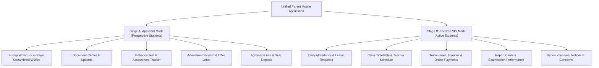

# 12 — Phase 2 Redesign Recommendations & Target Architecture

**Project:** EduTrack ERP — Parent Mobile Application  
**Audit Phase:** Phase 1 — Complete Mobile Application Audit & Baseline Validation  
**Date of Audit:** November 2, 2026  
**Status:** Complete & Validated  
**Purpose:** Actionable Strategic & Technical Roadmap for Subsequent Redesign Phases

---

## 1. Strategic Vision: The Unified Parent ERP Experience

The central finding of Phase 1 is that the existing mobile application is an **Admission Self-Service Portal**, while the broader school ERP capabilities (attendance, timetables, grades, general school fees, teacher communications) reside only in backend tables and web portals.

In Phase 2, the mobile application should evolve from a single-purpose admission tool into a **Comprehensive Parent Companion** supporting the full student lifecycle:



---

## 2. Target Design System Requirements

### A. Semantic Color Palette & WCAG AA Contrast

- Eliminate all hardcoded Tailwind hex codes (e.g. `bg-[#312e81]`, `text-indigo-950`).
- Enforce semantic tokens via `useTheme()`:
  - `colors.background`: `#f8fafc` (Light) / `#090d16` (Dark)
  - `colors.surface`: `#ffffff` (Light) / `#131b2e` (Dark)
  - `colors.primary`: `#4f46e5` (Light) / `#6366f1` (Dark)
  - `colors.textPrimary`: `#0f172a` (Light) / `#f8fafc` (Dark)
  - `colors.textSecondary`: `#475569` (Light) / `#94a3b8` (Dark)
- Enforce minimum 4.5:1 contrast for all text against backgrounds in both modes.

### B. Typography & Font Hierarchy

- Standardize on `Inter` / System Font with defined text variants:
  - `HeaderLarge`: 24px, Bold, tracking tight
  - `HeaderMedium`: 18px, Bold
  - `BodyRegular`: 14px, Regular, line-height 20px
  - `CaptionMuted`: 12px, Medium, line-height 16px
- Enforce `maxFontSizeMultiplier={1.3}` on all text atoms to prevent layout breakage under OS accessibility font scaling.

### C. Touch Targets & Ergonomics

- All interactive controls (buttons, icon taps, dropdowns, card links) must meet a minimum bounding box of **48 × 48 dp**.
- Dynamic bottom padding reading `useSafeAreaInsets().bottom` on all bottom tabs and action sheets.

---

## 3. Screen Redesign Categorization & Action Plan

---

### Category A: Screens Requiring Complete Redesign & Architecture Overhaul

1. **Secondary Dashboard (`app/(tabs)/dashboard.tsx`):**
   - **Current State:** Hardcoded admin statistics ("1,248 Students, 98 Teachers") with dead loop navigation.
   - **Phase 2 Action:** **Deprecate completely**. Replace with a new **Parent SIS Student Hub** connecting to backend `parentRouter.get('/:id/students')`.
2. **Fee Payment Screen (`app/(parent)/applications/[id]/fees.tsx`):**
   - **Current State:** Simulated client-generated transaction reference without payment gateway.
   - **Phase 2 Action:** **Full Overhaul**. Integrate official `react-native-razorpay` / `@stripe/stripe-react-native` SDK with backend order creation and webhook verification.
3. **Forgot Password Screen (`app/(auth)/forgot-password.tsx`):**
   - **Current State:** Unconnected dummy button navigating to blank OTP.
   - **Phase 2 Action:** Complete redesign and backend wiring to `POST /v1/auth/forgot-password`.
4. **Admission Wizard (`app/(parent)/applications/wizard.tsx`):**
   - **Current State:** 8 exhaustive sequential steps causing user drop-off; overflowing progress bar.
   - **Phase 2 Action:** Streamline into **4 intuitive stages**:
     - _Stage 1: Child Profile & Grade Applied_
     - _Stage 2: Parent / Guardian Information_
     - _Stage 3: Verification Documents & Photo_
     - _Stage 4: Review, Terms & Seat Fee_

---

### Category B: Screens Requiring Targeted Improvements

1. **Parent Home Dashboard (`app/(parent)/index.tsx`):**
   - **Phase 2 Action:** Add a top Segmented Control: `[ Active Enrolled Children | Admission Applications ]`. For enrolled students, show Today's Attendance card, Pending Fees due card, and Today's Timetable preview.
2. **Applications List (`app/(parent)/applications.tsx`):**
   - **Phase 2 Action:** Refactor from `ScrollView` to virtualized `FlatList`. Add segmented filter pills (`All`, `Under Review`, `Approved`, `Draft`).
3. **Parent Notification Center (`app/(parent)/notifications.tsx`):**
   - **Phase 2 Action:** Add category color coding (Yellow for Fees, Purple for Exams, Blue for Admissions) and swipe-to-dismiss gesture.
4. **Document Center (`app/(parent)/applications/[id]/documents.tsx`):**
   - **Phase 2 Action:** Add camera capture button (`expo-image-picker`) and inline document thumbnail previews.
5. **Fee Receipt Screen (`app/(parent)/applications/[id]/receipt.tsx`):**
   - **Phase 2 Action:** Add native PDF export (`expo-print`) and sharing via WhatsApp / Email (`expo-sharing`).
6. **Parent Account Profile (`app/(parent)/profile.tsx`):**
   - **Phase 2 Action:** Add "Edit Contact Info" modal, password reset shortcut, and notification preferences toggle.
7. **Login Screen (`app/(auth)/login.tsx`):**
   - **Phase 2 Action:** Add Biometric Quick-Login button (FaceID / Fingerprint) via `expo-local-authentication`.

---

### Category C: Screens Recommended for Deprecation / Removal

1. `app/index - Copy.tsx` & `app/_layout - Copy.tsx` (Dead orphaned duplicate files).
2. `app/(auth)/workspace.tsx` (100% hardcoded mock data).
3. `app/(tabs)/profile.tsx` (Mock admin profile).
4. `app/(common)/notifications.tsx` (Empty stub duplicating real parent notification center).
5. `app/(admission)/index.tsx` & `app/(teacher)/index.tsx` (Unused generic shells).

---

## 4. Technical Architecture Roadmap for Phase 2

```
========================================================================================
PHASE 2 TECHNICAL ENHANCEMENTS
========================================================================================
1. API Client Refactor (src/api/client.ts):
   ├── Add Axios 401 retry interceptor with silent JWT refresh via `POST /v1/auth/refresh`
   └── Attach complete tenant headers (`X-Tenant-ID`, `School-ID`, `Academic-Year-ID`)

2. Real-Time Security Remediation:
   └── Move WebSocket token from URL query string to initial TLS payload handshake

3. Payment Gateway Native Integration:
   ├── Install & configure `react-native-razorpay` (or Stripe)
   ├── Create `POST /v1/payments/create-order` client integration
   └── Add Webhook verification feedback loop

4. Enrolled Student SIS Expansion:
   ├── Create `src/features/student/` queries consuming `parentRouter.get('/:id/students')`
   ├── Build Attendance Calendar component (Present/Absent/Late)
   ├── Build Weekly Timetable grid component
   └── Build Report Card & Marks viewer

5. Performance Polish:
   ├── Convert all heavy ScrollViews to FlatLists
   └── Standardize on `expo-image` with disk caching
========================================================================================
```

---

## 5. Phased Rollout Schedule

|    Phase    | Milestone Name                            | Key Deliverables                                                                                                                  | Risk Level |
| :---------: | :---------------------------------------- | :-------------------------------------------------------------------------------------------------------------------------------- | :--------: |
| **Phase 2** | **Core UX Redesign & Security Hardening** | Security fixes (Token refresh, WS query param), 4-stage wizard redesign, Payment gateway integration, Theme token standardization |    High    |
| **Phase 3** | **Enrolled Student SIS Expansion**        | Daily attendance tracking, Class timetable, Report cards, General school tuition fee payments                                     |   Medium   |
| **Phase 4** | **Communication & Production Release**    | School announcements feed, push notification persistence (APNs/FCM), offline queue sync, automated E2E testing                    |   Medium   |
