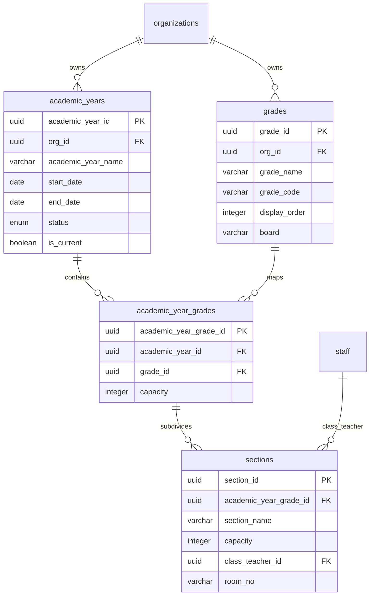

# EduTrack ERP — Stage-2 Phase 1: Frozen Database Baseline

**Document ID:** `docs/stage-2/phase-1/02_frozen_database_baseline.md`  
**Phase:** Stage-2 Phase 1: Foundation & Database Contract Verification  
**Author:** Senior PostgreSQL Database Architect & Lead Data Governance Auditor  
**Date:** November 2026  
**Status:** COMPLETE / EVIDENCE-BASED

---

## 1. Executive Summary

This document establishes the comprehensive, verified baseline of the frozen Stage-1 PostgreSQL database. The Stage-1 database structure is frozen and governed by strict zero-DDL rules. All database inventory figures, relationships, constraints, and known bootstrap defects documented herein have been forensically verified from the source SQL files in `apps/database/stage_1/schema/`.

---

## 2. Frozen Stage-1 SQL Suite Inventory

The physical database schema is defined across 11 sequentially numbered SQL scripts located at `apps/database/stage_1/schema/`:

```text
apps/database/stage_1/schema/
├── 01_extensions.sql                      # PostgreSQL extensions (uuid-ossp, pgcrypto, pgvector)
├── 02_enums.sql                           # PostgreSQL custom domain enum types
├── 03_functions.sql                       # Stored procedures & trigger functions
├── 04_tables.sql                          # Primary table definitions (30 tables)
├── 05_circular_fks.sql                    # Circular foreign key constraints added post-creation
├── 06_indexes.sql                         # B-tree and specialized indexes (68 indexes)
├── 07_triggers.sql                        # Automatic update triggers (25 triggers)
├── 08_rls.sql                             # Row-Level Security policies
├── 09_views.sql                           # Database views (v_active_admissions)
├── 10_admission_enquiry_alterations.sql   # CRM lead inquiry tables & modifications (2 tables)
└── 11_document_chunks_vector.sql          # AI vector search chunk table (1 table)
```

### 2.1 Object Count Summary

| Object Type                     | Verified Count | Source Script Reference                                                     |
| ------------------------------- | -------------- | --------------------------------------------------------------------------- |
| **PostgreSQL Extensions**       | 3              | `01_extensions.sql` (`uuid-ossp`, `pgcrypto`, `vector`)                     |
| **Custom Enum Types**           | 37             | `02_enums.sql` (36 enums) + `10_admission_enquiry_alterations.sql` (1 enum) |
| **Physical SQL Tables**         | 33             | `04_tables.sql` (30) + `10_alterations.sql` (2) + `11_vector.sql` (1)       |
| **Foreign Key Constraints**     | 74             | `04_tables.sql`, `05_circular_fks.sql`, `10_alterations.sql`                |
| **Unique Constraints**          | 35             | `04_tables.sql`, `10_alterations.sql`                                       |
| **Performance Indexes**         | 68             | `06_indexes.sql`, `10_alterations.sql`, `11_vector.sql`                     |
| **Trigger Functions**           | 1              | `03_functions.sql` (`update_updated_at_column()`)                           |
| **Active Triggers**             | 25             | `07_triggers.sql` (BEFORE UPDATE triggers on `updated_at`)                  |
| **Views**                       | 1              | `09_views.sql` (`v_active_admissions`)                                      |
| **Row-Level Security Policies** | 28             | `08_rls.sql`                                                                |

---

## 3. Physical Table Catalog (33 Tables)

The 33 physical tables defined in the Stage-1 SQL suite are organized across five functional clusters:

### 3.1 Organization & System Foundations (4 Tables)

1. `organizations` — Root multi-tenant entity storing institutional profile, contact info, settings.
2. `users` — User authentication credentials, hashed passwords, lockouts, multi-factor tokens.
3. `roles` — System and custom RBAC role definitions.
4. `user_roles` — Junction table assigning roles to users within an organization.

### 3.2 Staff & Human Resources (3 Tables)

5. `designations` — Job designations (e.g. Principal, Head of Department, Teacher).
6. `departments` — Academic and administrative department hierarchies.
7. `staff` — Faculty and administrative employee master records.

### 3.3 Core Academic Baseline (4 Tables)

8. `academic_years` — School sessions / academic cycles (e.g. "2025-2026"), dates, status.
9. `grades` — Grade levels / classes (e.g. "Grade 10", "Kindergarten"), sequence, board.
10. `academic_year_grades` — Junction mapping grades offered within an academic year.
11. `sections` — Class divisions / sections (e.g. "Section A"), room allocation, class teacher.

### 3.4 Admissions & CRM Engine (15 Tables)

12. `leads` — Prospective student inquiries and CRM leads.
13. `lead_activities` — Follow-up logs, calls, emails, status notes.
14. `lead_visits` — Campus visit schedules, confirmations, outcomes.
15. `lead_query_types` — Master categories for inquiries.
16. `lead_query_type_mappings` — Many-to-many junction between leads and query categories.
17. `admission_configurations` — Grade-level admission quotas, start/end dates, application fees.
18. `admissions_applications` — Full student admission application filings.
19. `document_types` — Document categories required for admission verification.
20. `admission_documents` — Uploaded applicant files, Supabase bucket URLs, verification status.
21. `assessment_configurations` — Entrance exam schedules, passing thresholds, locations.
22. `application_assessments` — Applicant exam attendance, scores, evaluator remarks.
23. `admission_decisions` — Final admission committee decisions (Offer, Reject, Waitlist).
24. `admission_fee_payments` — Admission fee deposits, payment reference, transaction status.
25. `parents` — Guardian / parent contact profiles.
26. `student_parents` — Relationship mapping between students and parents (Father, Mother, Guardian).

### 3.5 Student Lifecycle, AI & Communications (7 Tables)

27. `students` — Admitted student master profiles, student numbers, personal data.
28. `student_enrollments` — Student enrollment history across academic years, grades, and sections.
29. `chatbot_sessions` — AI chatbot user sessions, visitor identities, IP addresses.
30. `chatbot_messages` — AI chat transcripts, user queries, bot responses, citations.
31. `document_chunks` — RAG vector embeddings (1536/768 dim) for institutional handbook search.
32. `notifications` — System notifications, delivery status, user recipient references.
33. `countries` — Reference lookup for ISO country codes, dial codes, flags.

---

## 4. Academic Baseline Analysis for Stage-2

The Stage-1 schema provides four physical tables that directly support academic operations:



### Key Reusable Fields & Capabilities:

- `academic_years.status`: Enum `academic_year_status` (`planning`, `admissions_open`, `open`, `in_progress`, `closed`, `archived`).
- `grades.board`: Text field storing educational board/framework (e.g. `CBSE`, `ICSE`, `IB`, `Cambridge`, `State Board`).
- `grades.display_order`: Integer defining sequential grade progression.
- `sections.class_teacher_id`: Foreign key referencing `staff.staff_id` for homeroom teacher assignment.

---

## 5. Critical Stage-1 SQL Bootstrap Defects

Forensic inspection of `apps/database/stage_1/schema/*.sql` verified 6 distinct syntax and schema definition defects that prevent raw execution of the bootstrap suite:

1. **`04_tables.sql` (Line 41) — Missing Comma in `organizations` DDL:**
   A missing trailing comma after `DEFAULT now()` before the `CONSTRAINT` clause triggers a syntax error when parsing raw DDL.
2. **`04_tables.sql` (Line 1284) — Missing Comma in `student_enrollments` DDL:**
   Missing comma separating adjacent `UNIQUE` constraints (`student_id`, `academic_year_id`).
3. **`04_tables.sql` (Line 1296) — Missing `notification_priority` Enum:**
   `notifications.priority` column is declared with type `public.notification_priority`, but no such type exists in `02_enums.sql` (where `public.priority_level` was created instead).
4. **`02_enums.sql` (Lines 329–343) — Duplicate `notification_category` Enum:**
   The `notification_category` enum type is declared twice in `02_enums.sql`.
5. **`06_indexes.sql` (Line 284) — Non-Existent Column in Chatbot Index:**
   Index `idx_chatbot_sessions_lead_activity_id` targets column `chatbot_sessions.lead_activity_id`, which does not exist in `chatbot_sessions` table definition.
6. **`07_triggers.sql` (Line 194) — Dangling Keyword:**
   A stray, dangling `Create` keyword at the end of `07_triggers.sql` halts script execution.

> [!IMPORTANT]
> In accordance with Stage-1 database freeze rules, **none of these files were modified**. The live Supabase instance was migrated through introspection and Prisma push, but these raw SQL defects remain documented as blockers for standalone environment recreation.

---

## 6. Frozen Schema Scope Boundaries

The frozen Stage-1 schema explicitly **does NOT contain** physical tables for:

- Curriculum frameworks or framework version standards (`curriculum_frameworks`, `curriculum_framework_versions`).
- Subject taxonomies or grade-subject mappings (`subjects`, `subject_categories`, `academic_year_grade_subjects`).
- Curriculum structures, units, or competencies (`curriculum_plans`, `curriculum_plan_units`, `curriculum_learning_outcomes`).
- Digital resource libraries or metadata shares (`learning_resources`, `learning_resource_shares`, `resource_categories`).
- Lesson plans, differentiation strategies, or exit tickets (`lesson_plans`, `lesson_activities`, `lesson_exit_tickets`).
- Academic calendars, terms, or publication history (`academic_calendars`, `academic_terms`, `academic_calendar_publication_history`).

These capabilities belong to Stage 2 and must be handled with precise architectural governance.
