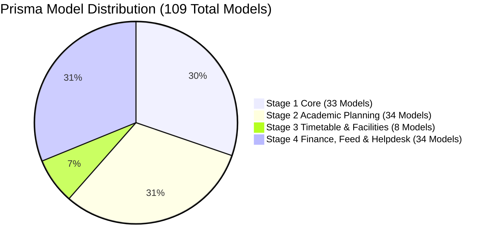

# EduTrack ERP — Stage-2 Phase 1: Prisma Persistence & Runtime Audit

**Document ID:** `docs/stage-2/phase-1/03_prisma_persistence_audit.md`  
**Phase:** Stage-2 Phase 1: Foundation & Database Contract Verification  
**Author:** Senior Prisma Architect & Principal Backend Engineer  
**Date:** November 2026  
**Status:** COMPLETE / CRITICAL FINDING IDENTIFIED

---

## 1. Executive Summary

This document presents a comprehensive, evidence-based audit of Prisma ORM configuration, generated client delegates, and the runtime persistence interception layer.

The audit reveals a critical architectural disparity:

1. `apps/backend/prisma/schema.prisma` defines **109 models**.
2. The generated `@prisma/client` runtime binary contains delegates for only **67 models**.
3. Exactly **42 models** have **NO generated delegates** in `@prisma/client`.
4. The backend initializes Prisma through a dynamic `Proxy` (`apps/backend/src/lib/prismaClient.ts`) that intercepts calls to missing delegates and routes writes directly into an in-memory `Map` (`fallbackStores`).
5. **All 34 Stage-2 models fall into this in-memory fallback**. Writes to Stage-2 models appear to succeed at runtime but are permanently lost whenever the Node.js process restarts.

---

## 2. Prisma Model Classification & Delegate Inventory

All 109 models declared in `apps/backend/prisma/schema.prisma` have been forensically classified across the four project stages:



### 2.1 Complete Model Master Inventory

| Model Name                              | Stage       | Physical SQL DDL               | Prisma Delegate  | Persistence Mechanism                | Risk Classification        |
| --------------------------------------- | ----------- | ------------------------------ | ---------------- | ------------------------------------ | -------------------------- |
| `organizations`                         | Stage 1     | Present (`04_tables.sql`)      | Available        | PostgreSQL Physical                  | Normal / Verified          |
| `users`                                 | Stage 1     | Present (`04_tables.sql`)      | Available        | PostgreSQL Physical                  | Normal / Verified          |
| `roles`                                 | Stage 1     | Present (`04_tables.sql`)      | Available        | PostgreSQL Physical                  | Normal / Verified          |
| `user_roles`                            | Stage 1     | Present (`04_tables.sql`)      | Available        | PostgreSQL Physical                  | Normal / Verified          |
| `designations`                          | Stage 1     | Present (`04_tables.sql`)      | Available        | PostgreSQL Physical                  | Normal / Verified          |
| `departments`                           | Stage 1     | Present (`04_tables.sql`)      | Available        | PostgreSQL Physical                  | Normal / Verified          |
| `staff`                                 | Stage 1     | Present (`04_tables.sql`)      | Available        | PostgreSQL Physical                  | Normal / Verified          |
| `parents`                               | Stage 1     | Present (`04_tables.sql`)      | Available        | PostgreSQL Physical                  | Normal / Verified          |
| `academic_years`                        | Stage 1     | Present (`04_tables.sql`)      | Available        | PostgreSQL Physical                  | Normal / Verified          |
| `grades`                                | Stage 1     | Present (`04_tables.sql`)      | Available        | PostgreSQL Physical                  | Normal / Verified          |
| `academic_year_grades`                  | Stage 1     | Present (`04_tables.sql`)      | Available        | PostgreSQL Physical                  | Normal / Verified          |
| `sections`                              | Stage 1     | Present (`04_tables.sql`)      | Available        | PostgreSQL Physical                  | Normal / Verified          |
| `leads`                                 | Stage 1     | Present (`04_tables.sql`)      | Available        | PostgreSQL Physical                  | Normal / Verified          |
| `lead_activities`                       | Stage 1     | Present (`04_tables.sql`)      | Available        | PostgreSQL Physical                  | Normal / Verified          |
| `lead_visits`                           | Stage 1     | Present (`04_tables.sql`)      | Available        | PostgreSQL Physical                  | Normal / Verified          |
| `lead_query_types`                      | Stage 1     | Present (`10_alterations.sql`) | Available        | PostgreSQL Physical                  | Normal / Verified          |
| `lead_query_type_mappings`              | Stage 1     | Present (`10_alterations.sql`) | Available        | PostgreSQL Physical                  | Normal / Verified          |
| `admission_configurations`              | Stage 1     | Present (`04_tables.sql`)      | Available        | PostgreSQL Physical                  | Normal / Verified          |
| `admissions_applications`               | Stage 1     | Present (`04_tables.sql`)      | Available        | PostgreSQL Physical                  | Normal / Verified          |
| `document_types`                        | Stage 1     | Present (`04_tables.sql`)      | Available        | PostgreSQL Physical                  | Normal / Verified          |
| `admission_documents`                   | Stage 1     | Present (`04_tables.sql`)      | Available        | PostgreSQL Physical                  | Normal / Verified          |
| `assessment_configurations`             | Stage 1     | Present (`04_tables.sql`)      | Available        | PostgreSQL Physical                  | Normal / Verified          |
| `application_assessments`               | Stage 1     | Present (`04_tables.sql`)      | Available        | PostgreSQL Physical                  | Normal / Verified          |
| `admission_decisions`                   | Stage 1     | Present (`04_tables.sql`)      | Available        | PostgreSQL Physical                  | Normal / Verified          |
| `admission_fee_payments`                | Stage 1     | Present (`04_tables.sql`)      | Available        | PostgreSQL Physical                  | Normal / Verified          |
| `students`                              | Stage 1     | Present (`04_tables.sql`)      | Available        | PostgreSQL Physical                  | Normal / Verified          |
| `student_parents`                       | Stage 1     | Present (`04_tables.sql`)      | Available        | PostgreSQL Physical                  | Normal / Verified          |
| `student_enrollments`                   | Stage 1     | Present (`04_tables.sql`)      | Available        | PostgreSQL Physical                  | Normal / Verified          |
| `chatbot_sessions`                      | Stage 1     | Present (`04_tables.sql`)      | Available        | PostgreSQL Physical                  | Normal / Verified          |
| `chatbot_messages`                      | Stage 1     | Present (`04_tables.sql`)      | Available        | PostgreSQL Physical                  | Normal / Verified          |
| `document_chunks`                       | Stage 1     | Present (`11_vector.sql`)      | Available        | PostgreSQL Physical                  | Normal / Verified          |
| `notifications`                         | Stage 1     | Present (`04_tables.sql`)      | Available        | PostgreSQL Physical                  | Normal / Verified          |
| `countries`                             | Stage 1     | Present (`04_tables.sql`)      | Available        | PostgreSQL Physical                  | Normal / Verified          |
| **All Stage 1 Models (33)**             | **Stage 1** | **33 Present**                 | **33 Available** | **100% PostgreSQL**                  | **VERIFIED**               |
| `academic_calendar_entries`             | Stage 2     | Absent from Stage-1            | **UNAVAILABLE**  | **In-Memory Map (`fallbackStores`)** | **CRITICAL: Volatile RAM** |
| `academic_calendar_entry_grades`        | Stage 2     | Absent from Stage-1            | **UNAVAILABLE**  | **In-Memory Map (`fallbackStores`)** | **CRITICAL: Volatile RAM** |
| `academic_calendar_publication_history` | Stage 2     | Absent from Stage-1            | **UNAVAILABLE**  | **In-Memory Map (`fallbackStores`)** | **CRITICAL: Volatile RAM** |
| `academic_calendar_working_days`        | Stage 2     | Absent from Stage-1            | **UNAVAILABLE**  | **In-Memory Map (`fallbackStores`)** | **CRITICAL: Volatile RAM** |
| `academic_calendars`                    | Stage 2     | Absent from Stage-1            | **UNAVAILABLE**  | **In-Memory Map (`fallbackStores`)** | **CRITICAL: Volatile RAM** |
| `academic_terms`                        | Stage 2     | Absent from Stage-1            | **UNAVAILABLE**  | **In-Memory Map (`fallbackStores`)** | **CRITICAL: Volatile RAM** |
| `academic_year_curriculum_mappings`     | Stage 2     | Absent from Stage-1            | **UNAVAILABLE**  | **In-Memory Map (`fallbackStores`)** | **CRITICAL: Volatile RAM** |
| `academic_year_grade_subjects`          | Stage 2     | Absent from Stage-1            | **UNAVAILABLE**  | **In-Memory Map (`fallbackStores`)** | **CRITICAL: Volatile RAM** |
| `curriculum_framework_versions`         | Stage 2     | Absent from Stage-1            | **UNAVAILABLE**  | **In-Memory Map (`fallbackStores`)** | **CRITICAL: Volatile RAM** |
| `curriculum_frameworks`                 | Stage 2     | Absent from Stage-1            | **UNAVAILABLE**  | **In-Memory Map (`fallbackStores`)** | **CRITICAL: Volatile RAM** |
| `curriculum_learning_outcomes`          | Stage 2     | Absent from Stage-1            | **UNAVAILABLE**  | **In-Memory Map (`fallbackStores`)** | **CRITICAL: Volatile RAM** |
| `curriculum_plan_units`                 | Stage 2     | Absent from Stage-1            | **UNAVAILABLE**  | **In-Memory Map (`fallbackStores`)** | **CRITICAL: Volatile RAM** |
| `curriculum_plans`                      | Stage 2     | Absent from Stage-1            | **UNAVAILABLE**  | **In-Memory Map (`fallbackStores`)** | **CRITICAL: Volatile RAM** |
| `learning_resource_grades`              | Stage 2     | Absent from Stage-1            | **UNAVAILABLE**  | **In-Memory Map (`fallbackStores`)** | **CRITICAL: Volatile RAM** |
| `learning_resource_recipients`          | Stage 2     | Absent from Stage-1            | **UNAVAILABLE**  | **In-Memory Map (`fallbackStores`)** | **CRITICAL: Volatile RAM** |
| `learning_resource_share_sections`      | Stage 2     | Absent from Stage-1            | **UNAVAILABLE**  | **In-Memory Map (`fallbackStores`)** | **CRITICAL: Volatile RAM** |
| `learning_resource_shares`              | Stage 2     | Absent from Stage-1            | **UNAVAILABLE**  | **In-Memory Map (`fallbackStores`)** | **CRITICAL: Volatile RAM** |
| `learning_resource_subjects`            | Stage 2     | Absent from Stage-1            | **UNAVAILABLE**  | **In-Memory Map (`fallbackStores`)** | **CRITICAL: Volatile RAM** |
| `learning_resource_tags`                | Stage 2     | Absent from Stage-1            | **UNAVAILABLE**  | **In-Memory Map (`fallbackStores`)** | **CRITICAL: Volatile RAM** |
| `learning_resources`                    | Stage 2     | Absent from Stage-1            | **UNAVAILABLE**  | **In-Memory Map (`fallbackStores`)** | **CRITICAL: Volatile RAM** |
| `lesson_activities`                     | Stage 2     | Absent from Stage-1            | **UNAVAILABLE**  | **In-Memory Map (`fallbackStores`)** | **CRITICAL: Volatile RAM** |
| `lesson_differentiation_strategies`     | Stage 2     | Absent from Stage-1            | **UNAVAILABLE**  | **In-Memory Map (`fallbackStores`)** | **CRITICAL: Volatile RAM** |
| `lesson_exit_tickets`                   | Stage 2     | Absent from Stage-1            | **UNAVAILABLE**  | **In-Memory Map (`fallbackStores`)** | **CRITICAL: Volatile RAM** |
| `lesson_plan_outcomes`                  | Stage 2     | Absent from Stage-1            | **UNAVAILABLE**  | **In-Memory Map (`fallbackStores`)** | **CRITICAL: Volatile RAM** |
| `lesson_plan_resources`                 | Stage 2     | Absent from Stage-1            | **UNAVAILABLE**  | **In-Memory Map (`fallbackStores`)** | **CRITICAL: Volatile RAM** |
| `lesson_plans`                          | Stage 2     | Absent from Stage-1            | **UNAVAILABLE**  | **In-Memory Map (`fallbackStores`)** | **CRITICAL: Volatile RAM** |
| `resource_categories`                   | Stage 2     | Absent from Stage-1            | **UNAVAILABLE**  | **In-Memory Map (`fallbackStores`)** | **CRITICAL: Volatile RAM** |
| `resource_tags`                         | Stage 2     | Absent from Stage-1            | **UNAVAILABLE**  | **In-Memory Map (`fallbackStores`)** | **CRITICAL: Volatile RAM** |
| `section_subject_faculty_assignments`   | Stage 2     | Absent from Stage-1            | **UNAVAILABLE**  | **In-Memory Map (`fallbackStores`)** | **CRITICAL: Volatile RAM** |
| `staff_subject_qualifications`          | Stage 2     | Absent from Stage-1            | **UNAVAILABLE**  | **In-Memory Map (`fallbackStores`)** | **CRITICAL: Volatile RAM** |
| `staff_unavailable_slots`               | Stage 2     | Absent from Stage-1            | **UNAVAILABLE**  | **In-Memory Map (`fallbackStores`)** | **CRITICAL: Volatile RAM** |
| `subject_categories`                    | Stage 2     | Absent from Stage-1            | **UNAVAILABLE**  | **In-Memory Map (`fallbackStores`)** | **CRITICAL: Volatile RAM** |
| `subject_selection_group_options`       | Stage 2     | Absent from Stage-1            | **UNAVAILABLE**  | **In-Memory Map (`fallbackStores`)** | **CRITICAL: Volatile RAM** |
| `subject_selection_groups`              | Stage 2     | Absent from Stage-1            | **UNAVAILABLE**  | **In-Memory Map (`fallbackStores`)** | **CRITICAL: Volatile RAM** |
| `subjects`                              | Stage 2     | Absent from Stage-1            | **UNAVAILABLE**  | **In-Memory Map (`fallbackStores`)** | **CRITICAL: Volatile RAM** |
| **All Stage 2 Models (34)**             | **Stage 2** | **0 Present**                  | **0 Available**  | **100% In-Memory RAM**               | **CRITICAL BLOCKER**       |
| **All Stage 3 Models (8)**              | **Stage 3** | **0 Present**                  | **0 Available**  | **100% In-Memory RAM**               | **CRITICAL BLOCKER**       |
| **All Stage 4 Models (34)**             | **Stage 4** | **0 Present in Stage 1**       | **34 Available** | **PostgreSQL (Pushed)**              | **Partially Protected**    |

---

## 3. Deep Dive: The `prismaClient.ts` Fallback Proxy

Inspection of `apps/backend/src/lib/prismaClient.ts` reveals how unmapped models are handled at runtime:

### 3.1 Proxy Mechanism (`lines 85-245`)

```typescript
// Safe Fallback Delegate for unrelated unmapped models
const fallbackStores = new Map<string, Map<string, any>>();

function getFallbackStore(modelName: string): Map<string, any> {
  if (!fallbackStores.has(modelName)) {
    fallbackStores.set(modelName, new Map<string, any>());
  }
  return fallbackStores.get(modelName)!;
}
```

When a service accesses `prisma.lesson_plans.create(...)`:

1. The property `'lesson_plans'` does NOT exist on `rawPrisma`.
2. The proxy handler executes:
   ```typescript
   if (!unmappedDelegates.has(prop)) {
     if (FINANCIAL_PERSISTENCE_MODELS.has(prop)) {
       unmappedDelegates.set(prop, createStrictFinancialDelegate(prop));
     } else {
       unmappedDelegates.set(prop, createSafeModelDelegate(prop));
     }
   }
   return unmappedDelegates.get(prop);
   ```
3. Because Stage-2 models are **not** listed in `FINANCIAL_PERSISTENCE_MODELS`, `createSafeModelDelegate` creates an in-memory map handler.
4. The `.create(...)` method generates a UUID and stores the record in `fallbackStores.get('lesson_plans')`.
5. The operation returns HTTP 201 Created and the caller assumes the record was persisted.

### 3.2 Consequences of In-Memory Fallback

- **Zero Durability:** Any process reload, node crash, deployment, or auto-scaling event empties `fallbackStores`.
- **Multi-Instance Incoherence:** In a production load-balanced environment, requests hitting Instance A cannot see records created on Instance B.
- **Relational Invalidation:** Foreign keys pointing to `academic_years` or `grades` are not validated against PostgreSQL.
- **RLS Bypass:** PostgreSQL Row-Level Security policies are never evaluated because no SQL query is sent.

---

## 4. Verification & Recommendations

> [!CAUTION]
> Building Stage-2 business logic directly on top of `prisma.<stage_2_model>` without resolving this persistence gap will produce an application that appears fully functional in a single continuous session, but immediately loses all curriculum, lesson plans, frameworks, and resources upon server restart.

### Recommended Governance Action:

1. For Phase 1, document this behavior clearly without altering `prismaClient.ts`.
2. For Phase 2, obtain explicit stakeholder approval to reconcile `schema.prisma` with physical migrations so that `@prisma/client` can be regenerated legitimately.
