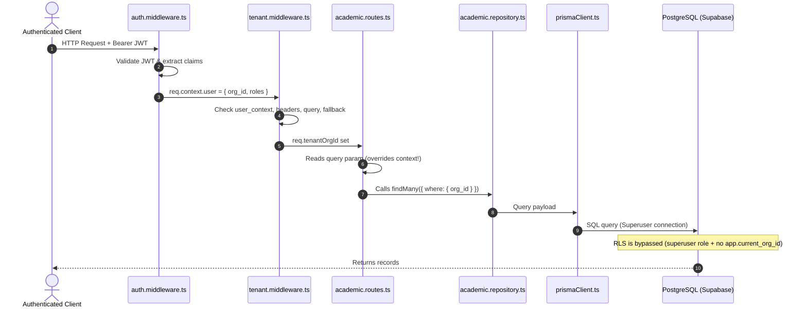

# EduTrack ERP — Stage-2 Phase 1: Multi-Tenant Isolation & Security Audit

**Document ID:** `docs/stage-2/phase-1/05_tenant_isolation_security_audit.md`  
**Phase:** Stage-2 Phase 1: Foundation & Database Contract Verification  
**Author:** Application Security Engineer & PostgreSQL Security Auditor  
**Date:** November 2026  
**Status:** COMPLETE / VULNERABILITIES IDENTIFIED

---

## 1. Executive Summary

EduTrack ERP is designed as a multi-tenant school operations platform where institutional boundaries are defined by `organizations.org_id`. This audit examines how tenant isolation is maintained from HTTP request ingestion to PostgreSQL execution.

The audit identified three critical security concerns:

1. **Query-Parameter Tenant Override:** Routes such as `GET /v1/academic/classes` prioritize user-supplied query parameters (`req.query.school_id`) over the authenticated JWT context (`req.context.user.org_id`), creating cross-tenant data leakage risks.
2. **Inactive Database RLS:** PostgreSQL Row-Level Security (RLS) policies in `08_rls.sql` rely on session variable `app.current_org_id`. The backend never sets this variable, and connections connect as PostgreSQL superuser/table owner, completely bypassing RLS.
3. **Missing Foreign Keys on Child Tables:** 15 child tables lack direct `org_id` columns, requiring multi-hop join queries to enforce tenant boundaries.

---

## 2. End-to-End Tenant Context Propagation Flow



### 2.1 Code Flaw: Tenant Impersonation via Query String

In `apps/backend/src/modules/academic-management/routes/academic.routes.ts` (lines 73–84):

```typescript
let targetOrgId = (req.query.school_id ||
  req.query.org_id ||
  (req as any).tenantOrgId ||
  (req as any).user?.org_id ||
  (req as any).user?.school_id ||
  req.context?.user?.org_id ||
  req.context?.user?.school_id) as string;

if (!targetOrgId || targetOrgId === 'school-main' || targetOrgId === 'org-main') {
  const activeOrg =
    (await prisma.organizations.findFirst({ where: { status: 'active' } })) ||
    (await prisma.organizations.findFirst());
  if (activeOrg) targetOrgId = activeOrg.org_id;
}
```

> [!CAUTION]
> **Security Defect:** An authenticated user from Institution A can pass `?school_id=<Institution_B_UUID>` in the URL. The route handler assigns `targetOrgId = req.query.school_id`, querying and returning classes and sections belonging to Institution B.

---

## 3. PostgreSQL Row-Level Security (RLS) Audit

`apps/database/stage_1/schema/08_rls.sql` establishes tenant isolation policies using:

```sql
CREATE POLICY org_isolation_policy ON organizations
  USING (org_id = current_setting('app.current_org_id', true)::uuid);
```

### 3.1 Verification Findings:

1. **Unset Session Variable:** The Node.js backend uses a persistent connection pool via `@prisma/client`. At no point in the request lifecycle does any middleware or repository execute `SET LOCAL app.current_org_id = '...'`.
2. **Superuser Bypass:** The default connection string in `.env` connects with PostgreSQL owner/superuser privileges. In PostgreSQL, table owners and superusers bypass RLS policies by default unless `FORCE ROW LEVEL SECURITY` is explicitly set on each table.
3. **Isolation Reliance:** Multi-tenant isolation currently relies **100% on application-level filtering** (`where: { org_id }`).

---

## 4. Child Tables Lacking Direct `org_id`

The following 15 Stage-1 tables do not have an `org_id` column and rely exclusively on parent joins for tenant scoping:

| Table Name                 | Parent Table                 | Relationship Path                                                      | Cross-Tenant Vulnerability Risk                             |
| -------------------------- | ---------------------------- | ---------------------------------------------------------------------- | ----------------------------------------------------------- |
| `academic_year_grades`     | `academic_years`             | `academic_year_id` -> `academic_years.org_id`                          | Medium: orphaned queries without join leak grades           |
| `sections`                 | `academic_year_grades`       | `academic_year_grade_id` -> `academic_year_grades` -> `academic_years` | High: 2-hop join required to verify ownership               |
| `lead_activities`          | `leads`                      | `lead_id` -> `leads.org_id`                                            | Medium: lookup by activity_id can disclose notes            |
| `lead_visits`              | `leads`                      | `lead_id` -> `leads.org_id`                                            | Medium: lookup by visit_id can disclose campus visits       |
| `lead_query_type_mappings` | `leads` / `lead_query_types` | `lead_id` -> `leads.org_id`                                            | Low: lookup reveals category assignments                    |
| `admission_documents`      | `admissions_applications`    | `application_id` -> `admissions_applications.org_id`                   | High: direct file download ID lookup risks file leak        |
| `application_assessments`  | `admissions_applications`    | `application_id` -> `admissions_applications.org_id`                   | Medium: exam score disclosures                              |
| `admission_decisions`      | `admissions_applications`    | `application_id` -> `admissions_applications.org_id`                   | Medium: admission status disclosure                         |
| `admission_fee_payments`   | `admissions_applications`    | `application_id` -> `admissions_applications.org_id`                   | High: payment transaction disclosure                        |
| `student_parents`          | `students` / `parents`       | `student_id` -> `students.org_id`                                      | Medium: parent relationship disclosure                      |
| `student_enrollments`      | `students`                   | `student_id` -> `students.org_id`                                      | High: academic progression cross-tenant leak                |
| `chatbot_messages`         | `chatbot_sessions`           | `session_id` -> `chatbot_sessions.org_id`                              | Low: conversation transcript leak                           |
| `user_roles`               | `users` / `roles`            | `user_id` -> `users.org_id`                                            | Critical: privilege escalation if role assigned across orgs |
| `feed_comments`            | `feed_posts`                 | `post_id` -> `feed_posts.org_id`                                       | Medium: social feed comments                                |
| `helpdesk_messages`        | `helpdesk_tickets`           | `ticket_id` -> `helpdesk_tickets.org_id`                               | Medium: ticket thread disclosures                           |

---

## 5. Multi-Tenant Isolation Security Matrix

| Layer                 | Existing Implementation             | Verification Status                        | Risk Level | Required Action                                                    |
| --------------------- | ----------------------------------- | ------------------------------------------ | ---------- | ------------------------------------------------------------------ |
| **JWT Claims**        | Encodes `org_id` & `school_id`      | Verified in `auth.middleware.ts`           | Low        | Maintain strict token validation                                   |
| **Tenant Middleware** | Resolves tenant; contains fallbacks | Verified in `tenant.middleware.ts`         | High       | Prevent query params from overriding verified token `org_id`       |
| **Route Scoping**     | Inconsistent across controllers     | Verified in `academic.routes.ts`           | Critical   | Enforce `req.context.user.org_id` as non-overrideable filter       |
| **Service Layer**     | Explicit `org_id` parameter passing | Partially Verified                         | Medium     | Ensure all Stage-2 service methods require mandatory `org_id`      |
| **Repository Layer**  | Injects `where: { org_id }`         | Partially Verified                         | Medium     | Reject queries without tenant scope                                |
| **Database RLS**      | Declared in `08_rls.sql`            | Inactive (Unset session variable)          | Critical   | Introduce `SET LOCAL app.current_org_id` or document as DB blocker |
| **File Storage**      | Supabase Storage signed URLs        | Verified in `storage.service.ts`           | Medium     | Prefix object paths with `${org_id}/` to enforce storage isolation |
| **AI Workflows**      | Vector chunks filtered by `org_id`  | Verified in `chatbot.vector.repository.ts` | Low        | Retain mandatory `WHERE org_id = $1` in vector similarity search   |

---

## 6. Recommendations for Stage-2 Implementation

1. **Strict Context Enforcer:** In all Stage-2 controllers, extract `org_id` strictly from `req.context.user.org_id`. Reject or ignore client-supplied `req.query.school_id` and `req.body.org_id`.
2. **Composite Join Validation:** For child entities like `sections`, `curriculum_plan_units`, or `lesson_plans`, validate that the parent entity belongs to the requesting tenant before committing updates.
3. **Tenant Storage Namespacing:** Store all Stage-2 uploaded digital resources in Supabase using the path schema:
   `academic-resources/${org_id}/${resource_id}/${filename}`.
