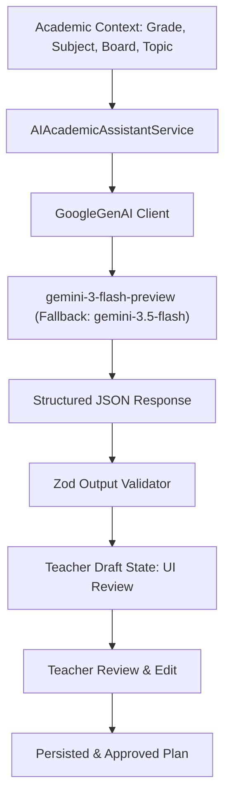

# EduTrack ERP — Stage-2 Phase 1: AI & Resource Integration Blueprint

**Document ID:** `docs/stage-2/phase-1/08_ai_and_resource_integration_blueprint.md`  
**Phase:** Stage-2 Phase 1: Foundation & Database Contract Verification  
**Author:** AI Systems Architect & Infrastructure Integration Specialist  
**Date:** November 2026  
**Status:** COMPLETE / ARCHITECTURAL BLUEPRINT

---

## 1. Executive Summary

Stage-2 incorporates artificial intelligence and digital multimedia assets into the core academic planning workflows:

1. **AI Curriculum Designer (Module 3):** Generates curriculum unit outlines, pedagogical sequencing, and Bloom's Taxonomy learning outcomes.
2. **AI Lesson Planning (Module 5):** Generates classroom lesson plans, interactive activities, differentiated learning accommodations, and exit tickets.
3. **Digital Resource Library (Module 4):** Stores teacher uploads, external Open Educational Resources (OER), YouTube links, AR/VR simulations, and STEM lab assets.

This blueprint establishes the integration strategy, prompt governance, human-in-the-loop review safeguards, and storage pipelines using existing repository infrastructure.

---

## 2. AI Infrastructure Baseline (`@google/genai`)

The repository already includes an active Google Gemini integration via the official `@google/genai` SDK (`apps/backend/src/modules/chatbot/services/chatbot.llm.service.ts`):



### 2.1 Model Selection & Latency

- **Primary Model:** `gemini-3-flash-preview` (high-speed structured output generation).
- **Fallback Models:** `gemini-3.5-flash`, `gemini-flash-latest`.
- **API Key Resolution:** `process.env.GEMINI_API_KEY || process.env.GOOGLE_API_KEY`.

---

## 3. Human-in-the-Loop AI Governance

> [!IMPORTANT]
> AI-generated curriculum and lesson plans must **NEVER** bypass human editorial review or automatically publish to active classrooms.

### Workflow Lifecycle:

1. **DRAFT_AI_PENDING:** Background job or synchronous endpoint requests outline from Gemini.
2. **DRAFT_GENERATED:** Gemini returns structured units and learning outcomes. Persisted with flag `is_ai_generated: true` and `ai_status: 'draft'`.
3. **TEACHER_REVIEW:** The teacher reviews, modifies learning objectives, adjusts duration, and edits activities via the web application.
4. **TEACHER_APPROVED:** Teacher clicks "Accept & Approve". The record transitions to `ai_status: 'reviewed'`.
5. **PUBLISHED:** The finalized plan becomes eligible for incorporation into the published academic setup.

---

## 4. Prompt Engineering & Structured JSON Schemas

### 4.1 Curriculum Unit Generation Prompt Template

```text
System: You are an expert instructional designer specializing in K-12 curriculum development aligned with the {{board}} educational framework and Bloom's Revised Taxonomy.

Task: Generate a comprehensive unit sequence for {{grade_name}} {{subject_name}} across {{term_name}}.

Output Requirements:
Return strictly a valid JSON object matching this schema:
{
  "units": [
    {
      "unit_number": 1,
      "title": "Unit Title",
      "summary": "Brief pedagogical overview",
      "duration_weeks": 3,
      "learning_outcomes": [
        {
          "outcome_text": "Students will be able to...",
          "bloom_level": "ANALYZE",
          "assessment_evidence": "Formative lab report"
        }
      ]
    }
  ]
}
```

### 4.2 Differentiated Lesson Plan Generation Prompt Template

```text
System: You are a master teacher designing inclusive lesson plans with tiered differentiation.

Task: Create a 45-minute lesson plan for Topic: "{{topic}}", Grade: "{{grade_name}}".

Include:
1. Direct Instruction (Hook, Modeling).
2. Guided & Independent Practice.
3. Differentiated Support:
   - Remedial Tier (Scaffolded graphic organizers, simplified vocabulary).
   - Core Tier (Grade-level standard practice).
   - Advanced / Enrichment Tier (Open-ended inquiry, extension challenge).
4. Exit Ticket: 2 formative diagnostic check questions.
```

---

## 5. File Storage & Digital Resource Architecture

### 5.1 Object Storage via Supabase

The repository integrates Supabase Storage through `apps/backend/src/services/storage.service.ts`:

- Binary files are uploaded to private Supabase buckets.
- Download links are delivered as time-limited signed URLs (`createSignedUrl`, default 3600 seconds).

### 5.2 Storage Namespacing & Tenant Isolation

To prevent cross-tenant data leakage in multi-tenant environments, storage paths must strictly adhere to tenant prefixes:

```text
academic-resources/
└── {org_id}/
    ├── curriculum/
    │   └── {curriculum_id}/
    │       └── syllabus_document.pdf
    └── resources/
        └── {resource_id}/
            └── physics_simulation_guide.pdf
```

### 5.3 File Upload Restrictions & Expansion

- **Existing Restriction:** `apps/backend/src/middlewares/upload.middleware.ts` restricts uploads to:
  `application/pdf`, `image/jpeg`, `image/png`, `image/webp` with a 10MB limit.
- **Stage-2 Educational Requirement:** Teachers require uploading lesson slide decks (`.pptx`, `.ppt`), lesson notes (`.docx`), audio guides (`.mp3`), and demonstration clips (`.mp4`).
- **Phase-1 Recommendation:** Create a dedicated `academicUploadMiddleware` that permits presentations and documents up to 50MB, while preserving PDF and image support.

### 5.4 External Resource Validation (YouTube, OER, AR/VR)

For non-binary resources (e.g. YouTube videos, PhET simulations, Khan Academy links):

1. **URL Validation:** Backend validates syntax using regex and checks for malicious domain redirects.
2. **Safe Embed Codes:** YouTube links are parsed to extract video IDs; the frontend renders them inside sandboxed `<iframe>` tags with `sandbox="allow-scripts allow-same-origin"`.
3. **OER Metadata:** Stores license type (e.g. Creative Commons `CC BY-NC-SA 4.0`), author attribution, and source institution.
