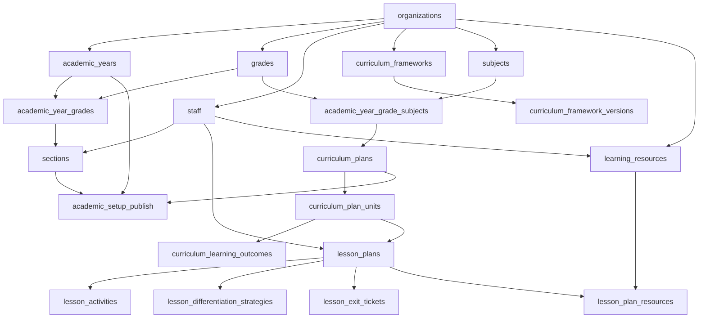

# EduTrack ERP — Stage-2 Phase 1: Dependency & Execution Plan

**Document ID:** `docs/stage-2/phase-1/10_stage2_dependency_and_execution_plan.md`  
**Phase:** Stage-2 Phase 1: Foundation & Database Contract Verification  
**Author:** Principal Software Architect & Release Coordinator  
**Date:** November 2026  
**Status:** COMPLETE / IMPLEMENTATION BLUEPRINT

---

## 1. Executive Summary

This document defines the strict relational dependency graph and sequenced implementation plan for Stage-2 (**Academic Planning & Digital Campus Setup**).

Because relational integrity requires parent entities to exist before child associations can be created, implementation must proceed in a technically validated sequence to prevent orphaned records or mock-dependent architectures.

---

## 2. Relational Entity Dependency Graph (DAG)



---

## 3. Recommended Implementation Sequence

To ensure stable, testable increments, Stage-2 implementation is divided into four execution milestones:

```text
+-----------------------------------------------------------------------------------------+
| Milestone 1: Structural Foundations (Module 1 & Module 2)                                |
| - Sessions (academic_years), Grades, Sections, Class Teachers                           |
| - Educational Boards, Framework Standards, Institutional Subject Taxonomy               |
+-----------------------------------------------------------------------------------------+
                                           │
                                           ▼
+-----------------------------------------------------------------------------------------+
| Milestone 2: Curriculum Architecture (Module 3)                                         |
| - Curriculum Plans Master, Term Allocations                                             |
| - AI-Assisted Unit Sequencing & Bloom's Taxonomy Learning Outcomes                      |
+-----------------------------------------------------------------------------------------+
                                           │
                        ┌──────────────────┴──────────────────┐
                        ▼                                     ▼
+--------------------------------------+   +--------------------------------------+
| Milestone 3A: Digital Resources      |   | Milestone 3B: AI Lesson Planning     |
| (Module 4)                           |   | (Module 5)                           |
| - Supabase Storage Namespacing       |   | - 45-Min Lesson Structure & Timing   |
| - OER, YouTube & STEM Lab Links      |   | - Differentiated Learning Strategy   |
| - Section-Level Resource Sharing     |   | - Formative Exit Tickets & Outlines  |
+--------------------------------------+   +--------------------------------------+
                        └──────────────────┬──────────────────┘
                                           │
                                           ▼
+-----------------------------------------------------------------------------------------+
| Milestone 4: Setup Validation & Institutional Publishing (Module 6)                      |
| - Multi-point Completeness Validation Engine                                            |
| - Pre-Publish Inspection & Warning Summary                                              |
| - Atomic Academic Year Status Transition to 'open'                                      |
+-----------------------------------------------------------------------------------------+
```

---

## 4. Parallelization Opportunities & Reusable Services

### 4.1 Parallel Execution of Modules 4 & 5

Once Milestone 2 (Curriculum Architecture) has established subjects, units, and learning outcomes:

- **Module 4 (Digital Resource Library)** can be implemented independently by the storage and media team.
- **Module 5 (AI Lesson Planning)** can be implemented concurrently by the pedagogical AI team.
- Both converge on the junction entity `lesson_plan_resources` to link uploaded materials directly into lesson plans.

### 4.2 Shared Backend Infrastructural Services

- `apps/backend/src/services/storage.service.ts`: Reused across both Module 4 (learning materials) and Module 5 (lesson plan attachments).
- `apps/backend/src/modules/chatbot/services/chatbot.llm.service.ts`: Reused as the Google Gemini SDK invocation engine for both Module 3 (curriculum drafting) and Module 5 (lesson generation).
- `apps/backend/src/middlewares/idempotency.middleware.ts`: Reused across all state-mutating POST endpoints to prevent duplicate plan generation.

---

## 5. Potential Circular Dependencies & Mitigation

1. **Circular Dependency: Sections vs Class Teachers:**
   - `sections.class_teacher_id` references `staff.staff_id`.
   - `staff.department_id` references `departments.department_id`.
   - **Resolution:** Staff master records must be pre-populated or imported before assigning class teachers to sections during Module 1 setup.
2. **Circular Dependency: Curriculum vs Resources:**
   - A lesson plan references digital resources, while digital resources are tagged with curriculum units.
   - **Resolution:** Decouple resources from lesson plans by treating `learning_resources` as an independent catalog, associating them via the loose junction `lesson_plan_resources`.
