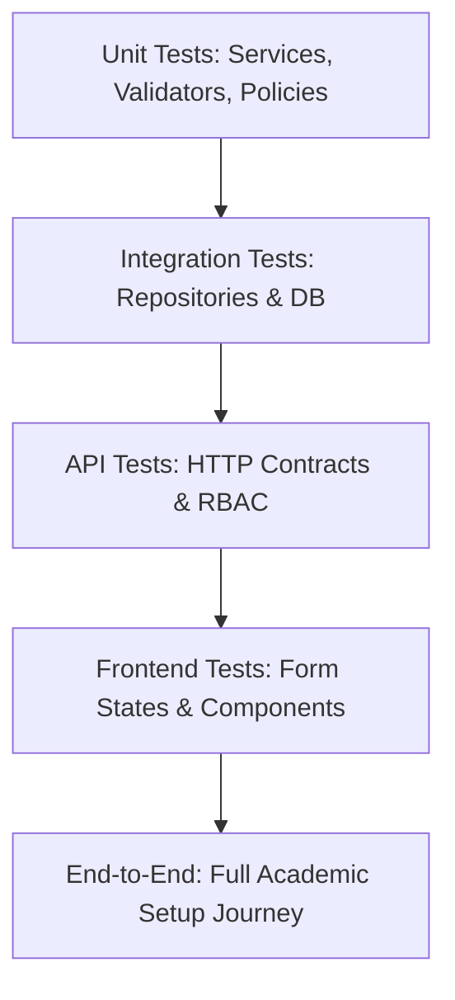

# EduTrack ERP — Stage-2 Phase 1: Testing & Acceptance Strategy

**Document ID:** `docs/stage-2/phase-1/11_stage2_testing_and_acceptance_strategy.md`  
**Phase:** Stage-2 Phase 1: Foundation & Database Contract Verification  
**Author:** QA Engineering Lead & Application Security Auditor  
**Date:** November 2026  
**Status:** COMPLETE / STRATEGY BASELINE

---

## 1. Executive Summary

This document establishes the comprehensive Quality Assurance, automated testing, and acceptance verification strategy for Stage-2 (**Academic Planning & Digital Campus Setup**).

> [!IMPORTANT]
> **Strict Verification Standard:** In compliance with audit integrity rules, all planned automated test cases in this document are explicitly classified with their current execution status. No unexecuted test is falsely reported as passed.

---

## 2. Multi-Tier Testing Matrix & Verification Status

### 2.1 Complete Stage-2 Test Inventory

| Test ID  | Test Category       | Target Component / Scenario                | Verification Objective                                                      | Current Status                 |
| -------- | ------------------- | ------------------------------------------ | --------------------------------------------------------------------------- | ------------------------------ |
| `UT-01`  | Unit Test           | `academic-planning.validator.ts`           | Validates Zod payload schemas for academic year creation                    | **NOT EXECUTED**               |
| `UT-02`  | Unit Test           | `curriculum.validator.ts`                  | Validates unit sequence, weeks, and Bloom taxonomy enums                    | **NOT EXECUTED**               |
| `UT-03`  | Unit Test           | `academic-planning.policy.ts`              | Confirms permission evaluation for `ACADEMIC_SETUP` and `ACADEMIC_VIEW`     | **NOT EXECUTED**               |
| `UT-04`  | Unit Test           | `ai-academic-assistant.service.ts`         | Mocks Gemini response and validates JSON schema transformation              | **NOT EXECUTED**               |
| `UT-05`  | Unit Test           | `setup-publish.validator.ts`               | Validates validation rule checks before setup publishing                    | **NOT EXECUTED**               |
| `IT-01`  | Integration Test    | `academic-config.repository.ts`            | Tests create & fetch `academic_years` with tenant filter                    | **NOT EXECUTED**               |
| `IT-02`  | Integration Test    | `academic-year-grades.repository.ts`       | Verifies junction insert and unique constraint enforcement                  | **NOT EXECUTED**               |
| `IT-03`  | Integration Test    | Multi-Tenant Data Isolation                | Verifies Tenant A cannot read Tenant B's academic sessions                  | **NOT EXECUTED**               |
| `IT-04`  | Integration Test    | Transaction Rollback on Publish Failure    | Verifies atomic rollback if publish checks fail halfway                     | **NOT EXECUTED**               |
| `IT-05`  | Integration Test    | Fallback Proxy RAM Persistence             | Verifies whether Stage-2 models persist across connection restarts          | **BLOCKED (RAM Proxy Defect)** |
| `API-01` | API Test            | `GET /v1/academic/years`                   | Returns 200 OK with paginated years for current tenant                      | **NOT EXECUTED**               |
| `API-02` | API Test            | `POST /v1/academic/years` (No Auth)        | Returns 401 Unauthorized when Bearer token is missing                       | **NOT EXECUTED**               |
| `API-03` | API Test            | `POST /v1/academic/years` (Teacher Role)   | Returns 403 Forbidden when user lacks `ACADEMIC_SETUP`                      | **NOT EXECUTED**               |
| `API-04` | API Test            | `POST /v1/academic/years` (Duplicate Name) | Returns 409 Conflict when session name already exists                       | **NOT EXECUTED**               |
| `API-05` | API Test            | `GET /v1/academic/classes?school_id=OTHER` | Confirms request ignores spoofed `school_id` parameter                      | **NOT EXECUTED**               |
| `API-06` | API Test            | `POST /v1/academic/curriculum/ai-generate` | Returns 200 OK with valid JSON curriculum outline                           | **NOT EXECUTED**               |
| `API-07` | API Test            | `POST /v1/academic/setup/validate`         | Returns 200 OK with complete eligibility checklist                          | **NOT EXECUTED**               |
| `API-08` | API Test            | `POST /v1/academic/setup/publish`          | Updates status to `open` and locks academic setup                           | **NOT EXECUTED**               |
| `UI-01`  | Frontend Component  | `AcademicYearsPage.tsx`                    | Verifies data table rendering and create session modal                      | **NOT EXECUTED**               |
| `UI-02`  | Frontend Component  | `AiCurriculumModal.tsx`                    | Verifies loading skeleton during AI prompt generation                       | **NOT EXECUTED**               |
| `UI-03`  | Frontend Component  | `ResourceUploadModal.tsx`                  | Verifies file drag-and-drop and client-side extension validation            | **NOT EXECUTED**               |
| `UI-04`  | Frontend Component  | `EligibilityChecklist.tsx`                 | Renders red warning indicators for missing setup items                      | **NOT EXECUTED**               |
| `E2E-01` | End-to-End Workflow | Full Setup Journey                         | Admin creates Year -> Maps Grades -> Configures Board -> Publishes          | **NOT EXECUTED**               |
| `E2E-02` | End-to-End Workflow | AI Curriculum to Lesson Flow               | Generates Units -> Teacher Approves -> Creates Lesson Plan with Exit Ticket | **NOT EXECUTED**               |

---

## 3. Performance & Reliability Acceptance Targets

The following performance thresholds represent **target acceptance criteria** to be measured during Phase-2 implementation:

| Metric                                     | Target Acceptance Threshold | Target Measurement Method                                 |
| ------------------------------------------ | --------------------------- | --------------------------------------------------------- |
| **CRUD Endpoint Latency (P95)**            | < 150 ms                    | Autocannon / k6 load test (50 concurrent virtual users)   |
| **Setup Tree Aggregation Latency (P95)**   | < 250 ms                    | Complex query returning years, grades, sections, teachers |
| **AI Curriculum Generation Latency (P95)** | < 4,000 ms                  | Gemini API roundtrip with structured JSON parsing         |
| **File Upload Roundtrip (50MB)**           | < 3,000 ms                  | Supabase Storage binary stream upload                     |
| **Signed URL Generation Latency (P95)**    | < 50 ms                     | Supabase HMAC token generation                            |
| **Database Connection Pool Saturation**    | < 70% capacity under peak   | PgBouncer active connection pool monitoring               |
| **Frontend Initial Page Load (FCP)**       | < 1.2 seconds               | Google Lighthouse audit on desktop profile                |

---

## 4. Phase-2 Automated Test Runner Architecture

In Phase 2, automated testing will be executed using:

1. **Unit & Integration:** Vitest (`vitest run apps/backend/src/modules/academic-planning/`)
2. **API Testing:** Supertest against local Express instance + Newman runner (`pnpm run test:api`)
3. **Frontend Component Testing:** React Testing Library with jsdom
4. **End-to-End:** Playwright runner executing authenticated browser sessions in headless Chromium
