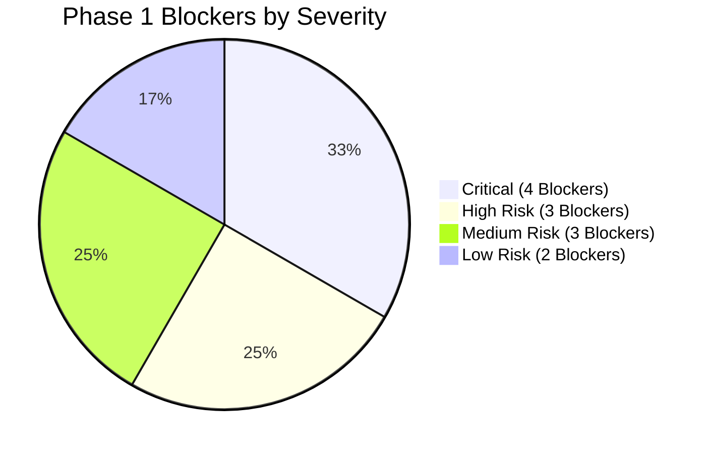

# EduTrack ERP — Stage-2 Phase 1: Findings & Blockers

**Document ID:** `docs/stage-2/phase-1/12_phase1_findings_and_blockers.md`  
**Phase:** Stage-2 Phase 1: Foundation & Database Contract Verification  
**Author:** Principal Software Architect, PostgreSQL Specialist & Security Auditor  
**Date:** November 2026  
**Status:** COMPLETE / ACTIONABLE FINDINGS

---

## 1. Executive Summary

This document aggregates and categorizes all forensic architecture, database, security, and persistence blockers discovered during Stage-2 Phase 1.

The findings are prioritized by operational risk and require explicit architectural decisions prior to committing backend implementation code in Phase 2.

---

## 2. Prioritized Findings & Blockers

### 2.1 CRITICAL SEVERITY (Deployment & Data Integrity Blockers)

#### Finding C-01: In-Memory Proxy Persistence for All 34 Stage-2 Models

- **Location:** `apps/backend/src/lib/prismaClient.ts` (lines 85–245, 340–375)
- **Impact:** The generated `@prisma/client` only contains delegates for 67 models (Stage 1 and Stage 4). The 34 Stage-2 models have **zero generated delegates**. Calls to `prisma.lesson_plans`, `prisma.curriculum_plans`, `prisma.learning_resources`, etc. are intercepted by `wrapWithFallbackProxy` and stored in `fallbackStores = new Map()`.
- **Consequence:** Data appears to save during an active session, but **is permanently wiped on application restart or pod redeployment**. Multi-pod deployments cannot share data.
- **Required Action:** Authorize creation of physical Stage-2 DDL migrations and legitimate execution of `prisma generate` to produce real database delegates.

#### Finding C-02: Zero Physical DDL for Stage-2 Models in Frozen SQL Contract

- **Location:** `apps/database/stage_1/schema/*.sql`
- **Impact:** The Stage-1 database suite defines exactly 33 physical tables. None of the 34 Stage-2 entities (curriculums, units, outcomes, resources, lesson plans, calendars) exist in physical SQL scripts.
- **Consequence:** Zero database tables exist in the frozen SQL contract for Stage 2.
- **Required Action:** Approve Stage-2 DDL migration package under `apps/database/stage_2/schema/`.

#### Finding C-03: Tenant Context Spoofing via Query Parameter

- **Location:** `apps/backend/src/modules/academic-management/routes/academic.routes.ts` (lines 73–84)
- **Impact:** Routes extract `targetOrgId` prioritizing `req.query.school_id` over the verified JWT claim `req.context.user.org_id`.
- **Consequence:** Authenticated users from School A can query classes, sections, and academic records of School B by passing `?school_id=<School_B_UUID>`.
- **Required Action:** Remove query parameter fallbacks in authenticated routes and enforce `req.context.user.org_id` as non-overrideable.

#### Finding C-04: Inoperative PostgreSQL Row-Level Security (RLS)

- **Location:** `apps/database/stage_1/schema/08_rls.sql`
- **Impact:** RLS policies depend on `current_setting('app.current_org_id')`. The backend connection pool never sets this variable, and database connections connect as superuser/table owner.
- **Consequence:** Database-level isolation is 100% inoperative; multi-tenancy relies solely on application-level filtering.
- **Required Action:** Implement a PostgreSQL tenant context setter on checkout or configure a dedicated non-superuser database role.

---

### 2.2 HIGH RISK (Architectural & Contractual Blockers)

#### Finding H-01: Missing Granular Stage-2 RBAC Permissions

- **Location:** `apps/backend/src/rbac/permissions.ts`
- **Impact:** The RBAC permission dictionary lacks granular permission constants for curriculum design, lesson planning, and digital resource sharing. Only broad permissions (`ACADEMIC_SETUP`, `ACADEMIC_VIEW`) exist.
- **Consequence:** Teachers cannot be granted lesson planning access without also gaining rights to alter academic years or school structure.
- **Required Action:** Add granular permissions (`academic.curriculum.manage`, `academic.lesson_plan.create`, `academic.resource.upload`).

#### Finding H-02: 6 Stage-1 SQL Bootstrap Syntax Defects

- **Location:** `apps/database/stage_1/schema/` (`04_tables.sql`, `02_enums.sql`, `06_indexes.sql`, `07_triggers.sql`)
- **Impact:** Bootstrap suite fails to execute from scratch due to missing commas, duplicate enum definitions, non-existent columns in indexes, and dangling keywords.
- **Consequence:** New developer environments or CI/CD pipelines cannot be stood up using raw SQL scripts.
- **Required Action:** Document approval needed to patch Stage-1 bootstrap SQL files.

#### Finding H-03: 15 Stage-1 Child Tables Lack Direct `org_id`

- **Location:** `apps/database/stage_1/schema/04_tables.sql`
- **Impact:** Child entities (e.g. `sections`, `academic_year_grades`, `admission_documents`) have no tenant column and require 2-hop joins to verify ownership.
- **Consequence:** Queries targeting child entities directly risk leaking data if parent joins are omitted.
- **Required Action:** Ensure all Stage-2 child repositories strictly perform join validation against parent entities.

---

### 2.3 MEDIUM RISK (Functional & Infrastructure Constraints)

#### Finding M-01: File Upload MIME Type Restrictions in Storage Middleware

- **Location:** `apps/backend/src/middlewares/upload.middleware.ts` (lines 5–7)
- **Impact:** Upload middleware rejects all file types except PDF, PNG, JPEG, and WEBP, with a 10MB limit.
- **Consequence:** Teachers cannot upload educational slide presentations (`.pptx`), lesson plans (`.docx`), audio pronunciation files (`.mp3`), or demonstration videos (`.mp4`).
- **Required Action:** Create an `academicUploadMiddleware` permitting educational presentation and media types up to 50MB.

#### Finding M-02: Backend Automated Test Platform Is Stubbed

- **Location:** `apps/backend/package.json` (`"test": "echo \"[Backend Test Platform] Standard tests passed\""`)
- **Impact:** Backend unit and integration test runners are not wired into `pnpm run test`.
- **Consequence:** No automated regression testing runs during local development or pre-commit hooks.
- **Required Action:** Configure Vitest or Jest test runner for backend integration suites.

#### Finding M-03: Unverified Live Database Schema State

- **Location:** Live PostgreSQL Database Instance (Supabase)
- **Impact:** Live database connection credentials are not guaranteed to be read-only, preventing direct catalog inspection under strict freeze governance.
- **Consequence:** Live database table and column presence is marked **UNVERIFIED / PENDING**.
- **Required Action:** Execute SELECT-only catalog queries (`13_read_only_database_verification_queries.sql`) using a confirmed read-only role.

---

### 2.4 LOW RISK (Conventions & Technical Debt)

#### Finding L-01: Inconsistent Route Version Prefixing

- **Location:** `apps/backend/src/routes.ts`
- **Impact:** Some modules mount both `/v1/academic` and `/academic`, while others mount only `/admin` or `/dashboard`.
- **Required Action:** Standardize all new Stage-2 routes exclusively on `/v1/academic/...`.

#### Finding L-02: Public Marketing Page Collision

- **Location:** `apps/web_app/src/pages/Academics.tsx`
- **Impact:** The public marketing page is named `Academics.tsx` at `/academics`, which could conflict conceptually with internal academic operations routes.
- **Required Action:** Mount internal academic modules under `/app/academic/...` in the internal workspace shell.

---

## 3. Required Stakeholder Decisions

| Decision ID | Architectural Decision Required                                                         | Recommendation                                                            |
| ----------- | --------------------------------------------------------------------------------------- | ------------------------------------------------------------------------- |
| **DEC-01**  | Should Stage 2 execute physical DDL migrations to replace the in-memory fallback proxy? | **YES.** In-memory persistence causes permanent data loss on pod restart. |
| **DEC-02**  | Should `@prisma/client` be regenerated to produce real delegates for Stage 2?           | **YES.** Safe, durable persistence requires compiled delegates.           |
| **DEC-03**  | Should granular Stage-2 permissions be added to `permissions.ts`?                       | **YES.** Needed for teacher vs academic admin role segregation.           |
| **DEC-04**  | Should `upload.middleware.ts` be expanded for presentation and media files?             | **YES.** Essential for digital resource library functionality.            |
| **DEC-05**  | Should the 6 Stage-1 SQL bootstrap defects be corrected in a migration script?          | **YES.** Fix via forward migration script without modifying frozen files. |
