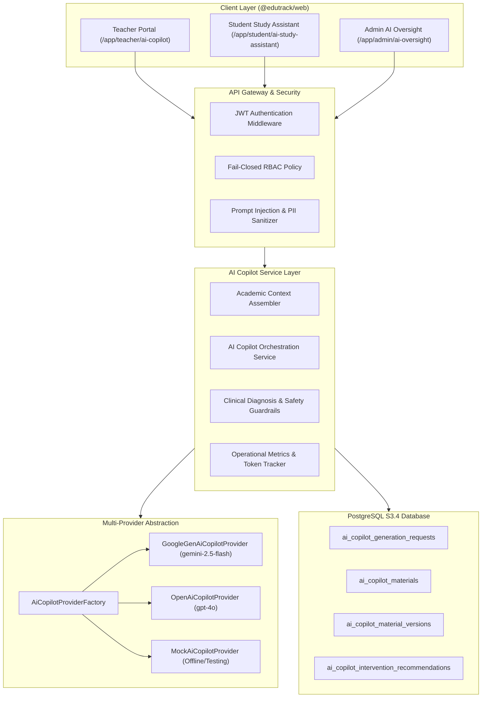

# STAGE 3 PHASE 5 — AI ARCHITECTURE & INTEGRATION

## Multi-Provider Abstraction, Context Assembly & Lifecycle Architecture

**Repository:** `/Users/sathish/Documents/GitHub/EduTech`  
**Phase:** Stage 3 — Phase 5: AI Teacher Copilot & Intelligent Learning Assistance  
**Architecture Contract:** Zero-DDL, Multi-Provider, Fail-Closed Security, Teacher-in-the-Loop Governance

---

## 1. Architectural Overview

The AI Teacher Copilot architecture is designed as a modular, provider-agnostic, multi-tenant intelligence layer embedded inside the EduTrack ERP backend (`@edutrack/api`) and presented through a unified frontend (`@edutrack/web`).

---

## 2. Multi-Provider Strategy & Factory Design

The system implements the `AiCopilotProvider` interface across three distinct concrete providers:

1. **`GoogleGenAiCopilotProvider`**:
   - Primary cloud provider utilizing the Google Gemini API.
   - Model: `gemini-2.5-flash` with graceful fallback to `gemini-1.5-flash`.
   - Structured Output: JSON schemas passed via generation configuration.
   - Leak Detection Defense: Detects Google API key compromise notices in development and fails closed with actionable error translation.

2. **`OpenAiCopilotProvider`**:
   - Secondary cloud provider utilizing OpenAI `chat/completions`.
   - Model: `gpt-4o` with `response_format: { type: "json_object" }`.
   - Enabled when `OPENAI_API_KEY` is configured in environment.

3. **`MockAiCopilotProvider`**:
   - Deterministic offline provider for automated testing and CI environments.
   - Returns complete, structurally valid JSON payloads covering all 14 copilot capabilities.
   - Simulates token usage and latency metrics without external network dependencies.

4. **`AiCopilotProviderFactory`**:
   - Detects active credentials (`GEMINI_API_KEY`, `OPENAI_API_KEY`).
   - Defaults to `MockAiCopilotProvider` when cloud keys are unset or invalid, ensuring 100% test reliability and zero downtime.

---

## 3. Academic Context Assembly Engine

AI models are never invoked with generic prompts. The `AiCopilotContextService` constructs an isolated, tenant-verified academic context snapshot:

1. **Teacher Context Resolution**:
   - Resolves teacher's active staff profile from `users` and `staff`.
   - Resolves assigned grades, sections, subjects, and curriculum plans from `faculty_assignments`.
   - Blocks cross-tenant or unassigned subject requests with 403 Forbidden.

2. **Curriculum Pacing Derivation**:
   - Reads published curriculum units, planned dates, and learning outcomes from `curriculum_plan_units` and `curriculum_learning_outcomes`.

3. **Performance Context Snapshot**:
   - Queries real attendance from `classroom_session_attendance`.
   - Queries real submissions and scores from `learning_activity_submissions`.
   - When data is sparse, the system explicitly reports low confidence rather than fabricating hallucinated performance metrics.

---

## 4. Operational Cost & Token Management

Every generation request is metered through `AiCopilotUsageService`:

- Request ID, Timestamp, Org ID, User ID.
- Capability category (lesson plan, material, question, assessment, homework, project, performance, learning gap, feedback, parent, study).
- Provider and model utilized.
- Estimated tokens consumed (input + output).
- Latency in milliseconds and success/failure outcome.
- Aggregated real-time metrics exposed to administrators at `/v1/ai-teacher-copilot/admin/usage`.
