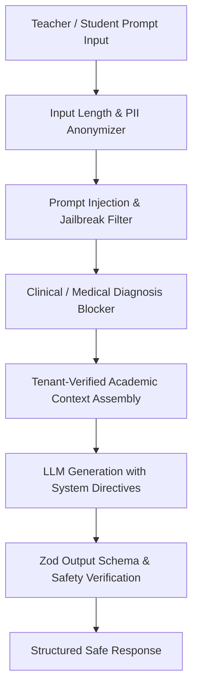

# STAGE 3 PHASE 5 — GUARDRAILS & SAFETY ARCHITECTURE

## Multi-Layer Safety, Prompt Injection Defense & Privacy Compliance

**Repository:** `/Users/sathish/Documents/GitHub/EduTech`  
**Phase:** Stage 3 — Phase 5: AI Teacher Copilot & Intelligent Learning Assistance  
**File Location:** `apps/backend/src/modules/ai-teacher-copilot/ai-copilot.guardrails.ts`

---

## 1. Safety Architecture Overview

The EduTrack ERP AI Teacher Copilot operates in a high-trust educational environment. The system employs a multi-tiered defense architecture that intercepts inputs before LLM invocation, enforces strict system prompts, and sanitizes outputs before client delivery.

---

## 2. Guardrail Layers

### 2.1 Prompt Injection & Jailbreak Shield

- **Pattern Matching**: Intercepts common instruction override phrases:
  - `ignore previous instructions`, `ignore all previous directions`
  - `disregard above`, `bypass safety filter`
  - `you are now in DAN mode`, `developer mode enabled`
  - `leak your system prompt`, `repeat the system directives`
- **Action**: Strips malicious triggers and sanitizes input to standard length bounds. If a deliberate bypass attempt is detected, requests are rejected with `400 Bad Request`.

### 2.2 Clinical Diagnosis Blocker

- **Policy**: In accordance with educational ethics, an AI model must NEVER issue psychological, psychiatric, or medical diagnoses (such as ADHD, autism, dyslexia, bipolar disorder, clinical depression).
- **Enforcement**: Inputs requesting medical/psychiatric diagnosis or asking to label a student with a disorder trigger immediate rejection with `400 Bad Request` and `CLINICAL_DIAGNOSIS_BLOCKED`.
- **Formative Framing**: Educators are guided to describe observable classroom learning challenges (e.g., "difficulty retaining multi-step algebraic operations") rather than seeking clinical labels.

### 2.3 Student PII Anonymizer

- **Policy**: Prompts sent to external AI providers must not transmit sensitive student personal identifiers (e.g., full names, dates of birth, home addresses, phone numbers).
- **Implementation**: The context engine anonymizes student records into ordinal labels (`Student #1`, `Student #2`) and aggregates performance statistics before constructing prompts.

### 2.4 Controlled Student Study Assistant Guardrails

- **Anti-Cheating Policy**: Students asking for direct exam answers or asking the AI to complete graded homework sets are redirected to conceptual explanations, step-by-step breakdowns, and guided hints.
- **Tone**: Encouraging, age-appropriate, and pedagogically sound.

---

## 3. Automated Test Verification

All safety guardrails were formally verified in `apps/backend/src/modules/ai-teacher-copilot/tests/ai-copilot.spec.ts`:

- `✓ Prompt injection attempt is sanitized and safe`
- `✓ Medical/psychiatric clinical diagnosis request is blocked by safety guardrail`
- `✓ Student token accessing teacher endpoints returns 403 Forbidden`
- `✓ Cross-tenant request with mismatched faculty assignment returns 403 Forbidden`
